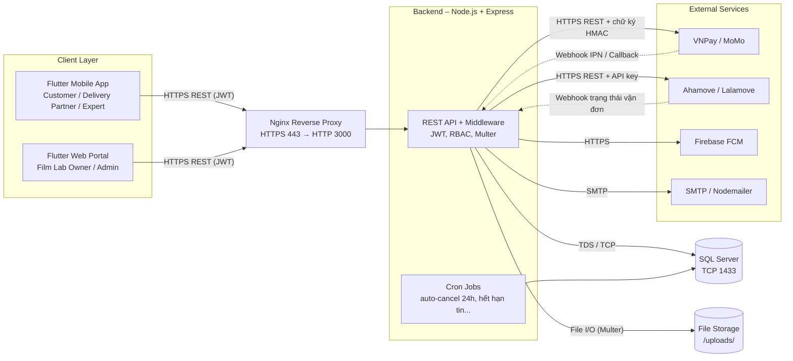
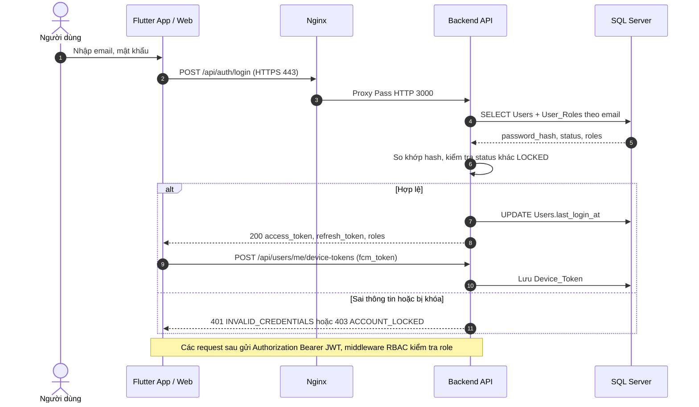
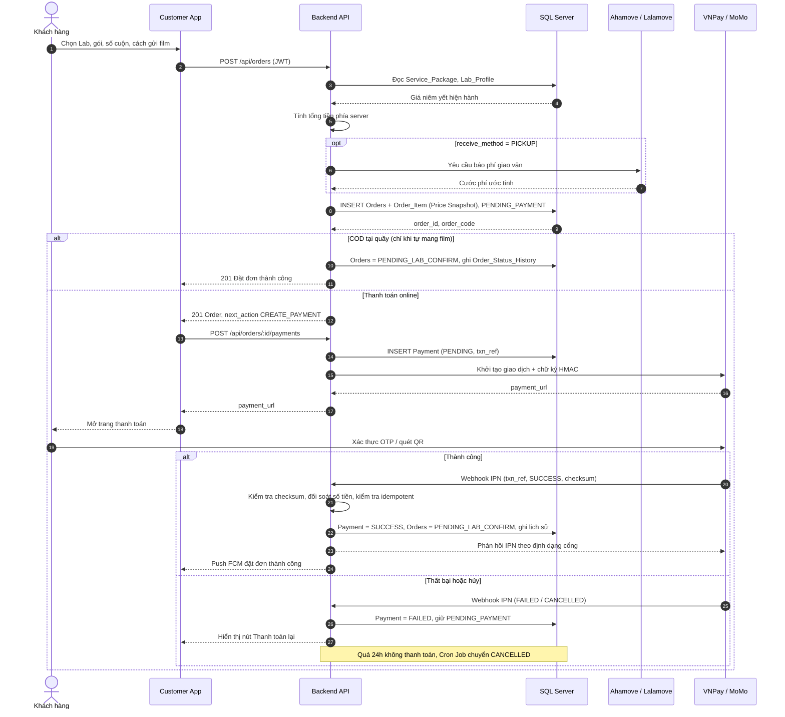
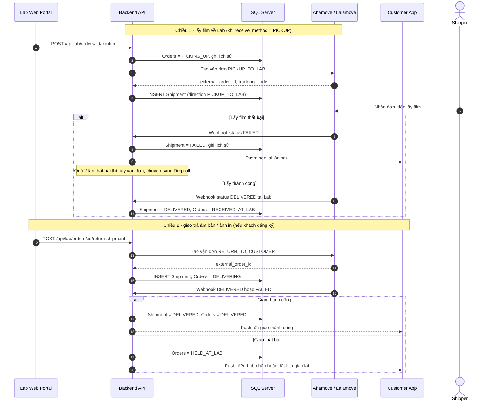
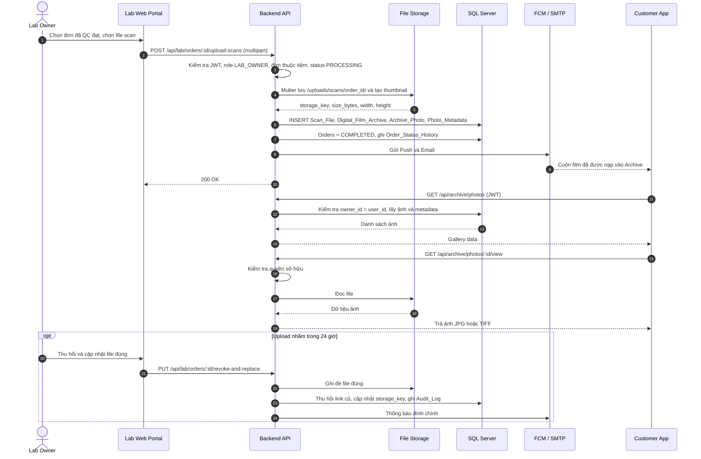
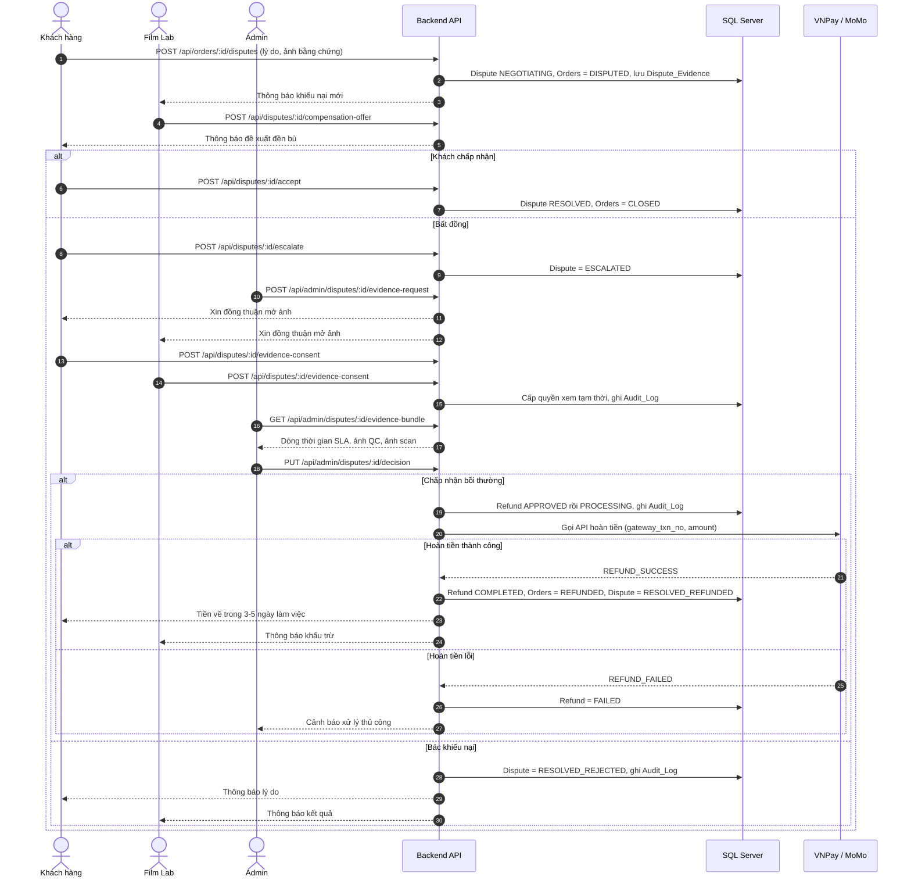
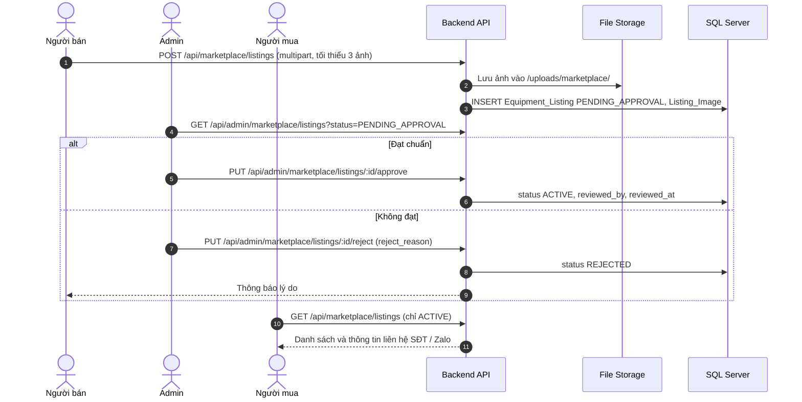

# API INTEGRATION ANALYSIS – Phân tích các API gọi nhau giữa các phần mềm

> **Dự án:** MiniLab – Nền tảng kết nối cộng đồng nhiếp ảnh phim và các Film Lab
> **Nhóm thực hiện:** Nhóm 8
> **Issue:** #22 – *Phân tích các API gọi nhau giữa các phần mềm* (đọc các sơ đồ và file tổng hợp yêu cầu để xác định cần gọi API thế nào)
> **Nguồn đầu vào:** Use Case & Activity (Week 2), Kiến trúc & Triển khai (Week 2), State Machine & Sequence (Week 2), Thiết kế CSDL – 44 bảng (Week 2)

---

## Mục lục

1. [Mục tiêu, phạm vi và quy ước đánh dấu](#1-mục-tiêu-phạm-vi-và-quy-ước-đánh-dấu)
2. [Các phần mềm tham gia và kênh giao tiếp](#2-các-phần-mềm-tham-gia-và-kênh-giao-tiếp)
3. [Quy ước chung của REST API](#3-quy-ước-chung-của-rest-api)
4. [API Client ↔ Backend (theo nhóm)](#4-api-client--backend-theo-nhóm)
5. [Đặc tả chi tiết các API trọng yếu](#5-đặc-tả-chi-tiết-các-api-trọng-yếu)
6. [Tích hợp dịch vụ bên thứ ba và Webhook](#6-tích-hợp-dịch-vụ-bên-thứ-ba-và-webhook)
7. [Sequence Diagram cho các luồng API](#7-sequence-diagram-cho-các-luồng-api)
8. [API Matrix tổng hợp](#8-api-matrix-tổng-hợp)
9. [Mapping API ↔ Cơ sở dữ liệu](#9-mapping-api--cơ-sở-dữ-liệu)
10. [Mapping API ↔ Use Case](#10-mapping-api--use-case)
11. [Mapping API ↔ State Machine (đơn hàng)](#11-mapping-api--state-machine-đơn-hàng)
12. [Bảo mật API (JWT, RBAC, Signature, Webhook)](#12-bảo-mật-api)
13. [Xử lý lỗi và tính idempotent](#13-xử-lý-lỗi-và-tính-idempotent)
14. [Điểm chưa đồng bộ giữa các tài liệu và đề xuất](#14-điểm-chưa-đồng-bộ-giữa-các-tài-liệu-và-đề-xuất)
15. [Thứ tự ưu tiên triển khai](#15-thứ-tự-ưu-tiên-triển-khai)
16. [Kết luận](#16-kết-luận)

---

## 1. Mục tiêu, phạm vi và quy ước đánh dấu

### 1.1. Mục tiêu

Tài liệu này trả lời câu hỏi của Issue #22: **"Hệ thống cần gọi API như thế nào?"** Cụ thể:

- Xác định **ai gọi ai** (Flutter Mobile, Flutter Web, Backend, SQL Server, File Storage, VNPay/MoMo, Ahamove/Lalamove, FCM, SMTP).
- Liệt kê **endpoint, method, quyền truy cập, request/response** cho từng nghiệp vụ.
- Chỉ rõ **webhook/callback** (chiều ngược: bên thứ ba gọi vào Backend).
- Ánh xạ mỗi API với **bảng CSDL**, **Use Case** và **trạng thái đơn hàng**.

> Đây là tài liệu **phân tích/đặc tả**, chưa phải mã nguồn. Nội dung được suy ra từ các sơ đồ Week 2 của nhóm.

### 1.2. Quy ước đánh dấu nguồn gốc của từng API (rất quan trọng)

Để tránh nhầm giữa "đã chốt" và "đề xuất", mỗi API trong tài liệu mang một nhãn:

| Nhãn | Ý nghĩa |
|---|---|
| 🟢 **[SEQ]** | Endpoint **được ghi trực tiếp** trong Sequence Diagram / tài liệu kiến trúc của nhóm. |
| 🟡 **[PROPOSED]** | Endpoint **đề xuất** do suy ra từ Use Case, State Machine hoặc CSDL; nhóm cần thống nhất trước khi code. |
| 🟣 **[EXT]** | API/endpoint của **bên thứ ba**. Chỉ mô tả vai trò và dữ liệu cần trao đổi; endpoint, tên trường chính xác phải theo tài liệu chính thức của nhà cung cấp tại thời điểm tích hợp. |

### 1.3. Danh sách API đã được nhóm chốt trong tài liệu (🟢)

| # | Method | Endpoint | Nơi xuất hiện |
|---|---|---|---|
| 1 | POST | `/api/orders` | Sequence 1 |
| 2 | POST | `/api/lab/orders/:id/upload-scans` | Sequence 2 |
| 3 | PUT | `/api/lab/orders/:id/revoke-and-replace` | Sequence 2 |
| 4 | GET | `/api/archive/photos` | Sequence 2 |
| 5 | GET | `/api/archive/photos/:id/view` | Kiến trúc – chính sách bảo mật |
| 6 | POST | `/api/orders/:id/disputes` | Sequence 3 |

Ngoài ra Sequence 1 mô tả **Webhook IPN** từ cổng thanh toán (chưa đặt tên endpoint) – được đề xuất đường dẫn ở mục 6.

---

## 2. Các phần mềm tham gia và kênh giao tiếp

### 2.1. Sơ đồ tổng quan



### 2.2. Bảng kênh giao tiếp (ai gọi ai)

| # | Bên gọi | Bên nhận | Kênh / Giao thức | Mục đích |
|---|---|---|---|---|
| K1 | Flutter Mobile / Web | Backend (qua Nginx) | HTTPS:443, REST/JSON, header `Authorization: Bearer <JWT>` | Toàn bộ nghiệp vụ người dùng |
| K2 | Flutter Web (Lab) | Backend | HTTPS, `multipart/form-data` | Upload ảnh scan, ảnh QC, ảnh Marketplace |
| K3 | Nginx | Backend | HTTP:3000 (Proxy Pass) | Chuyển tiếp request, SSL termination |
| K4 | Backend | SQL Server | TDS / TCP:1433 | Đọc/ghi dữ liệu quan hệ và metadata |
| K5 | Backend | File Storage | File I/O (Multer, thư mục `/uploads/`) | Lưu/đọc ảnh scan gốc, thumbnail, ảnh thiết bị |
| K6 | Backend | VNPay / MoMo | HTTPS REST, ký HMAC | Khởi tạo thanh toán, gọi hoàn tiền |
| K7 | VNPay / MoMo | Backend | HTTPS Webhook (IPN) | Báo kết quả thanh toán/hoàn tiền |
| K8 | Backend | Ahamove / Lalamove | HTTPS REST, API key | Tính phí, tạo/hủy vận đơn |
| K9 | Ahamove / Lalamove | Backend | HTTPS Webhook | Cập nhật trạng thái vận đơn |
| K10 | Backend | Firebase FCM | HTTPS | Push notification |
| K11 | Backend | SMTP | SMTP | OTP, email thông báo đính chính |
| K12 | Cron Job (trong Backend) | SQL Server | Nội bộ | Tự hủy đơn quá 24h chưa thanh toán, tự đóng đơn quá hạn khiếu nại |

### 2.3. Phân quyền theo vai trò (RBAC – 5 vai trò)

| Role code | Client chính | Nhóm API được phép |
|---|---|---|
| `CUSTOMER` | Flutter Mobile | Auth, Labs, Orders, Payments, Archive, Disputes, Marketplace, Community, Reviews |
| `LAB_OWNER` | Flutter Web | Lab profile/giá, xử lý đơn, upload scan, thương lượng khiếu nại, đăng bán B2C |
| `EXPERT` | Flutter Mobile | Bài viết chuyên môn, Workshop/Photowalk, đăng bán thiết bị kiểm định |
| `DELIVERY_PARTNER` | Flutter Mobile (gọn nhẹ) | Nhận đơn pickup/giao trả, cập nhật trạng thái vận chuyển |
| `ADMIN` | Flutter Web | Duyệt đối tác, tiền kiểm Marketplace, phân xử khiếu nại, hoàn tiền, Dashboard, Audit Log |

> Một `User` có thể giữ nhiều vai trò (bảng `User_Roles`), nên middleware RBAC kiểm tra **role nằm trong tập vai trò của JWT**, không so sánh đơn lẻ.

---

## 3. Quy ước chung của REST API

| Hạng mục | Quy ước đề xuất |
|---|---|
| Base URL | `https://<domain>/api` (Nginx → Node.js cổng 3000) |
| Định dạng | JSON (UTF-8); upload dùng `multipart/form-data` |
| Xác thực | `Authorization: Bearer <access_token>` (JWT). API công khai: tìm Lab, xem bảng giá, đăng ký/đăng nhập, webhook (xác thực bằng chữ ký) |
| Đặt tên | Danh từ số nhiều, `kebab-case`; trường JSON dùng `snake_case` (khớp tên cột CSDL) |
| Phân trang | `?page=1&page_size=20` → trả `{ data, page, page_size, total }` |
| Thời gian | ISO-8601, UTC (khớp `DATETIME2` lưu UTC) |
| Tiền tệ | Số nguyên/`decimal` VND, không dùng số thực nhị phân |
| Idempotency | Webhook dựa vào `Payment.txn_ref` UNIQUE; tạo đơn có thể kèm header `Idempotency-Key` *(đề xuất)* |

### 3.1. Định dạng response chuẩn *(đề xuất)*

Thành công:

```json
{
  "success": true,
  "data": { },
  "message": "OK"
}
```

Lỗi:

```json
{
  "success": false,
  "error": {
    "code": "ORDER_INVALID_STATE",
    "message": "Đơn hàng không ở trạng thái cho phép thao tác này",
    "details": [ ]
  }
}
```

### 3.2. Mã HTTP sử dụng

| Mã | Dùng khi |
|---|---|
| 200 / 201 / 204 | Thành công / Tạo mới / Thành công không nội dung |
| 400 | Dữ liệu không hợp lệ (vi phạm validate, CHECK constraint) |
| 401 | Thiếu/hết hạn JWT |
| 403 | Sai vai trò hoặc không sở hữu tài nguyên (VD: `owner_id ≠ user_id`) |
| 404 | Không tìm thấy |
| 409 | Xung đột trạng thái (đơn đã hủy, callback trùng, listing đã bán) |
| 413 / 415 | File quá lớn / sai định dạng (ngoài JPG, PNG, TIFF, DNG) |
| 422 | Sai nghiệp vụ (hủy đơn khi Lab đã nhận film, quá hạn khiếu nại) |
| 429 | Vượt giới hạn tần suất (Nginx rate limiting) |
| 502 / 504 | Lỗi/timeout khi gọi dịch vụ bên thứ ba |

---

## 4. API Client ↔ Backend (theo nhóm)

> Cột **Role**: `PUB` = công khai, `AUTH` = mọi người dùng đăng nhập, còn lại là role cụ thể. Cột **Nhãn**: 🟢 / 🟡 như mục 1.2.

### 4.1. Nhóm Auth & Tài khoản

| Method | Endpoint | Role | Mục đích | Nhãn |
|---|---|---|---|---|
| POST | `/api/auth/register` | PUB | Đăng ký (tạo `Users` status `PENDING_VERIFY`, gán role) | 🟡 |
| POST | `/api/auth/verify-email` | PUB | Xác thực email bằng mã/OTP | 🟡 |
| POST | `/api/auth/login` | PUB | Đăng nhập, nhận JWT | 🟡 |
| POST | `/api/auth/refresh` | AUTH | Làm mới access token | 🟡 |
| POST | `/api/auth/logout` | AUTH | Đăng xuất, vô hiệu token/FCM token | 🟡 |
| POST | `/api/auth/forgot-password` | PUB | Gửi OTP đặt lại mật khẩu qua SMTP (hiệu lực 15 phút) | 🟡 |
| POST | `/api/auth/reset-password` | PUB | Đặt lại mật khẩu bằng OTP | 🟡 |
| GET / PUT | `/api/users/me` | AUTH | Xem/sửa hồ sơ cá nhân | 🟡 |
| GET / POST / PUT / DELETE | `/api/users/me/addresses[/:id]` | AUTH | Quản lý địa chỉ (`User_Address`, 1 địa chỉ mặc định) | 🟡 |
| POST | `/api/users/me/device-tokens` | AUTH | Đăng ký FCM token (`Device_Token`) | 🟡 |
| DELETE | `/api/users/me/device-tokens/:token` | AUTH | Hủy đăng ký FCM token khi đăng xuất | 🟡 |
| POST | `/api/partners/apply` | AUTH | Nộp hồ sơ Lab / Expert / Delivery Partner chờ duyệt | 🟡 |

### 4.2. Nhóm Danh mục & Lab (tìm kiếm, bảng giá)

| Method | Endpoint | Role | Mục đích | Nhãn |
|---|---|---|---|---|
| GET | `/api/catalog/film-formats` | PUB | Danh mục khổ film | 🟡 |
| GET | `/api/catalog/process-types` | PUB | Quy trình tráng (C41/E6/BW/ECN2) | 🟡 |
| GET | `/api/catalog/film-stocks` | PUB | Danh mục loại film | 🟡 |
| GET | `/api/labs` | PUB | Tìm kiếm/lọc/so sánh Lab (khổ film, quy trình, SLA, khu vực) | 🟡 |
| GET | `/api/labs/:id` | PUB | Chi tiết Lab (giờ mở cửa, rating, hỗ trợ pickup) | 🟡 |
| GET | `/api/labs/:id/packages` | PUB | Bảng giá `Service_Package` đang `is_active` | 🟡 |
| GET | `/api/labs/:id/reviews` | PUB | Danh sách đánh giá | 🟡 |
| PUT | `/api/lab/profile` | LAB_OWNER | Cấu hình hồ sơ tiệm | 🟡 |
| POST / PUT / DELETE | `/api/lab/packages[/:id]` | LAB_OWNER | Cấu hình bảng giá (chỉ áp dụng đơn tương lai – Price Snapshot) | 🟡 |
| PUT | `/api/lab/film-formats` | LAB_OWNER | Khổ film Lab hỗ trợ (`Lab_Film_Format`) | 🟡 |

### 4.3. Nhóm Đơn hàng (Customer)

| Method | Endpoint | Role | Mục đích | Nhãn |
|---|---|---|---|---|
| POST | `/api/orders` | CUSTOMER | **Tạo đơn**: tính tiền, lưu `Orders` + `Order_Item` (Price Snapshot) | 🟢 |
| GET | `/api/orders` | CUSTOMER | Danh sách đơn của tôi (lọc theo status) | 🟡 |
| GET | `/api/orders/:id` | CUSTOMER / LAB_OWNER / ADMIN | Chi tiết đơn + công đoạn + lịch sử trạng thái | 🟡 |
| GET | `/api/orders/:id/tracking` | CUSTOMER | Theo dõi tiến độ thời gian thực (`Order_Process_Step`, `Shipment`) | 🟡 |
| POST | `/api/orders/:id/cancel` | CUSTOMER | Hủy đơn hợp lệ (trước khi Lab nhận film) | 🟡 |
| POST | `/api/orders/:id/surcharge/respond` | CUSTOMER | Đồng ý/từ chối phụ phí Cine ECN-2 / Push | 🟡 |
| POST | `/api/orders/:id/confirm-satisfied` | CUSTOMER | Xác nhận hài lòng → `CLOSED` | 🟡 |
| POST | `/api/orders/:id/reviews` | CUSTOMER | Đánh giá Lab (`Review` type `LAB`) | 🟡 |

### 4.4. Nhóm Đơn hàng (Film Lab xử lý)

| Method | Endpoint | Role | Mục đích | Nhãn |
|---|---|---|---|---|
| GET | `/api/lab/orders` | LAB_OWNER | Danh sách đơn của tiệm (lọc theo status) | 🟡 |
| POST | `/api/lab/orders/:id/confirm` | LAB_OWNER | Xác nhận đơn → `PICKING_UP` hoặc chờ khách mang film | 🟡 |
| POST | `/api/lab/orders/:id/reject` | LAB_OWNER | Từ chối đơn (kèm lý do) → `CANCELLED` | 🟡 |
| POST | `/api/lab/orders/:id/receive` | LAB_OWNER | Ghi nhận đã nhận film + ảnh QC (`step_type=RECEIVE`, `evidence_photo_url`) → `RECEIVED_AT_LAB` | 🟡 |
| POST | `/api/lab/orders/:id/surcharge-proposal` | LAB_OWNER | Đề xuất phụ phí (số lượng lệch, Push, Cine ECN-2) | 🟡 |
| POST | `/api/lab/orders/:id/start-processing` | LAB_OWNER | Chuyển `PROCESSING` khi film đạt chuẩn và đã thanh toán đủ | 🟡 |
| PUT | `/api/lab/orders/:id/steps/:stepType` | LAB_OWNER | Cập nhật công đoạn DEVELOP/WASH/DRY/SCAN/PREPARE/QC (`Order_Process_Step`) | 🟡 |
| POST | `/api/lab/orders/:id/upload-scans` | LAB_OWNER | **Upload file scan** (multipart), nạp Archive, → `COMPLETED` | 🟢 |
| PUT | `/api/lab/orders/:id/revoke-and-replace` | LAB_OWNER | **Thu hồi & ghi đè** file scan trong 24h | 🟢 |
| POST | `/api/lab/orders/:id/return-shipment` | LAB_OWNER | Tạo vận đơn Chiều 2 (giao trả âm bản/ảnh in) → `DELIVERING` | 🟡 |

### 4.5. Nhóm Thanh toán & Hoàn tiền

| Method | Endpoint | Role | Mục đích | Nhãn |
|---|---|---|---|---|
| POST | `/api/orders/:id/payments` | CUSTOMER | Khởi tạo giao dịch online (VNPay/MoMo) → trả `payment_url` (cũng dùng cho "Thanh toán lại") | 🟡 |
| GET | `/api/payments/:id` | CUSTOMER | Tra cứu trạng thái giao dịch | 🟡 |
| GET | `/api/payments/vnpay/return` | PUB | Return URL – chuyển hướng người dùng về app sau thanh toán (chỉ để hiển thị, **không** dùng để cập nhật đơn) | 🟡 |
| GET/POST | `/api/webhooks/payment/vnpay` | Signature | **Webhook IPN VNPay** | 🟡 (luồng 🟢 ở Sequence 1) |
| POST | `/api/webhooks/payment/momo` | Signature | **Webhook IPN MoMo** | 🟡 (luồng 🟢 ở Sequence 1) |
| POST | `/api/admin/refunds/:id/retry` | ADMIN | Gọi lại API hoàn tiền khi `REFUND_FAILED` | 🟡 |

### 4.6. Nhóm Giao vận

| Method | Endpoint | Role | Mục đích | Nhãn |
|---|---|---|---|---|
| POST | `/api/shipping/quote` | CUSTOMER | Báo phí giao vận trước khi tạo đơn (Backend gọi Ahamove/Lalamove) | 🟡 |
| POST | `/api/webhooks/shipping/:provider` | Signature | **Webhook trạng thái vận đơn** (`ahamove` / `lalamove`) | 🟡 |
| GET | `/api/delivery/shipments` | DELIVERY_PARTNER | Danh sách đơn pickup/giao được phân | 🟡 |
| POST | `/api/delivery/shipments/:id/accept` | DELIVERY_PARTNER | Nhận đơn (shipper nội bộ) | 🟡 |
| PUT | `/api/delivery/shipments/:id/status` | DELIVERY_PARTNER | Cập nhật `PICKED_UP/IN_TRANSIT/DELIVERED/FAILED` + `proof_image_url` | 🟡 |
| POST | `/api/orders/:id/return-reschedule` | CUSTOMER | Đặt lịch giao lại sau `HELD_AT_LAB` (trả thêm phí ship) | 🟡 |

### 4.7. Nhóm Digital Film Archive

| Method | Endpoint | Role | Mục đích | Nhãn |
|---|---|---|---|---|
| GET | `/api/archive` | CUSTOMER | Danh sách "cuộn film" (`Digital_Film_Archive`) của tôi | 🟡 |
| GET | `/api/archive/photos` | CUSTOMER | **Gallery view** – danh sách ảnh + metadata + đường dẫn | 🟢 |
| GET | `/api/archive/photos/:id` | CUSTOMER | Chi tiết ảnh + `Photo_Metadata` | 🟡 |
| GET | `/api/archive/photos/:id/view` | CUSTOMER / ADMIN (có điều kiện) | **Xem ảnh** có kiểm tra quyền sở hữu | 🟢 |
| GET | `/api/archive/photos/:id/download` | CUSTOMER | Tải file gốc (.JPG / .TIFF 16-bit) | 🟡 |
| GET | `/api/archive/photos/:id/thumbnail` | CUSTOMER | Ảnh thu nhỏ xem trước | 🟡 |
| PUT | `/api/archive/photos/:id/metadata` | CUSTOMER | Sửa máy ảnh, lens, ISO, khẩu độ, film… | 🟡 |
| PUT / DELETE | `/api/archive/photos/:id/tags` | CUSTOMER | Gắn/gỡ tag (`Photo_Tag`) | 🟡 |
| PATCH | `/api/archive/photos/:id/favorite` | CUSTOMER | Đánh dấu yêu thích | 🟡 |
| DELETE | `/api/archive/photos/:id` | CUSTOMER | Xóa mềm (`is_deleted`) | 🟡 |
| POST | `/api/archive/:id/share` | CUSTOMER | Tạo liên kết chia sẻ Album (`visibility`) | 🟡 |

### 4.8. Nhóm Khiếu nại (3 bước)

| Method | Endpoint | Role | Mục đích | Nhãn |
|---|---|---|---|---|
| POST | `/api/orders/:id/disputes` | CUSTOMER | **Bước 1** – Tạo khiếu nại + ảnh bằng chứng | 🟢 |
| GET | `/api/disputes` / `/api/disputes/:id` | CUSTOMER / LAB_OWNER / ADMIN | Xem hồ sơ khiếu nại | 🟡 |
| POST | `/api/disputes/:id/messages` | CUSTOMER / LAB_OWNER | Trao đổi (`Dispute_Message`) | 🟡 |
| POST | `/api/disputes/:id/evidence` | CUSTOMER / LAB_OWNER | Đính kèm bằng chứng (`Dispute_Evidence`) | 🟡 |
| POST | `/api/disputes/:id/compensation-offer` | LAB_OWNER | **Bước 2** – Đề xuất đền bù (voucher/film mới/chụp bù) | 🟡 |
| POST | `/api/disputes/:id/accept` | CUSTOMER | Chấp nhận thỏa thuận → `RESOLVED`, đơn `CLOSED` | 🟡 |
| POST | `/api/disputes/:id/escalate` | CUSTOMER | **Bước 3** – Yêu cầu Admin phân xử → `ESCALATED` | 🟡 |
| POST | `/api/disputes/:id/withdraw` | CUSTOMER | Rút khiếu nại → `WITHDRAWN` | 🟡 |
| POST | `/api/admin/disputes/:id/evidence-request` | ADMIN | Yêu cầu hai bên đồng thuận mở ảnh QC/scan | 🟡 |
| POST | `/api/disputes/:id/evidence-consent` | CUSTOMER / LAB_OWNER | Đồng ý/từ chối mở ảnh làm chứng cứ | 🟡 |
| GET | `/api/admin/disputes/:id/evidence-bundle` | ADMIN | Hồ sơ đối soát (SLA, ảnh QC, ảnh scan) – ghi Audit Log | 🟡 |
| PUT | `/api/admin/disputes/:id/decision` | ADMIN | Phán quyết: bồi thường (kèm tỷ lệ hoàn) hoặc bác | 🟡 |
| GET | `/api/admin/disputes` | ADMIN | Hàng chờ tranh chấp | 🟡 |

### 4.9. Nhóm Marketplace & Review

| Method | Endpoint | Role | Mục đích | Nhãn |
|---|---|---|---|---|
| GET | `/api/marketplace/listings` | PUB | Tìm/lọc thiết bị (khoảng giá, dòng máy, khu vực) – chỉ `ACTIVE` | 🟡 |
| GET | `/api/marketplace/listings/:id` | PUB | Chi tiết + thông số cơ học + liên hệ SĐT/Zalo | 🟡 |
| POST | `/api/marketplace/listings` | AUTH (Customer/Lab/Expert) | Đăng tin (tối thiểu 3 ảnh thật) → `PENDING_APPROVAL` | 🟡 |
| PUT / DELETE | `/api/marketplace/listings/:id` | Chủ tin | Sửa (thông tin trọng yếu → quay lại `PENDING_APPROVAL`) / xóa | 🟡 |
| PATCH | `/api/marketplace/listings/:id/sold` | Chủ tin | Đánh dấu đã bán → `SOLD` | 🟡 |
| POST / DELETE | `/api/marketplace/listings/:id/favorite` | AUTH | Lưu/bỏ lưu tin | 🟡 |
| POST | `/api/marketplace/listings/:id/contact` | AUTH | Ghi nhận liên hệ (`Marketplace_Transaction` `CONTACTED`) | 🟡 |
| POST | `/api/marketplace/listings/:id/report` | AUTH | Báo cáo tin vi phạm | 🟡 |
| GET | `/api/admin/marketplace/listings?status=PENDING_APPROVAL` | ADMIN | Hàng chờ tiền kiểm | 🟡 |
| PUT | `/api/admin/marketplace/listings/:id/approve` | ADMIN | Duyệt → `ACTIVE` | 🟡 |
| PUT | `/api/admin/marketplace/listings/:id/reject` | ADMIN | Từ chối (bắt buộc `reject_reason`) → `REJECTED` | 🟡 |
| PUT | `/api/admin/marketplace/listings/:id/remove` | ADMIN | Gỡ tin vi phạm → `HIDDEN` | 🟡 |
| POST | `/api/marketplace/transactions/:id/reviews` | AUTH | Đánh giá người bán (`Review` type `SELLER`) | 🟡 |

### 4.10. Nhóm Cộng đồng, Sự kiện, Thông báo

| Method | Endpoint | Role | Mục đích | Nhãn |
|---|---|---|---|---|
| GET / POST | `/api/posts` | PUB / AUTH | Danh sách / đăng bài (`Post_Article`) | 🟡 |
| GET / PUT / DELETE | `/api/posts/:id` | PUB / tác giả | Chi tiết / sửa / xóa | 🟡 |
| POST | `/api/posts/:id/comments` | AUTH | Bình luận (hỗ trợ `parent_comment_id`) | 🟡 |
| POST | `/api/posts/:id/report` | AUTH | Báo cáo vi phạm | 🟡 |
| PUT | `/api/admin/posts/:id/moderate` | ADMIN | Ẩn/Gỡ bài (hậu kiểm) | 🟡 |
| GET / POST | `/api/events` | PUB / EXPERT | Danh sách / tạo Workshop-Photowalk | 🟡 |
| POST / DELETE | `/api/events/:id/registrations` | CUSTOMER | Đăng ký / hủy đăng ký | 🟡 |
| GET | `/api/notifications` | AUTH | Danh sách thông báo in-app (`Notification`) | 🟡 |
| PATCH | `/api/notifications/:id/read` | AUTH | Đánh dấu đã đọc | 🟡 |

### 4.11. Nhóm Quản trị (Admin)

| Method | Endpoint | Mục đích | Nhãn |
|---|---|---|---|
| GET | `/api/admin/users` | Tìm/lọc theo vai trò, trạng thái | 🟡 |
| PUT | `/api/admin/users/:id/lock` · `/unlock` | Khóa/mở khóa (ghi `locked_by`, `locked_reason`) | 🟡 |
| GET | `/api/admin/partners?status=PENDING` | Hàng chờ duyệt Lab/Expert/Delivery | 🟡 |
| PUT | `/api/admin/partners/:type/:id/approve` · `/reject` | Thẩm định đối tác | 🟡 |
| PUT | `/api/admin/labs/:id/suspend` | Ẩn/đình chỉ Lab vi phạm | 🟡 |
| GET | `/api/admin/dashboard` | Thống kê User, Đơn hàng, Tỷ lệ SLA | 🟡 |
| GET | `/api/admin/audit-logs` | Tra cứu nhật ký kiểm toán | 🟡 |
| GET / PUT | `/api/admin/system-config` | Cấu hình phí nền tảng (`System_Config`) | 🟡 |

---

## 5. Đặc tả chi tiết các API trọng yếu

### 5.1. `POST /api/auth/login` 🟡

| Mục | Nội dung |
|---|---|
| Caller → Receiver | Flutter (Mobile/Web) → Backend |
| Auth | Không |
| DB | `Users`, `User_Roles`, `Roles` (đọc); `Users.last_login_at` (ghi) |

**Request**
```json
{ "email": "khach@example.com", "password": "********" }
```

**Response 200**
```json
{
  "success": true,
  "data": {
    "access_token": "<jwt>",
    "refresh_token": "<jwt>",
    "user": { "user_id": 1, "full_name": "Nguyễn Văn A", "roles": ["CUSTOMER"] }
  }
}
```

**Xử lý:** so khớp `password_hash` (bcrypt/argon2) → từ chối nếu `status` là `LOCKED`/`DELETED`/`PENDING_VERIFY` → nạp danh sách role vào JWT.
**Lỗi:** `401 INVALID_CREDENTIALS`, `403 ACCOUNT_LOCKED`, `403 EMAIL_NOT_VERIFIED`.

---

### 5.2. `POST /api/orders` 🟢 (Sequence 1)

| Mục | Nội dung |
|---|---|
| Caller → Receiver | Customer App → Backend |
| Auth | JWT, role `CUSTOMER` |
| DB đọc | `Lab_Profile`, `Service_Package` (giá niêm yết hiện hành), `User_Address` |
| DB ghi | `Orders`, `Order_Item`, `Order_Status_History` |
| Gọi ngoài | (tùy chọn) Ahamove/Lalamove để tính phí nếu `receive_method = PICKUP` |

**Request**
```json
{
  "lab_id": 12,
  "receive_method": "PICKUP",
  "return_method": "DIGITAL_ONLY",
  "payment_method": "ONLINE",
  "pickup_address_id": 5,
  "customer_note": "Cuộn Portra 400 chụp ở Đà Lạt",
  "items": [
    { "package_id": 31, "film_stock_id": 8, "quantity": 2, "note": "Push +1" }
  ]
}
```

> `payment_method`: `ONLINE` hoặc `COD`. `COD` **chỉ hợp lệ khi** `receive_method = SELF_DROP_OFF` (khách mang film đến quầy) – đúng với Sequence 1 và Activity 4.1.

**Response 201 – thanh toán online**
```json
{
  "success": true,
  "data": {
    "order_id": 1001,
    "order_code": "FL-20261106-0001",
    "status": "PENDING_PAYMENT",
    "subtotal": 240000,
    "shipping_fee": 25000,
    "platform_fee": 0,
    "discount_amount": 0,
    "total_amount": 265000,
    "items": [
      { "order_item_id": 2001, "package_id": 31, "quantity": 2, "unit_price": 120000, "line_total": 240000 }
    ],
    "next_action": "CREATE_PAYMENT"
  }
}
```

**Các bước Backend xử lý (bám theo Sequence 1):**
1. Kiểm tra JWT + role, kiểm tra `Lab_Profile.approval_status = APPROVED`, gói dịch vụ `is_active`, khổ film Lab hỗ trợ (`Lab_Film_Format`).
2. Đọc giá hiện hành từ DB → **tính lại phía server** (không tin giá do client gửi): `Tổng = Σ(unit_price × quantity) + phụ phí + tiền in`.
3. Nếu `PICKUP` → gọi API vận chuyển lấy phí, ghi `shipping_fee`.
4. Ghi `Orders` + `Order_Item` với **`unit_price` là snapshot** (Lab đổi giá sau này không ảnh hưởng). Ràng buộc DB: `total_amount = subtotal + shipping_fee + platform_fee − discount_amount`; `line_total = unit_price × quantity`.
5. Nhánh COD → cập nhật ngay `PENDING_LAB_CONFIRM`; nhánh Online → giữ `PENDING_PAYMENT` và đợi bước thanh toán (mục 5.3).

**Lỗi:** `400 VALIDATION_ERROR`, `404 LAB_NOT_FOUND`, `422 PACKAGE_NOT_AVAILABLE`, `422 COD_NOT_ALLOWED_WITH_PICKUP`, `502 SHIPPING_QUOTE_FAILED`.

---

### 5.3. `POST /api/orders/:id/payments` 🟡

Khởi tạo giao dịch trên cổng thanh toán; dùng lại cho "Thanh toán lại" (mỗi lần tạo một `Payment` mới – bảng `Payment` quan hệ 1-N với `Orders`).

**Request**
```json
{ "gateway": "VNPAY", "return_url": "minilab://payment-result" }
```

**Response 200**
```json
{
  "success": true,
  "data": {
    "payment_id": 501,
    "txn_ref": "FL-20261106-0001-1",
    "payment_url": "https://<cổng-thanh-toán>/...",
    "expires_in": 900
  }
}
```

**Xử lý:** kiểm tra đơn thuộc khách và đang `PENDING_PAYMENT` → sinh `txn_ref` duy nhất → ghi `Payment (PENDING)` → ký HMAC → gọi cổng [EXT] → trả `payment_url`.
**Lỗi:** `409 ORDER_ALREADY_PAID`, `422 ORDER_INVALID_STATE`, `502 GATEWAY_ERROR`.

---

### 5.4. Webhook IPN thanh toán 🟡 (luồng 🟢 trong Sequence 1)

| Mục | Nội dung |
|---|---|
| Caller → Receiver | VNPay/MoMo → Backend (`/api/webhooks/payment/vnpay`, `/api/webhooks/payment/momo`) |
| Auth | **Không dùng JWT** – xác thực bằng **chữ ký/checksum** |
| DB | `Payment`, `Orders`, `Order_Status_History` |

**Trình tự xử lý bắt buộc:**
1. Xác thực chữ ký/checksum bằng khóa bí mật → sai thì **từ chối**, không ghi DB.
2. Tìm `Payment` theo `txn_ref`; không có → trả mã "không tìm thấy đơn" theo quy ước của cổng.
3. **Đối soát số tiền** `amount` của cổng với `Payment.amount`.
4. **Idempotent:** nếu `Payment.status` đã là `SUCCESS` → trả OK, không xử lý lại (callback có thể gửi lặp).
5. Trong **một transaction**: cập nhật `Payment` (`SUCCESS`, `gateway_txn_no`, `response_code`, `paid_at`) + `Orders.status = PENDING_LAB_CONFIRM` + ghi `Order_Status_History` (`changed_by = NULL` = hệ thống).
6. Phản hồi cổng (đúng định dạng từng cổng) → **sau đó** gửi FCM cho khách.
7. Nhánh thất bại/hủy: `Payment = FAILED/CANCELLED`, **giữ nguyên** `PENDING_PAYMENT`, app hiện nút "Thanh toán lại". Quá 24h → Cron Job chuyển `CANCELLED`.

> ⚠️ Định dạng response chuẩn mà từng cổng yêu cầu (VNPay, MoMo) và phương thức HTTP của IPN (GET/POST) **phải đối chiếu tài liệu chính thức** khi tích hợp. Tài liệu nhóm chỉ ghi chung là "phản hồi IPN: 200 OK".

---

### 5.5. `POST /api/lab/orders/:id/upload-scans` 🟢 (Sequence 2)

| Mục | Nội dung |
|---|---|
| Caller → Receiver | Lab Web Portal → Backend |
| Content-Type | `multipart/form-data` |
| Auth | JWT, role `LAB_OWNER`; đơn phải thuộc Lab của chủ tiệm; đơn đang `PROCESSING`, các bước QC đã đạt |
| DB ghi | `Scan_File`, `Digital_Film_Archive`, `Archive_Photo`, `Photo_Metadata`, `Orders` (→ `COMPLETED`), `Order_Status_History` |
| Hạ tầng | Multer → `/uploads/scans/order_:id/`; FCM + SMTP |

**Request (form-data)**

| Field | Kiểu | Ghi chú |
|---|---|---|
| `order_item_id` | số | Cuộn film được nạp scan |
| `files[]` | file (nhiều) | `.jpg`, `.png`, `.tiff`, `.dng` (khớp `CK_Scan_Mime`) |
| `metadata` | JSON (tùy chọn) | Thiết bị scan, DPI… |

**Response 200**
```json
{
  "success": true,
  "data": {
    "order_id": 1001,
    "status": "COMPLETED",
    "archive_id": 77,
    "uploaded": [
      { "scan_file_id": 9001, "photo_id": 12001,
        "storage_key": "/uploads/scans/order_1001/roll_01_001.jpg",
        "size_bytes": 4821033, "width_px": 6000, "height_px": 4000 }
    ]
  }
}
```

**Các bước (bám Sequence 2):**
1. Kiểm tra JWT, vai trò, đơn thuộc tiệm, trạng thái `PROCESSING`.
2. Multer stream từng file xuống `/uploads/scans/order_{id}/`; sinh `storage_key` **tương đối** (không lưu BLOB trong SQL Server).
3. Tính `size_bytes`, `width/height`, `checksum_sha256`; tạo thumbnail vào `/uploads/thumbnails/`.
4. Ghi DB (nên trong một transaction): `Scan_File` → `Digital_Film_Archive` (1-1 với `Order_Item`) → `Archive_Photo` → `Photo_Metadata`.
5. Cập nhật đơn `COMPLETED`, ghi lịch sử trạng thái.
6. Gửi FCM + email: *"Cuộn film của bạn đã được tráng và nạp vào Archive!"*.

**Lỗi:** `403 NOT_ORDER_OF_LAB`, `422 ORDER_NOT_PROCESSING`, `415 UNSUPPORTED_FILE_TYPE`, `413 FILE_TOO_LARGE`, `409 STORAGE_KEY_EXISTS`.
**Lưu ý lỗi một phần:** nếu ghi DB thất bại sau khi file đã lưu → phải **xóa file mồ côi** (rollback file) để tránh rác thư mục.

---

### 5.6. `PUT /api/lab/orders/:id/revoke-and-replace` 🟢 (Sequence 2 – nhánh opt)

| Mục | Nội dung |
|---|---|
| Điều kiện | Chỉ trong **24 giờ** kể từ lần upload (so với `Scan_File.uploaded_at`); Lab Owner của đơn |
| Content-Type | `multipart/form-data` (file đúng) |
| DB | `Scan_File`, `Archive_Photo` (`storage_key` mới), `Audit_Log` |
| Thông báo | FCM + email đính chính cho khách |

**Xử lý:** ghi đè file đúng vào `/uploads/scans/order_{id}/` → **thu hồi link cũ** → cập nhật `storage_key` mới → ghi `Audit_Log` (`old_value`/`new_value`) → gửi thông báo *"Lab đã cập nhật bản scan đính chính cho bạn"*.
**Lỗi:** `422 REVOKE_WINDOW_EXPIRED` (quá 24h).

---

### 5.7. `GET /api/archive/photos` và `GET /api/archive/photos/:id/view` 🟢

**Request:** `GET /api/archive/photos?archive_id=77&page=1&page_size=40` (JWT)

**Response 200**
```json
{
  "success": true,
  "data": [
    {
      "photo_id": 12001,
      "archive_id": 77,
      "storage_key": "/uploads/scans/order_1001/roll_01_001.jpg",
      "thumbnail_key": "/uploads/thumbnails/order_1001/roll_01_001_t.jpg",
      "metadata": {
        "camera_model": "Canon AE-1", "lens": "50mm f/1.8",
        "iso": 400, "aperture": 2.8, "shutter_speed": "1/250",
        "film_stock_id": 8, "process_type_id": 1
      }
    }
  ],
  "page": 1, "page_size": 40, "total": 36
}
```

**Kiểm soát truy cập:**
- Backend xác thực JWT và kiểm tra **`Digital_Film_Archive.owner_id = user_id`** trong token.
- Admin **không** được xem ảnh riêng tư, **trừ** khi đơn có khiếu nại chính thức, hai bên đã đồng thuận (mục 5.8) và mọi lượt xem đều ghi `Audit_Log`.
- Không bật Directory Browsing trên `/uploads/scans/`.

---

### 5.8. Luồng Khiếu nại – `POST /api/orders/:id/disputes` 🟢 và các API kế tiếp

**Tạo khiếu nại (Bước 1)** – Request `multipart/form-data` hoặc JSON + danh sách file:
```json
{
  "reason_type": "QUALITY",
  "description": "Ảnh scan bị mờ, lỗi màu ở 10 khung đầu",
  "requested_amount": 120000
}
```
Điều kiện: đơn thuộc khách, trạng thái `COMPLETED` hoặc `DELIVERED`, **còn trong hạn khiếu nại**. Ghi `Dispute_Complaint (NEGOTIATING)`, `Orders = DISPUTED` (theo State Machine), ghi `Dispute_Evidence`, thông báo cho Lab.

**Bảng chuyển trạng thái khiếu nại:**

| Hành động | API | `Dispute_Complaint.status` | Hệ quả |
|---|---|---|---|
| Tạo | `POST /orders/:id/disputes` | `NEGOTIATING` | Đơn `DISPUTED` |
| Lab đề xuất đền bù | `POST /disputes/:id/compensation-offer` | `NEGOTIATING` | Thông báo khách |
| Khách đồng ý | `POST /disputes/:id/accept` | `RESOLVED_*` / thỏa thuận | Đơn `CLOSED` |
| Khách yêu cầu Admin | `POST /disputes/:id/escalate` | `ESCALATED` (`escalated_at` bắt buộc) | Vào hàng chờ Admin |
| Admin xin mở ảnh | `POST /admin/disputes/:id/evidence-request` | `ESCALATED` | Gửi yêu cầu cho khách + Lab |
| Hai bên đồng thuận | `POST /disputes/:id/evidence-consent` | `ESCALATED` | Cấp quyền xem **tạm thời**, ghi Audit Log |
| Admin chấp nhận bồi thường | `PUT /admin/disputes/:id/decision` | `RESOLVED_REFUNDED` | Tạo `Refund` → gọi cổng |
| Admin bác | `PUT /admin/disputes/:id/decision` | `RESOLVED_REJECTED` | Đơn `CLOSED`, thông báo lý do |

**Phán quyết `PUT /api/admin/disputes/:id/decision`**
```json
{
  "decision": "REFUND",
  "refund_ratio": 1.0,
  "approved_refund_amount": 240000,
  "decision_note": "Lỗi hóa chất, film hỏng thuộc trách nhiệm Lab"
}
```
Backend: lưu phán quyết + `Audit_Log` → `Refund (APPROVED)` + `approved_by` (ràng buộc `CK_Refund_Approve`) → `Refund (PROCESSING)` → gọi API hoàn tiền của cổng [EXT] bằng `Gateway_Transaction_ID` + `amount` → kết quả:
- `REFUND_SUCCESS` → `Refund = COMPLETED`, `Order = REFUNDED`, `Dispute = RESOLVED_REFUNDED`; thông báo khách (tiền về trong 3–5 ngày làm việc) và Lab (khấu trừ).
- `REFUND_FAILED` → `Refund = FAILED`, cảnh báo Admin xử lý thủ công (`POST /admin/refunds/:id/retry`).

---

## 6. Tích hợp dịch vụ bên thứ ba và Webhook

> 🟣 Mọi endpoint của đối tác **không được tự đặt**; phần dưới mô tả **dữ liệu cần trao đổi** và **điểm nối với CSDL**.

### 6.1. Cổng thanh toán VNPay / MoMo

| Chiều | Mục đích | Dữ liệu gửi / nhận | Bảng DB liên quan |
|---|---|---|---|
| Backend → Cổng | Khởi tạo giao dịch | Mã đơn / `txn_ref`, số tiền, mô tả, return URL, IPN URL, **chữ ký HMAC** | `Payment` |
| Cổng → Backend | **IPN** kết quả thanh toán | `txn_ref`, mã giao dịch cổng, số tiền, mã phản hồi, checksum | `Payment`, `Orders`, `Order_Status_History` |
| Backend → Cổng | **Hoàn tiền** | `gateway_txn_no` gốc, số tiền hoàn, lý do | `Refund`, `Payment` |
| Cổng → Backend | Kết quả hoàn tiền (nếu cổng có callback) hoặc đọc từ response | mã hoàn tiền, trạng thái | `Refund` (`gateway_refund_ref`) |

Bí mật cấu hình (hash secret, partner key) lưu trong **biến môi trường**, không commit vào repo.

### 6.2. Đơn vị vận chuyển Ahamove / Lalamove

| Chiều | Mục đích | Dữ liệu | Bảng DB |
|---|---|---|---|
| Backend → Đối tác | **Báo phí** | Tọa độ/địa chỉ lấy – giao, loại gói hàng | (chưa ghi) → `Orders.shipping_fee` |
| Backend → Đối tác | **Tạo vận đơn Chiều 1** (`PICKUP_TO_LAB`) | Người gửi/nhận, SĐT, địa chỉ, mã đơn | `Shipment` (`external_order_id`, `tracking_code`) |
| Backend → Đối tác | **Tạo vận đơn Chiều 2** (`RETURN_TO_CUSTOMER`) | Lab → khách | `Shipment` |
| Backend → Đối tác | Hủy vận đơn (pickup thất bại quá 2 lần, hủy đơn) | `external_order_id` | `Shipment.status = CANCELLED` |
| Đối tác → Backend | **Webhook trạng thái** | `external_order_id`, trạng thái, thời điểm, ảnh bằng chứng | `Shipment`, `Orders`, `Order_Status_History` |

**Ánh xạ trạng thái vận đơn → trạng thái đơn:**

| `Shipment.direction` | `Shipment.status` | Hệ quả lên `Orders` |
|---|---|---|
| `PICKUP_TO_LAB` | `ASSIGNED` / `PICKED_UP` / `IN_TRANSIT` | Giữ `PICKING_UP` |
| `PICKUP_TO_LAB` | `DELIVERED` (shipper bàn giao tại Lab) | → `RECEIVED_AT_LAB` |
| `PICKUP_TO_LAB` | `FAILED` (lần 1, 2) | Giữ `PICKING_UP`, hẹn lại |
| `PICKUP_TO_LAB` | `FAILED` (quá 2 lần) | Hủy pickup → chuyển Drop-off (chờ khách mang film) |
| `RETURN_TO_CUSTOMER` | `DELIVERED` | → `DELIVERED` rồi `CLOSED` |
| `RETURN_TO_CUSTOMER` | `FAILED` | → `HELD_AT_LAB`, chờ khách đến nhận hoặc trả phí giao lại |

**Webhook `POST /api/webhooks/shipping/:provider`** – ví dụ payload *(minh họa, tên trường theo đối tác thực tế)*:
```json
{ "external_order_id": "AHM-123456", "status": "DELIVERED",
  "timestamp": "2026-11-07T03:12:00Z", "proof_image_url": "https://..." }
```
Backend: xác thực chữ ký/token của đối tác → tìm `Shipment` theo `external_order_id` → cập nhật `Shipment` + `Orders` + `Order_Status_History` trong một transaction → gửi FCM.

### 6.3. Firebase Cloud Messaging

| Sự kiện kích hoạt | Người nhận | Nội dung |
|---|---|---|
| Thanh toán thành công | Customer | "Đặt đơn thành công, chờ Lab tiếp nhận" |
| Lab đề xuất phụ phí | Customer | Cần duyệt phụ phí |
| Đơn `COMPLETED` (upload scan xong) | Customer | "Cuộn film của bạn đã được tráng và nạp vào Archive!" |
| Revoke & Replace | Customer | "Lab đã cập nhật bản scan đính chính cho bạn" |
| Có khiếu nại mới / đề xuất đền bù / phán quyết | Lab, Customer | Theo từng bước khiếu nại |
| Có shipment mới | Delivery Partner | Đơn pickup/giao mới |

Backend lấy `fcm_token` từ `Device_Token`, ghi bản ghi `Notification` (in-app) song song với push.

### 6.4. SMTP / Nodemailer

| Tình huống | Nội dung |
|---|---|
| Đăng ký / quên mật khẩu | Mã OTP (hiệu lực 15 phút) |
| Upload scan xong / Revoke & Replace | Email thông báo kết quả / đính chính |
| Kết quả phán quyết khiếu nại | Email cho hai bên |

---

## 7. Sequence Diagram cho các luồng API

### 7.1. Đăng nhập và truy cập API có phân quyền



### 7.2. Tạo đơn và thanh toán online (Sequence 1 → API)



### 7.3. Giao vận hai chiều và Webhook trạng thái



### 7.4. Upload scan, nạp Archive và xem ảnh (Sequence 2 → API)



### 7.5. Khiếu nại và hoàn tiền tự động (Sequence 3 → API)



### 7.6. Tiền kiểm tin Marketplace



---

## 8. API Matrix tổng hợp

### 8.1. Giao tiếp Client ↔ Backend

| # | Caller | Receiver | Method | Endpoint | Mục đích | Auth | Nhãn |
|---|---|---|---|---|---|---|---|
| 1 | Flutter | Backend | POST | `/api/auth/login` | Đăng nhập | — | 🟡 |
| 2 | Flutter | Backend | POST | `/api/auth/register` | Đăng ký | — | 🟡 |
| 3 | Flutter | Backend | GET | `/api/labs` | Tìm Lab | — | 🟡 |
| 4 | Customer App | Backend | POST | `/api/orders` | Tạo đơn + Price Snapshot | JWT | 🟢 |
| 5 | Customer App | Backend | POST | `/api/orders/:id/payments` | Tạo giao dịch thanh toán | JWT | 🟡 |
| 6 | Customer App | Backend | POST | `/api/orders/:id/cancel` | Hủy đơn hợp lệ | JWT | 🟡 |
| 7 | Lab Web | Backend | POST | `/api/lab/orders/:id/confirm` | Lab xác nhận đơn | JWT + LAB_OWNER | 🟡 |
| 8 | Lab Web | Backend | POST | `/api/lab/orders/:id/receive` | Nhận film + ảnh QC | JWT + LAB_OWNER | 🟡 |
| 9 | Lab Web | Backend | PUT | `/api/lab/orders/:id/steps/:stepType` | Cập nhật công đoạn | JWT + LAB_OWNER | 🟡 |
| 10 | Lab Web | Backend | POST | `/api/lab/orders/:id/upload-scans` | Upload scan | JWT + LAB_OWNER | 🟢 |
| 11 | Lab Web | Backend | PUT | `/api/lab/orders/:id/revoke-and-replace` | Thu hồi & ghi đè | JWT + LAB_OWNER | 🟢 |
| 12 | Customer App | Backend | GET | `/api/archive/photos` | Gallery Archive | JWT | 🟢 |
| 13 | Customer App | Backend | GET | `/api/archive/photos/:id/view` | Xem ảnh có kiểm tra quyền | JWT | 🟢 |
| 14 | Customer App | Backend | POST | `/api/orders/:id/disputes` | Tạo khiếu nại | JWT | 🟢 |
| 15 | Lab Web | Backend | POST | `/api/disputes/:id/compensation-offer` | Đề xuất đền bù | JWT + LAB_OWNER | 🟡 |
| 16 | Customer App | Backend | POST | `/api/disputes/:id/escalate` | Yêu cầu Admin phân xử | JWT | 🟡 |
| 17 | Admin Web | Backend | PUT | `/api/admin/disputes/:id/decision` | Phán quyết | JWT + ADMIN | 🟡 |
| 18 | Customer App | Backend | POST | `/api/marketplace/listings` | Đăng tin | JWT | 🟡 |
| 19 | Admin Web | Backend | PUT | `/api/admin/marketplace/listings/:id/approve` | Duyệt tin | JWT + ADMIN | 🟡 |
| 20 | Shipper App | Backend | PUT | `/api/delivery/shipments/:id/status` | Cập nhật vận chuyển | JWT + DELIVERY_PARTNER | 🟡 |

### 8.2. Giao tiếp Backend ↔ Hạ tầng và dịch vụ ngoài

| # | Caller | Receiver | Giao thức | Mục đích | Xác thực | Nhãn |
|---|---|---|---|---|---|---|
| 21 | Backend | SQL Server | TDS / TCP 1433 | Đọc/ghi dữ liệu | Tài khoản DB, chỉ mở trong Private Subnet | 🟢 |
| 22 | Backend | File Storage | File I/O (Multer) | Lưu/đọc ảnh scan, thumbnail, ảnh thiết bị | Quyền thư mục máy chủ | 🟢 |
| 23 | Backend | VNPay / MoMo | HTTPS REST | Khởi tạo thanh toán | Chữ ký HMAC | 🟢 |
| 24 | VNPay / MoMo | Backend | HTTPS Webhook | IPN kết quả thanh toán | Checksum | 🟢 |
| 25 | Backend | VNPay / MoMo | HTTPS REST | Hoàn tiền tự động | Chữ ký HMAC | 🟢 |
| 26 | Backend | Ahamove / Lalamove | HTTPS REST | Báo phí, tạo/hủy vận đơn | API key | 🟢 |
| 27 | Ahamove / Lalamove | Backend | HTTPS Webhook | Trạng thái vận đơn | Token/chữ ký của đối tác | 🟡 |
| 28 | Backend | Firebase FCM | HTTPS | Push notification | Credential dịch vụ | 🟢 |
| 29 | Backend | SMTP | SMTP | OTP, email thông báo | SMTP Auth | 🟢 |
| 30 | Cron Job | SQL Server | Nội bộ | Tự hủy đơn >24h, tự đóng đơn hết hạn khiếu nại | — | 🟢 |

---

## 9. Mapping API ↔ Cơ sở dữ liệu

| Nhóm API | Bảng **đọc** | Bảng **ghi** |
|---|---|---|
| `POST /auth/register` | `Users`, `Roles` | `Users`, `User_Roles` |
| `POST /auth/login` | `Users`, `User_Roles`, `Roles` | `Users.last_login_at` |
| Địa chỉ, device token | `User_Address`, `Device_Token` | `User_Address`, `Device_Token` |
| Tìm Lab / bảng giá | `Lab_Profile`, `Lab_Film_Format`, `Service_Package`, `Film_Format`, `Process_Type`, `Review` | — |
| `POST /orders` | `Lab_Profile`, `Service_Package`, `Film_Stock`, `User_Address`, `System_Config` (phí nền tảng) | `Orders`, `Order_Item`, `Order_Status_History` |
| `POST /orders/:id/payments` | `Orders` | `Payment` |
| Webhook thanh toán | `Payment`, `Orders` | `Payment`, `Orders`, `Order_Status_History`, `Notification` |
| Hủy đơn | `Orders`, `Payment` | `Orders`, `Order_Status_History`, `Refund` (hoàn 100% nếu đã thanh toán) |
| Lab xác nhận / nhận film | `Orders`, `Order_Item` | `Orders`, `Order_Process_Step` (`RECEIVE` + `evidence_photo_url`), `Order_Status_History` |
| Đề xuất / duyệt phụ phí | `Orders`, `Order_Item` | `Orders`, `Order_Item`, `Payment` (thanh toán phụ phí), `Order_Status_History` |
| Cập nhật công đoạn | `Order_Process_Step` | `Order_Process_Step`, `Order_Item.status` |
| Tính phí / tạo vận đơn | `Orders`, `User_Address`, `Lab_Profile` | `Shipment`, `Orders.shipping_fee` |
| Webhook vận chuyển | `Shipment`, `Orders` | `Shipment`, `Orders`, `Order_Status_History`, `Notification` |
| `upload-scans` | `Orders`, `Order_Item` | `Scan_File`, `Digital_Film_Archive`, `Archive_Photo`, `Photo_Metadata`, `Orders`, `Order_Status_History`, `Notification` |
| `revoke-and-replace` | `Scan_File`, `Archive_Photo` | `Scan_File`, `Archive_Photo`, `Audit_Log` |
| `GET /archive/...` | `Digital_Film_Archive`, `Archive_Photo`, `Photo_Metadata`, `Photo_Tag`, `Tag` | — |
| Sửa metadata / tag | `Photo_Metadata`, `Tag` | `Photo_Metadata`, `Photo_Tag`, `Tag`, `Archive_Photo` |
| Khiếu nại | `Orders`, `Dispute_Complaint` | `Dispute_Complaint`, `Dispute_Message`, `Dispute_Evidence`, `Orders` |
| Phán quyết + hoàn tiền | `Dispute_Complaint`, `Payment`, `Order_Process_Step`, `Order_Status_History` | `Dispute_Complaint`, `Refund`, `Payment`, `Orders`, `Audit_Log`, `Notification` |
| Marketplace | `Equipment_Listing`, `Equipment_Category`, `Listing_Image` | `Equipment_Listing`, `Listing_Image`, `Listing_Favorite`, `Marketplace_Transaction` |
| Review | `Orders`, `Marketplace_Transaction`, `Review` | `Review`, cập nhật `Lab_Profile.avg_rating`/`review_count` |
| Cộng đồng / sự kiện | `Post_Article`, `Post_Comment`, `Post_Category`, `Event` | `Post_Article`, `Post_Comment`, `Post_Tag`, `Event_Registration` |
| Admin duyệt đối tác / khóa user | `Lab_Profile`, `Expert_Profile`, `Delivery_Partner_Profile`, `Users` | cùng các bảng + `Audit_Log` |

---

## 10. Mapping API ↔ Use Case

| Use Case | API chính | Actor |
|---|---|---|
| Đăng ký / Đăng nhập / Quản lý tài khoản | `/auth/*`, `/users/me*` | Tất cả |
| Tìm kiếm & So sánh Lab | `GET /labs`, `/labs/:id`, `/labs/:id/packages` | Customer |
| Đặt dịch vụ tráng/scan & In ảnh | `POST /orders`, `POST /shipping/quote` | Customer |
| Thanh toán đơn hàng & Hủy đơn | `POST /orders/:id/payments`, webhook IPN, `POST /orders/:id/cancel` | Customer |
| Tiếp nhận đơn & Chụp ảnh QC | `POST /lab/orders/:id/confirm`, `/receive` | Film Lab Owner |
| Đề xuất phụ phí | `POST /lab/orders/:id/surcharge-proposal`, `POST /orders/:id/surcharge/respond` | Lab Owner, Customer |
| Cập nhật công đoạn tráng/scan | `PUT /lab/orders/:id/steps/:stepType` | Film Lab Owner |
| Upload scan vào Archive / Thu hồi & ghi đè | `POST .../upload-scans`, `PUT .../revoke-and-replace` | Film Lab Owner |
| Quản lý Digital Film Archive | `GET /archive/photos`, `/photos/:id`, `/view`, `/download`, metadata, tags | Customer |
| Nhận đơn pickup / Giao trả | `GET /delivery/shipments`, `PUT /delivery/shipments/:id/status`, webhook vận chuyển | Delivery Partner |
| Review & Đánh giá Lab | `POST /orders/:id/reviews` | Customer |
| Gửi khiếu nại & Thương lượng | `POST /orders/:id/disputes`, `/disputes/:id/messages`, `/accept`, `/escalate` | Customer, Lab Owner |
| Phán quyết khiếu nại & Duyệt hoàn tiền | `evidence-request`, `evidence-bundle`, `PUT .../decision` | Admin |
| Mua bán thiết bị Marketplace | `/marketplace/listings*` | Customer, Lab, Expert |
| Tiền kiểm 100% tin Marketplace | `/admin/marketplace/listings/*` | Admin |
| Thảo luận cộng đồng & Workshop | `/posts*`, `/events*` | Customer, Expert |
| Hậu kiểm bài viết | `/admin/posts/:id/moderate` | Admin |
| Thẩm định đối tác / Khóa tài khoản | `/admin/partners/*`, `/admin/users/*` | Admin |
| Dashboard & Audit Log | `/admin/dashboard`, `/admin/audit-logs` | Admin |

---

## 11. Mapping API ↔ State Machine (đơn hàng)

| Chuyển trạng thái (State Machine) | API / sự kiện kích hoạt | Tác nhân |
|---|---|---|
| `[*]` → `Pending_Payment` | `POST /orders` (online) | Customer |
| `[*]` → `Pending_Confirmation` | `POST /orders` (COD, tự mang) | Customer |
| `Pending_Payment` → `Pending_Confirmation` | Webhook IPN `SUCCESS` | Cổng thanh toán |
| `Pending_Payment` → `Cancelled` | Cron Job >24h hoặc `POST /orders/:id/cancel` | Hệ thống / Customer |
| `Pending_Confirmation` → `Pickup_In_Progress` | `POST /lab/orders/:id/confirm` (Pickup) + tạo vận đơn | Lab |
| `Pending_Confirmation` → `Awaiting_Dropoff` | `POST /lab/orders/:id/confirm` (tự mang) | Lab |
| `Pending_Confirmation` → `Cancelled` | `POST /orders/:id/cancel` (hoàn 100%) hoặc `/lab/orders/:id/reject` | Customer / Lab |
| `Pickup_In_Progress` (lặp, tối đa 2 lần) | Webhook vận chuyển `FAILED` | Đối tác vận chuyển |
| `Pickup_In_Progress` → `Awaiting_Dropoff` | Thất bại quá 2 lần → hủy vận đơn | Backend |
| `Pickup_In_Progress` / `Awaiting_Dropoff` → `Received_at_Lab` | Webhook `DELIVERED` hoặc `POST /lab/orders/:id/receive` | Đối tác / Lab |
| `Received_at_Lab` → `Pending_Surcharge` | `POST /lab/orders/:id/surcharge-proposal` | Lab |
| `Received_at_Lab` → `Cancelled` | `POST /lab/orders/:id/reject` (film ẩm mốc) | Lab |
| `Received_at_Lab` → `Processing` | `POST /lab/orders/:id/start-processing` | Lab |
| `Pending_Surcharge` → `Processing` / `Cancelled` | `POST /orders/:id/surcharge/respond` (đồng ý / từ chối) | Customer |
| `Processing` (Developing → Scanning → QC / Blank_Film) | `PUT /lab/orders/:id/steps/:stepType` | Lab |
| `Processing` → `Completed` | `POST /lab/orders/:id/upload-scans` | Lab |
| `Completed` → `Delivering` | `POST /lab/orders/:id/return-shipment` | Lab |
| `Completed` → `Closed` | Cron Job hết hạn khiếu nại (chỉ nhận file số) | Hệ thống |
| `Completed` / `Delivered` → `Disputed` | `POST /orders/:id/disputes` | Customer |
| `Delivering` → `Delivered` / `Held_at_Lab` | Webhook vận chuyển Chiều 2 | Đối tác |
| `Held_at_Lab` → `Delivering` / `Delivered` | `POST /orders/:id/return-reschedule` / Lab xác nhận khách nhận tại tiệm | Customer / Lab |
| `Delivered` → `Closed` | `POST /orders/:id/confirm-satisfied` hoặc Cron sau 3 ngày | Customer / Hệ thống |
| `Disputed` → `Refunded` | `PUT /admin/disputes/:id/decision` + hoàn tiền thành công | Admin / Cổng thanh toán |
| `Disputed` → `Closed` | `POST /disputes/:id/accept` hoặc Admin bác | Customer / Admin |
| `Refunded` → `Closed` | Hoàn tiền hoàn tất | Hệ thống |

---

## 12. Bảo mật API

### 12.1. Xác thực & phân quyền

| Cơ chế | Áp dụng |
|---|---|
| **JWT** | Mọi API trừ nhóm công khai; access token ngắn hạn + refresh token |
| **RBAC middleware** | `requireRole('LAB_OWNER')`, `requireRole('ADMIN')`… kiểm tra tập role trong JWT |
| **Kiểm tra sở hữu tài nguyên** | Order thuộc `customer_id`/`lab_id` của người gọi; ảnh thuộc `owner_id`; tin thuộc `seller_id` → sai trả `403` |
| **Hạn chế ảnh riêng tư** | Admin chỉ xem khi có khiếu nại chính thức + hai bên đồng thuận + ghi `Audit_Log` |

### 12.2. Bảo mật kênh và webhook

| Hạng mục | Biện pháp |
|---|---|
| Truyền tải | HTTPS 443 qua Nginx (SSL termination); Backend và SQL Server nằm trong Private Subnet |
| Gọi cổng thanh toán | Ký HMAC; khóa bí mật lưu biến môi trường |
| Webhook thanh toán | **Bắt buộc** xác thực checksum + đối soát số tiền + idempotent theo `txn_ref` |
| Webhook vận chuyển | Xác thực token/chữ ký của đối tác; giới hạn IP nếu đối tác công bố |
| Upload file | Multer giới hạn kích thước, kiểm tra MIME/đuôi (JPG, PNG, TIFF, DNG), đổi tên file ngẫu nhiên, chống path traversal |
| File Storage | Thư mục private, không bật Directory Browsing; phục vụ qua endpoint có kiểm tra token |
| Chống lạm dụng | Rate limiting tại Nginx (đặc biệt `/auth/*`, `/forgot-password`) |
| Dữ liệu nhạy cảm | Mật khẩu băm bcrypt/argon2; không ghi token/mật khẩu vào log |
| Truy vết | Hành động nhạy cảm (khóa tài khoản, phán quyết, hoàn tiền, xem ảnh làm chứng, revoke file) → `Audit_Log` |

---

## 13. Xử lý lỗi và tính idempotent

| Tình huống | Cách xử lý |
|---|---|
| Webhook thanh toán gửi lặp | `Payment.txn_ref` UNIQUE + kiểm tra `status` trước khi cập nhật → trả OK nhưng không xử lý lại |
| Webhook đến trước khi app quay về | Trạng thái đơn chỉ cập nhật theo **IPN**, không theo return URL |
| Số tiền IPN lệch `Payment.amount` | Từ chối, ghi log cảnh báo, không đổi trạng thái đơn |
| Cổng/đối tác vận chuyển timeout | Trả `502/504`; đơn giữ trạng thái cũ; cho phép thử lại (Order chưa chuyển trạng thái) |
| Tạo đơn trùng do bấm nhiều lần | Header `Idempotency-Key` hoặc khóa chặn trùng theo (customer, lab, thời điểm) *(đề xuất)* |
| Upload thất bại một phần | Transaction DB + xóa file mồ côi đã ghi xuống đĩa |
| Hoàn tiền lỗi | `Refund = FAILED`, cảnh báo Admin, `POST /admin/refunds/:id/retry` |
| Chuyển trạng thái sai thứ tự | Backend kiểm tra bảng chuyển trạng thái (mục 11) → `422 ORDER_INVALID_STATE` |
| Race condition (hai Lab thao tác một đơn) | Dùng `UPDATE ... WHERE status = <trạng thái mong đợi>` và kiểm tra số dòng ảnh hưởng |
| Vi phạm CHECK constraint DB | Map sang `400/422` với mã lỗi nghiệp vụ, không trả lỗi SQL thô |

**Bảng mã lỗi nghiệp vụ đề xuất**

| Mã | HTTP | Ý nghĩa |
|---|---|---|
| `INVALID_CREDENTIALS` | 401 | Sai email/mật khẩu |
| `ACCOUNT_LOCKED` | 403 | Tài khoản bị khóa |
| `FORBIDDEN_ROLE` | 403 | Không đủ quyền vai trò |
| `NOT_OWNER` | 403 | Không sở hữu tài nguyên |
| `ORDER_INVALID_STATE` | 422 | Sai trạng thái đơn cho thao tác |
| `COD_NOT_ALLOWED_WITH_PICKUP` | 422 | COD chỉ áp dụng khi tự mang film |
| `PAYMENT_AMOUNT_MISMATCH` | 400 | Lệch số tiền IPN |
| `PAYMENT_SIGNATURE_INVALID` | 400 | Sai chữ ký/checksum |
| `REVOKE_WINDOW_EXPIRED` | 422 | Quá 24h thu hồi file |
| `DISPUTE_WINDOW_EXPIRED` | 422 | Quá hạn khiếu nại |
| `UNSUPPORTED_FILE_TYPE` | 415 | Sai định dạng file |
| `LISTING_NEEDS_MIN_PHOTOS` | 400 | Tin đăng chưa đủ 3 ảnh |
| `GATEWAY_ERROR` / `SHIPPING_PROVIDER_ERROR` | 502 | Lỗi dịch vụ bên thứ ba |

---

## 14. Điểm chưa đồng bộ giữa các tài liệu và đề xuất

Khi đối chiếu 4 tài liệu Week 2, nhóm cần thống nhất các điểm sau **trước khi viết code API**:

| # | Vấn đề phát hiện | Chi tiết | Đề xuất |
|---|---|---|---|
| 1 | **Tên/số lượng trạng thái đơn hàng** | State Machine có 15 trạng thái (`Awaiting_Dropoff`, `Pending_Surcharge`, `Held_at_Lab`, `Disputed`, `Refunded`, `Delivered`…). `CK_Orders_Status` trong CSDL chỉ cho 9 giá trị (`PENDING_PAYMENT`, `PENDING_LAB_CONFIRM`, `PICKING_UP`, `RECEIVED_AT_LAB`, `PROCESSING`, `COMPLETED`, `DELIVERING`, `CLOSED`, `CANCELLED`). Sequence 3 lại ghi `Order = DISPUTED/REFUNDED`. | Mở rộng `CK_Orders_Status` cho đủ trạng thái dùng bởi API (hoặc gộp trạng thái phụ vào bảng khác) và thống nhất cách đặt tên (`Pending_Confirmation` ↔ `PENDING_LAB_CONFIRM`). |
| 2 | **Đếm số lần pickup thất bại** | Quy tắc "tối đa 2 lần" chưa có cột lưu số lần. `Shipment` có `UNIQUE(order_id, direction)` nên mỗi chiều chỉ 1 vận đơn. | Thêm `pickup_attempts` vào `Orders` hoặc `Shipment`, hoặc cho phép nhiều vận đơn/lần thử và bỏ ràng buộc UNIQUE. |
| 3 | **Cách phục vụ ảnh Archive** | Kiến trúc nêu 3 cách: Express Static (Sequence 2), Nginx có kiểm tra token (sơ đồ 4 tầng), endpoint bảo vệ `/view` (chính sách bảo mật). Express Static công khai sẽ **lộ ảnh riêng tư** nếu biết URL. | Chốt **endpoint có kiểm tra JWT** (`/archive/photos/:id/view`); không phục vụ `/uploads/scans/` dạng static công khai. |
| 4 | **Phụ phí phát sinh** | State Machine và Activity có luồng phụ phí, nhưng CSDL chưa có bảng/cột riêng cho đề xuất phụ phí và việc thanh toán bổ sung. | Thêm bảng `Order_Surcharge` (hoặc dùng `Order_Item`/`Payment` với loại phụ phí) và 2 API surcharge ở mục 4.3/4.4. |
| 5 | **COD hoàn tiền / hủy** | Hủy đơn hợp lệ "hoàn 100%" áp dụng cho đơn đã thanh toán online; COD không có bước hoàn qua cổng. | Quy định rõ: COD hủy thì không tạo `Refund`; chỉ đơn có `Payment = SUCCESS` mới tạo `Refund`. |
| 6 | **Hạn khiếu nại** | Sequence 3 kiểm tra "còn trong hạn" nhưng chưa nêu số ngày; State Machine nói tự đóng sau hạn khiếu nại / 3 ngày. | Chốt số ngày và lưu trong `System_Config` (VD `dispute_window_days`). |
| 7 | **Đồng thuận mở ảnh làm chứng** | Chưa có bảng lưu việc đồng ý của khách/Lab và thời hạn cấp quyền tạm thời. | Thêm bảng/cột lưu consent (hoặc dùng `Dispute_Evidence` + `Audit_Log`) kèm `expires_at`. |
| 8 | **Sai khác nhỏ: nhãn trạng thái khiếu nại** | Sequence dùng `RESOLVED`, CSDL dùng `RESOLVED_REFUNDED` / `RESOLVED_REJECTED`; "thỏa thuận thành công" chưa có giá trị riêng. | Bổ sung `RESOLVED_SETTLED` hoặc quy ước dùng `CLOSED`. |
| 9 | **Tài liệu CSDL bị cắt cụt** | Đoạn script SQL của bảng `Review` kết thúc giữa chừng (ràng buộc `CK_Rv_Target`) và các bảng 33–44 (Post, Event, Notification, Audit_Log…) không xuất hiện trong bản đọc. | Rà lại file gốc để đảm bảo mapping mục 9 khớp 100% với script cuối cùng. |
| 10 | **Định dạng IPN từng cổng** | Tài liệu chỉ ghi "200 OK". | Đối chiếu tài liệu VNPay/MoMo để chốt phương thức HTTP và định dạng response bắt buộc. |

---

## 15. Thứ tự ưu tiên triển khai

| Mức | Nhóm | Phụ thuộc |
|---|---|---|
| 🔴 **Bắt buộc (MVP demo)** | 1) Auth + RBAC → 2) Labs/Bảng giá → 3) Orders (`POST /orders`) → 4) Payment + Webhook IPN → 5) Lab xử lý đơn (confirm/receive/steps) → 6) **Upload scan** → 7) **Archive** (Gallery, view) | JWT/RBAC phải xong trước các nhóm sau |
| 🟡 **Nên có** | 8) Notification (FCM, SMTP) → 9) Giao vận 2 chiều + Webhook → 10) Khiếu nại 3 bước | Cần có Orders + Payment |
| 🟢 **Hoàn thiện** | 11) Hoàn tiền tự động → 12) Marketplace + tiền kiểm → 13) Community/Event → 14) Dashboard + Audit Log | Refund phụ thuộc Dispute + Payment |

> Gợi ý khi demo đồ án: dùng **sandbox** của VNPay/MoMo; với Ahamove/Lalamove có thể làm **mock service** (đúng hợp đồng request/response) nếu chưa có tài khoản đối tác.

---

## 16. Kết luận

- Hệ thống MiniLab có **hai lớp API**: (1) **REST API công khai** giữa Flutter Mobile/Web và Backend Node.js/Express, (2) **API tích hợp hai chiều** giữa Backend với VNPay/MoMo, Ahamove/Lalamove, FCM và SMTP, trong đó VNPay/MoMo và Ahamove/Lalamove còn **gọi ngược vào Backend bằng Webhook**.
- Các API đã được nhóm chốt trực tiếp trong sơ đồ gồm: `POST /api/orders`, `POST /api/lab/orders/:id/upload-scans`, `PUT /api/lab/orders/:id/revoke-and-replace`, `GET /api/archive/photos`, `GET /api/archive/photos/:id/view`, `POST /api/orders/:id/disputes`. Phần còn lại trong tài liệu là **đề xuất (🟡)** suy ra từ Use Case, State Machine và CSDL.
- Mỗi API đều đã được gắn với **bảng CSDL**, **Use Case** và **chuyển trạng thái đơn hàng**, giúp nhóm lập trình viên triển khai nhất quán.
- Mục 14 liệt kê **10 điểm cần thống nhất** giữa các tài liệu (đặc biệt: trạng thái đơn hàng giữa State Machine và CSDL, cơ chế phục vụ ảnh Archive riêng tư, bảng phụ phí và đếm lần pickup thất bại) để tránh lệch khi code.
