# WEEK 2 – Nhóm 1: Thiết kế Cơ sở dữ liệu

> **Dự án:** Nền tảng kết nối cộng đồng nhiếp ảnh phim và các Film Lab (MiniLab)
> **CSDL:** Microsoft SQL Server · **Backend:** Node.js (Express) · **Chuẩn hóa:** 3NF
> **Phạm vi:** Sơ đồ ERD quan niệm (Conceptual) và Lược đồ quan hệ / ERD vật lý (Physical)

## Mục lục

1. [Tổng quan & phạm vi](#1-tổng-quan--phạm-vi)
2. [Sơ đồ ERD quan niệm (Conceptual ERD)](#2-sơ-đồ-erd-quan-niệm-conceptual-erd)
3. [Ma trận quan hệ 1-1 / 1-N / N-N](#3-ma-trận-quan-hệ-1-1--1-n--n-n)
4. [Sơ đồ ERD vật lý (Physical ERD) theo phân hệ](#4-sơ-đồ-erd-vật-lý-physical-erd-theo-phân-hệ)
5. [Đặc tả chi tiết bảng – Script SQL Server](#5-đặc-tả-chi-tiết-bảng--script-sql-server)
6. [Chỉ mục (Index)](#6-chỉ-mục-index)
7. [Dữ liệu khởi tạo (Seed data)](#7-dữ-liệu-khởi-tạo-seed-data)
8. [Chuẩn hóa dữ liệu (3NF)](#8-chuẩn-hóa-dữ-liệu-3nf)
9. [Vòng đời trạng thái & quy tắc nghiệp vụ gắn với CSDL](#9-vòng-đời-trạng-thái--quy-tắc-nghiệp-vụ-gắn-với-csdl)
10. [Đối chiếu yêu cầu Week 1 ↔ Bảng CSDL](#10-đối-chiếu-yêu-cầu-week-1--bảng-csdl)

---

## 1. Tổng quan & phạm vi

CSDL phục vụ 5 vai trò (Customer, Film Lab Owner, Photography Expert, Delivery Partner, System Administrator) và 6 phân hệ nghiệp vụ lấy từ tài liệu Week 1:

| # | Phân hệ | Bảng chính |
|---|---------|-----------|
| 1 | Định danh & phân quyền (RBAC) | `Roles`, `Users`, `User_Roles`, `User_Address`, `Lab_Profile`, `Expert_Profile`, `Delivery_Partner_Profile` |
| 2 | Danh mục & dịch vụ Lab | `Film_Format`, `Process_Type`, `Film_Stock`, `Lab_Film_Format`, `Service_Package` |
| 3 | Đơn hàng, thanh toán, vận chuyển | `Orders`, `Order_Item`, `Order_Status_History`, `Order_Process_Step`, `Payment`, `Refund`, `Shipment` |
| 4 | Digital Film Archive | `Scan_File`, `Digital_Film_Archive`, `Archive_Photo`, `Photo_Metadata`, `Tag`, `Photo_Tag` |
| 5 | Marketplace & Review | `Equipment_Category`, `Equipment_Listing`, `Listing_Image`, `Listing_Favorite`, `Marketplace_Transaction`, `Review` |
| 6 | Cộng đồng, khiếu nại, hệ thống | `Post_Category`, `Post_Article`, `Post_Tag`, `Post_Comment`, `Event`, `Event_Registration`, `Dispute_Complaint`, `Dispute_Message`, `Dispute_Evidence`, `Notification`, `Device_Token`, `Audit_Log`, `System_Config` |

**Tổng: 44 bảng.** Ngoài 12 thực thể bắt buộc theo đề (User, Lab_Profile, Service_Package, Order, Order_Item, Digital_Film_Archive, Photo_Metadata, Equipment_Listing, Review, Post_Article, Dispute_Complaint), nhóm bổ sung các bảng cần thiết để hệ thống chạy được đầy đủ nghiệp vụ: thanh toán, hoàn tiền, vận chuyển, lịch sử trạng thái, công đoạn xử lý film, file scan, thông báo, workshop/photowalk, nhật ký kiểm toán, cấu hình phí.

**Quy ước đặt tên:** bảng dùng `PascalCase_Snake`, cột dùng `snake_case`. Khóa chính `<entity>_id`. Chuỗi tiếng Việt dùng `NVARCHAR`; mã/enum/URL dùng `VARCHAR`. Tiền tệ VND dùng `DECIMAL(15,2)`. Thời gian dùng `DATETIME2` lưu UTC.

---

## 2. Sơ đồ ERD quan niệm (Conceptual ERD)

**Mục đích:** xác định thực thể chính, thuộc tính tiêu biểu và mối quan hệ (1-1, 1-N, N-N). Chưa quan tâm kiểu dữ liệu/khóa ngoại. Các quan hệ N-N (`}o--o{`) ở mức này sẽ được tách thành bảng trung gian ở ERD vật lý.

### 2.1. ERD quan niệm tổng thể

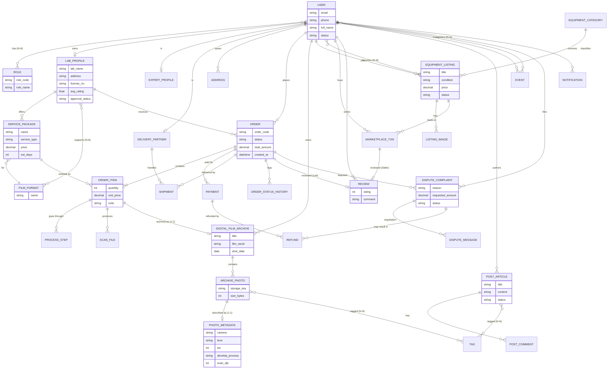

### 2.2. Chuyên biệt hóa người dùng (Generalization)

Một `USER` có thể giữ **nhiều vai trò** cùng lúc (ví dụ khách hàng đồng thời là chuyên gia). Thông tin riêng từng vai trò tách thành bảng profile quan hệ 1-1.

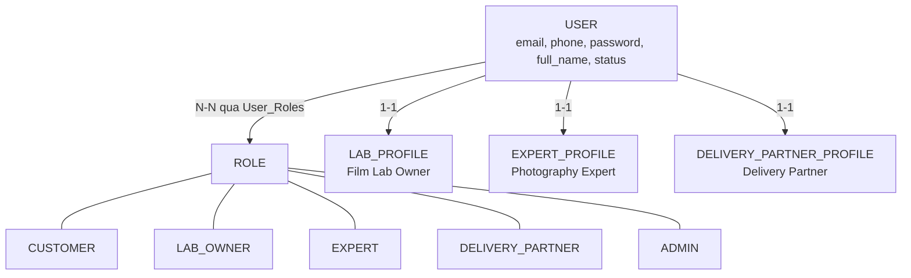

---

## 3. Ma trận quan hệ 1-1 / 1-N / N-N

| # | Thực thể A | Quan hệ | Thực thể B | Loại | Cách hiện thực ở mức vật lý |
|---|-----------|---------|-----------|------|------------------------------|
| 1 | User | has | Role | **N-N** | Bảng trung gian `User_Roles` |
| 2 | User | owns | Lab_Profile | 1-N (thực tế 1-1) | `Lab_Profile.owner_id` FK |
| 3 | User | is | Expert_Profile | **1-1** | `Expert_Profile.user_id` FK + UNIQUE |
| 4 | User | is | Delivery_Partner_Profile | **1-1** | `user_id` FK + UNIQUE |
| 5 | User | saves | User_Address | 1-N | `User_Address.user_id` FK |
| 6 | Lab_Profile | offers | Service_Package | 1-N | `Service_Package.lab_id` FK |
| 7 | Lab_Profile | supports | Film_Format | **N-N** | Bảng trung gian `Lab_Film_Format` |
| 8 | User (Customer) | places | Orders | 1-N | `Orders.customer_id` FK |
| 9 | Lab_Profile | receives | Orders | 1-N | `Orders.lab_id` FK |
| 10 | Orders | contains | Order_Item | 1-N | `Order_Item.order_id` FK |
| 11 | Service_Package | ordered as | Order_Item | 1-N | `Order_Item.package_id` FK |
| 12 | Order_Item | goes through | Order_Process_Step | 1-N | `order_item_id` FK |
| 13 | Orders | has | Payment | 1-N | `Payment.order_id` FK (cho phép thanh toán lại) |
| 14 | Payment | has | Refund | 1-N | `Refund.payment_id` FK |
| 15 | Orders | has | Shipment | 1-N | Tối đa 2 chiều: pickup + return |
| 16 | Delivery_Partner | handles | Shipment | 1-N | `Shipment.partner_id` FK |
| 17 | Order_Item | produces | Scan_File | 1-N | `Scan_File.order_item_id` FK |
| 18 | Order_Item | archived as | Digital_Film_Archive | **1-1** | `order_item_id` FK + UNIQUE (nullable) |
| 19 | User | owns | Digital_Film_Archive | 1-N | `owner_id` FK |
| 20 | Digital_Film_Archive | contains | Archive_Photo | 1-N | `archive_id` FK |
| 21 | Archive_Photo | described by | Photo_Metadata | **1-1** | `Photo_Metadata.photo_id` là PK đồng thời FK |
| 22 | Archive_Photo | tagged | Tag | **N-N** | `Photo_Tag` |
| 23 | User | sells | Equipment_Listing | 1-N | `seller_id` FK |
| 24 | User | favorites | Equipment_Listing | **N-N** | `Listing_Favorite` |
| 25 | Equipment_Listing | has | Listing_Image | 1-N | `listing_id` FK |
| 26 | Equipment_Listing | leads to | Marketplace_Transaction | 1-N | `listing_id` FK |
| 27 | Orders / Marketplace_Transaction | reviewed | Review | 1-1 | `Review.order_id` hoặc `txn_id` (CHECK đúng 1 trong 2) + UNIQUE |
| 28 | User | authors | Post_Article | 1-N | `author_id` FK |
| 29 | Post_Article | tagged | Tag | **N-N** | `Post_Tag` |
| 30 | Post_Article | has | Post_Comment | 1-N (đệ quy) | `parent_comment_id` tự tham chiếu |
| 31 | User | hosts | Event | 1-N | `host_id` FK |
| 32 | User | registers | Event | **N-N** | `Event_Registration` |
| 33 | Orders | disputed | Dispute_Complaint | 1-N | `order_id` FK |
| 34 | Dispute_Complaint | has | Dispute_Message / Dispute_Evidence | 1-N | `dispute_id` FK |
| 35 | User | receives | Notification | 1-N | `user_id` FK |

---

## 4. Sơ đồ ERD vật lý (Physical ERD) theo phân hệ

Sơ đồ vật lý được chia theo phân hệ để dễ đọc trên GitHub. `PK` = khóa chính, `FK` = khóa ngoại, `UK` = unique.

### 4.1. Định danh, phân quyền & hồ sơ vai trò

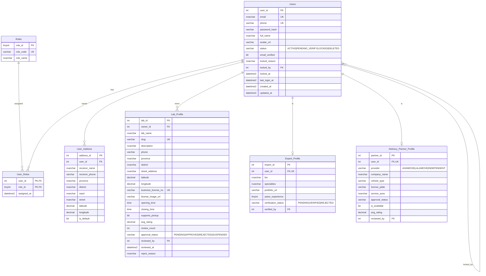

### 4.2. Danh mục & dịch vụ Lab

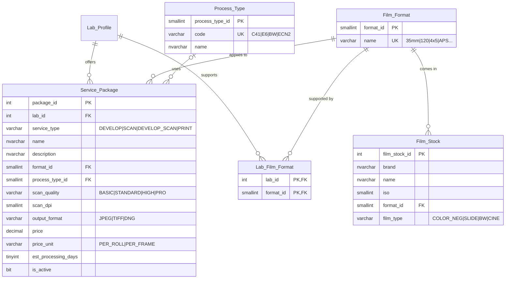

### 4.3. Đơn hàng, thanh toán, hoàn tiền, vận chuyển

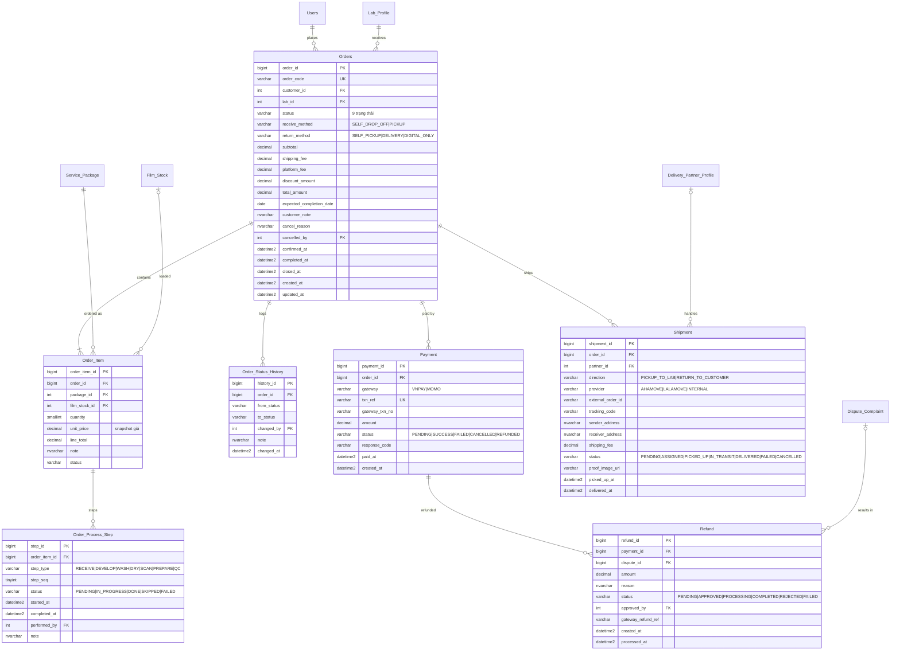

### 4.4. Digital Film Archive & Metadata

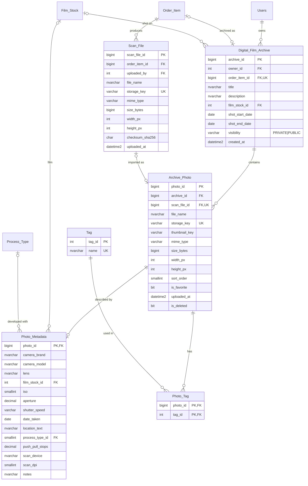

### 4.5. Marketplace & Review

```mermaid
erDiagram
    Users ||--o{ Equipment_Listing : "sells"
    Equipment_Category ||--o{ Equipment_Listing : "classifies"
    Equipment_Category |o--o{ Equipment_Category : "parent"
    Equipment_Listing ||--o{ Listing_Image : "has"
    Users ||--o{ Listing_Favorite : "saves"
    Equipment_Listing ||--o{ Listing_Favorite : "saved by"
    Equipment_Listing ||--o{ Marketplace_Transaction : "leads to"
    Users ||--o{ Marketplace_Transaction : "buys"
    Users ||--o{ Review : "writes"
    Orders |o--o| Review : "Lab review"
    Marketplace_Transaction |o--o| Review : "Seller review"

    Equipment_Category {
        int category_id PK
        int parent_id FK
        nvarchar name UK
    }
    Equipment_Listing {
        bigint listing_id PK
        int seller_id FK
        int category_id FK
        varchar listing_type "SELL|TRADE|BUY"
        nvarchar title
        nvarchar description
        nvarchar brand
        nvarchar model
        varchar item_condition "NEW|LIKE_NEW|GOOD|FAIR|FOR_PARTS"
        decimal price
        bit is_negotiable
        nvarchar location_text
        varchar contact_phone
        varchar contact_zalo
        varchar status "PENDING_APPROVAL|ACTIVE|REJECTED|SOLD|EXPIRED|HIDDEN"
        int reviewed_by FK
        datetime2 reviewed_at
        nvarchar reject_reason
        int view_count
        datetime2 expires_at
        datetime2 created_at
    }
    Listing_Image {
        bigint image_id PK
        bigint listing_id FK
        varchar image_url
        tinyint sort_order
    }
    Listing_Favorite {
        int user_id PK, FK
        bigint listing_id PK, FK
        datetime2 created_at
    }
    Marketplace_Transaction {
        bigint txn_id PK
        bigint listing_id FK
        int buyer_id FK
        decimal agreed_price
        varchar status "CONTACTED|AGREED|COMPLETED|CANCELLED"
        datetime2 created_at
        datetime2 completed_at
    }
    Review {
        bigint review_id PK
        int reviewer_id FK
        varchar review_type "LAB|SELLER"
        bigint order_id FK
        bigint txn_id FK
        tinyint rating "1-5"
        nvarchar comment
        nvarchar reply_text
        datetime2 replied_at
        varchar status "VISIBLE|HIDDEN|REMOVED"
        int moderated_by FK
        datetime2 created_at
    }
```

### 4.6. Cộng đồng, Workshop / Photowalk

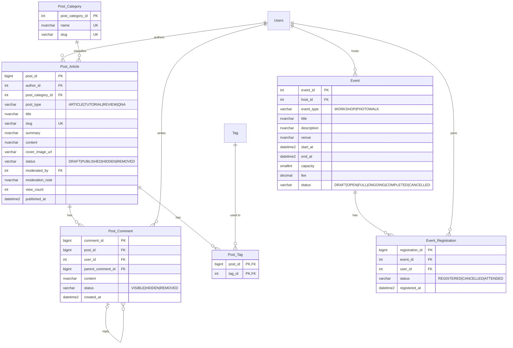

### 4.7. Khiếu nại, thông báo, hệ thống

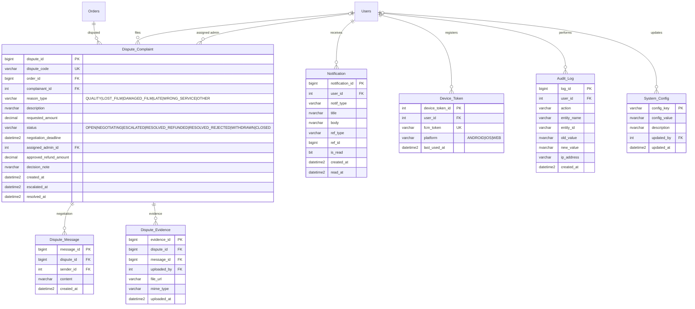

---

## 5. Đặc tả chi tiết bảng – Script SQL Server

> Chạy theo đúng thứ tự dưới đây (bảng cha trước, bảng con sau). Mọi ràng buộc đặt tên rõ ràng (`PK_`, `FK_`, `UQ_`, `CK_`, `DF_`) để dễ bảo trì và dễ đọc thông báo lỗi.

### 5.1. Khởi tạo CSDL

```sql
CREATE DATABASE FilmLabPlatform COLLATE Vietnamese_100_CI_AS;
GO
USE FilmLabPlatform;
GO
```

### 5.2. Phân hệ Định danh & phân quyền

```sql
-- 1. Roles
CREATE TABLE Roles (
    role_id     TINYINT       NOT NULL,
    role_code   VARCHAR(30)   NOT NULL,
    role_name   NVARCHAR(100) NOT NULL,
    description NVARCHAR(255) NULL,
    CONSTRAINT PK_Roles PRIMARY KEY (role_id),
    CONSTRAINT UQ_Roles_Code UNIQUE (role_code),
    CONSTRAINT CK_Roles_Code CHECK (role_code IN
        ('CUSTOMER','LAB_OWNER','EXPERT','DELIVERY_PARTNER','ADMIN'))
);

-- 2. Users
CREATE TABLE Users (
    user_id        INT IDENTITY(1,1) NOT NULL,
    email          NVARCHAR(255)  NOT NULL,
    phone          VARCHAR(20)    NULL,
    password_hash  VARCHAR(255)   NOT NULL,           -- bcrypt/argon2, KHÔNG lưu mật khẩu thô
    full_name      NVARCHAR(150)  NOT NULL,
    avatar_url     VARCHAR(500)   NULL,
    status         VARCHAR(20)    NOT NULL CONSTRAINT DF_Users_Status DEFAULT 'PENDING_VERIFY',
    email_verified BIT            NOT NULL CONSTRAINT DF_Users_EmailVerified DEFAULT 0,
    locked_reason  NVARCHAR(500)  NULL,
    locked_by      INT            NULL,
    locked_at      DATETIME2(0)   NULL,
    last_login_at  DATETIME2(0)   NULL,
    created_at     DATETIME2(0)   NOT NULL CONSTRAINT DF_Users_Created DEFAULT SYSUTCDATETIME(),
    updated_at     DATETIME2(0)   NOT NULL CONSTRAINT DF_Users_Updated DEFAULT SYSUTCDATETIME(),
    CONSTRAINT PK_Users PRIMARY KEY (user_id),
    CONSTRAINT UQ_Users_Email UNIQUE (email),
    CONSTRAINT FK_Users_LockedBy FOREIGN KEY (locked_by) REFERENCES Users(user_id),
    CONSTRAINT CK_Users_Status CHECK (status IN ('ACTIVE','PENDING_VERIFY','LOCKED','DELETED')),
    CONSTRAINT CK_Users_Email CHECK (email LIKE '%_@_%._%'),
    CONSTRAINT CK_Users_Locked CHECK (status <> 'LOCKED' OR (locked_at IS NOT NULL AND locked_by IS NOT NULL))
);
CREATE UNIQUE INDEX UX_Users_Phone ON Users(phone) WHERE phone IS NOT NULL;

-- 3. User_Roles (N-N: User <-> Role)
CREATE TABLE User_Roles (
    user_id     INT          NOT NULL,
    role_id     TINYINT      NOT NULL,
    assigned_at DATETIME2(0) NOT NULL CONSTRAINT DF_UserRoles_Assigned DEFAULT SYSUTCDATETIME(),
    CONSTRAINT PK_User_Roles PRIMARY KEY (user_id, role_id),
    CONSTRAINT FK_UserRoles_User FOREIGN KEY (user_id) REFERENCES Users(user_id) ON DELETE CASCADE,
    CONSTRAINT FK_UserRoles_Role FOREIGN KEY (role_id) REFERENCES Roles(role_id)
);

-- 4. User_Address
CREATE TABLE User_Address (
    address_id     INT IDENTITY(1,1) NOT NULL,
    user_id        INT           NOT NULL,
    receiver_name  NVARCHAR(150) NOT NULL,
    receiver_phone VARCHAR(20)   NOT NULL,
    province       NVARCHAR(100) NOT NULL,
    district       NVARCHAR(100) NOT NULL,
    ward           NVARCHAR(100) NULL,
    street         NVARCHAR(255) NOT NULL,
    latitude       DECIMAL(9,6)  NULL,
    longitude      DECIMAL(9,6)  NULL,
    is_default     BIT           NOT NULL CONSTRAINT DF_UserAddr_Default DEFAULT 0,
    CONSTRAINT PK_User_Address PRIMARY KEY (address_id),
    CONSTRAINT FK_UserAddr_User FOREIGN KEY (user_id) REFERENCES Users(user_id) ON DELETE CASCADE,
    CONSTRAINT CK_UserAddr_Lat CHECK (latitude  BETWEEN -90  AND 90),
    CONSTRAINT CK_UserAddr_Lng CHECK (longitude BETWEEN -180 AND 180)
);
CREATE UNIQUE INDEX UX_UserAddr_OneDefault ON User_Address(user_id) WHERE is_default = 1;
```

### 5.3. Danh mục & hồ sơ Lab / Expert / Delivery

```sql
-- 5. Film_Format
CREATE TABLE Film_Format (
    format_id SMALLINT IDENTITY(1,1) NOT NULL,
    name      VARCHAR(30) NOT NULL,
    CONSTRAINT PK_Film_Format PRIMARY KEY (format_id),
    CONSTRAINT UQ_Film_Format_Name UNIQUE (name)
);

-- 6. Process_Type (quy trình tráng)
CREATE TABLE Process_Type (
    process_type_id SMALLINT IDENTITY(1,1) NOT NULL,
    code            VARCHAR(20)   NOT NULL,
    name            NVARCHAR(100) NOT NULL,
    CONSTRAINT PK_Process_Type PRIMARY KEY (process_type_id),
    CONSTRAINT UQ_Process_Type_Code UNIQUE (code)
);

-- 7. Film_Stock (danh mục loại film)
CREATE TABLE Film_Stock (
    film_stock_id INT IDENTITY(1,1) NOT NULL,
    brand         NVARCHAR(100) NOT NULL,
    name          NVARCHAR(150) NOT NULL,
    iso           SMALLINT      NULL,
    format_id     SMALLINT      NOT NULL,
    film_type     VARCHAR(20)   NOT NULL,
    CONSTRAINT PK_Film_Stock PRIMARY KEY (film_stock_id),
    CONSTRAINT FK_FilmStock_Format FOREIGN KEY (format_id) REFERENCES Film_Format(format_id),
    CONSTRAINT UQ_FilmStock UNIQUE (brand, name, format_id),
    CONSTRAINT CK_FilmStock_Type CHECK (film_type IN ('COLOR_NEG','SLIDE','BW','CINE')),
    CONSTRAINT CK_FilmStock_ISO CHECK (iso IS NULL OR iso BETWEEN 1 AND 25600)
);

-- 8. Lab_Profile
CREATE TABLE Lab_Profile (
    lab_id              INT IDENTITY(1,1) NOT NULL,
    owner_id            INT            NOT NULL,
    lab_name            NVARCHAR(200)  NOT NULL,
    slug                VARCHAR(220)   NOT NULL,
    description         NVARCHAR(2000) NULL,
    phone               VARCHAR(20)    NOT NULL,
    province            NVARCHAR(100)  NOT NULL,
    district            NVARCHAR(100)  NOT NULL,
    street_address      NVARCHAR(255)  NOT NULL,
    latitude            DECIMAL(9,6)   NULL,
    longitude           DECIMAL(9,6)   NULL,
    business_license_no VARCHAR(50)    NULL,
    license_image_url   VARCHAR(500)   NULL,
    logo_url            VARCHAR(500)   NULL,
    cover_url           VARCHAR(500)   NULL,
    opening_time        TIME(0)        NULL,
    closing_time        TIME(0)        NULL,
    supports_pickup     BIT            NOT NULL CONSTRAINT DF_Lab_Pickup DEFAULT 0,
    avg_rating          DECIMAL(3,2)   NOT NULL CONSTRAINT DF_Lab_Rating DEFAULT 0,   -- denormalized, cập nhật bằng trigger/job
    review_count        INT            NOT NULL CONSTRAINT DF_Lab_RvCount DEFAULT 0,  -- denormalized
    approval_status     VARCHAR(20)    NOT NULL CONSTRAINT DF_Lab_Approval DEFAULT 'PENDING',
    reviewed_by         INT            NULL,
    reviewed_at         DATETIME2(0)   NULL,
    reject_reason       NVARCHAR(500)  NULL,
    created_at          DATETIME2(0)   NOT NULL CONSTRAINT DF_Lab_Created DEFAULT SYSUTCDATETIME(),
    updated_at          DATETIME2(0)   NOT NULL CONSTRAINT DF_Lab_Updated DEFAULT SYSUTCDATETIME(),
    CONSTRAINT PK_Lab_Profile PRIMARY KEY (lab_id),
    CONSTRAINT UQ_Lab_Slug UNIQUE (slug),
    CONSTRAINT FK_Lab_Owner    FOREIGN KEY (owner_id)    REFERENCES Users(user_id),
    CONSTRAINT FK_Lab_Reviewer FOREIGN KEY (reviewed_by) REFERENCES Users(user_id),
    CONSTRAINT CK_Lab_Status CHECK (approval_status IN ('PENDING','APPROVED','REJECTED','SUSPENDED')),
    CONSTRAINT CK_Lab_Rating CHECK (avg_rating BETWEEN 0 AND 5),
    CONSTRAINT CK_Lab_Hours  CHECK (opening_time IS NULL OR closing_time IS NULL OR opening_time < closing_time),
    CONSTRAINT CK_Lab_Reject CHECK (approval_status <> 'REJECTED' OR reject_reason IS NOT NULL)
);
CREATE UNIQUE INDEX UX_Lab_License ON Lab_Profile(business_license_no) WHERE business_license_no IS NOT NULL;

-- 9. Lab_Film_Format (N-N)
CREATE TABLE Lab_Film_Format (
    lab_id    INT      NOT NULL,
    format_id SMALLINT NOT NULL,
    CONSTRAINT PK_Lab_Film_Format PRIMARY KEY (lab_id, format_id),
    CONSTRAINT FK_LFF_Lab    FOREIGN KEY (lab_id)    REFERENCES Lab_Profile(lab_id) ON DELETE CASCADE,
    CONSTRAINT FK_LFF_Format FOREIGN KEY (format_id) REFERENCES Film_Format(format_id)
);

-- 10. Service_Package
CREATE TABLE Service_Package (
    package_id           INT IDENTITY(1,1) NOT NULL,
    lab_id               INT            NOT NULL,
    service_type         VARCHAR(20)    NOT NULL,
    name                 NVARCHAR(200)  NOT NULL,
    description          NVARCHAR(1000) NULL,
    format_id            SMALLINT       NOT NULL,
    process_type_id      SMALLINT       NULL,        -- NULL khi chỉ scan
    scan_quality         VARCHAR(20)    NULL,        -- NULL khi chỉ tráng
    scan_dpi             SMALLINT       NULL,
    output_format        VARCHAR(20)    NULL,
    price                DECIMAL(15,2)  NOT NULL,
    price_unit           VARCHAR(20)    NOT NULL CONSTRAINT DF_SP_Unit DEFAULT 'PER_ROLL',
    est_processing_days  TINYINT        NOT NULL,
    is_active            BIT            NOT NULL CONSTRAINT DF_SP_Active DEFAULT 1,
    created_at           DATETIME2(0)   NOT NULL CONSTRAINT DF_SP_Created DEFAULT SYSUTCDATETIME(),
    updated_at           DATETIME2(0)   NOT NULL CONSTRAINT DF_SP_Updated DEFAULT SYSUTCDATETIME(),
    CONSTRAINT PK_Service_Package PRIMARY KEY (package_id),
    CONSTRAINT FK_SP_Lab     FOREIGN KEY (lab_id)          REFERENCES Lab_Profile(lab_id) ON DELETE CASCADE,
    CONSTRAINT FK_SP_Format  FOREIGN KEY (format_id)       REFERENCES Film_Format(format_id),
    CONSTRAINT FK_SP_Process FOREIGN KEY (process_type_id) REFERENCES Process_Type(process_type_id),
    CONSTRAINT UQ_SP_LabName UNIQUE (lab_id, name),
    CONSTRAINT CK_SP_Type    CHECK (service_type IN ('DEVELOP','SCAN','DEVELOP_SCAN','PRINT')),
    CONSTRAINT CK_SP_Quality CHECK (scan_quality IS NULL OR scan_quality IN ('BASIC','STANDARD','HIGH','PRO')),
    CONSTRAINT CK_SP_Output  CHECK (output_format IS NULL OR output_format IN ('JPEG','TIFF','DNG','PNG')),
    CONSTRAINT CK_SP_Unit    CHECK (price_unit IN ('PER_ROLL','PER_FRAME')),
    CONSTRAINT CK_SP_Price   CHECK (price >= 0),
    CONSTRAINT CK_SP_Days    CHECK (est_processing_days BETWEEN 1 AND 60),
    -- Ràng buộc chéo: tráng phải có process_type, scan phải có scan_quality
    CONSTRAINT CK_SP_Consistency CHECK (
        (service_type = 'DEVELOP'      AND process_type_id IS NOT NULL) OR
        (service_type = 'SCAN'         AND scan_quality   IS NOT NULL) OR
        (service_type = 'DEVELOP_SCAN' AND process_type_id IS NOT NULL AND scan_quality IS NOT NULL) OR
        (service_type = 'PRINT')
    )
);

-- 11. Expert_Profile (1-1 với Users)
CREATE TABLE Expert_Profile (
    expert_id           INT IDENTITY(1,1) NOT NULL,
    user_id             INT           NOT NULL,
    bio                 NVARCHAR(2000) NULL,
    specialties         NVARCHAR(500) NULL,
    portfolio_url       VARCHAR(500)  NULL,
    years_experience    TINYINT       NULL,
    verification_status VARCHAR(20)   NOT NULL CONSTRAINT DF_Exp_Status DEFAULT 'PENDING',
    verified_by         INT           NULL,
    CONSTRAINT PK_Expert_Profile PRIMARY KEY (expert_id),
    CONSTRAINT UQ_Expert_User UNIQUE (user_id),
    CONSTRAINT FK_Expert_User     FOREIGN KEY (user_id)     REFERENCES Users(user_id) ON DELETE CASCADE,
    CONSTRAINT FK_Expert_Verifier FOREIGN KEY (verified_by) REFERENCES Users(user_id),
    CONSTRAINT CK_Expert_Status CHECK (verification_status IN ('PENDING','VERIFIED','REJECTED'))
);

-- 12. Delivery_Partner_Profile (1-1 với Users)
CREATE TABLE Delivery_Partner_Profile (
    partner_id      INT IDENTITY(1,1) NOT NULL,
    user_id         INT           NOT NULL,
    provider        VARCHAR(20)   NOT NULL,
    company_name    NVARCHAR(150) NULL,
    vehicle_type    VARCHAR(30)   NULL,
    license_plate   VARCHAR(20)   NULL,
    service_area    NVARCHAR(255) NULL,
    approval_status VARCHAR(20)   NOT NULL CONSTRAINT DF_DP_Status DEFAULT 'PENDING',
    is_available    BIT           NOT NULL CONSTRAINT DF_DP_Avail DEFAULT 1,
    avg_rating      DECIMAL(3,2)  NOT NULL CONSTRAINT DF_DP_Rating DEFAULT 0,
    reviewed_by     INT           NULL,
    CONSTRAINT PK_Delivery_Partner PRIMARY KEY (partner_id),
    CONSTRAINT UQ_DP_User UNIQUE (user_id),
    CONSTRAINT FK_DP_User     FOREIGN KEY (user_id)     REFERENCES Users(user_id) ON DELETE CASCADE,
    CONSTRAINT FK_DP_Reviewer FOREIGN KEY (reviewed_by) REFERENCES Users(user_id),
    CONSTRAINT CK_DP_Provider CHECK (provider IN ('AHAMOVE','LALAMOVE','INDEPENDENT')),
    CONSTRAINT CK_DP_Status   CHECK (approval_status IN ('PENDING','APPROVED','REJECTED','SUSPENDED')),
    CONSTRAINT CK_DP_Rating   CHECK (avg_rating BETWEEN 0 AND 5)
);
```

### 5.4. Đơn hàng, thanh toán, vận chuyển

```sql
-- 13. Orders
CREATE TABLE Orders (
    order_id                BIGINT IDENTITY(1,1) NOT NULL,
    order_code              VARCHAR(20)   NOT NULL,                 -- VD: FL-20261027-0001
    customer_id             INT           NOT NULL,
    lab_id                  INT           NOT NULL,
    status                  VARCHAR(25)   NOT NULL CONSTRAINT DF_Orders_Status DEFAULT 'PENDING_PAYMENT',
    receive_method          VARCHAR(20)   NOT NULL,
    return_method           VARCHAR(20)   NOT NULL,
    subtotal                DECIMAL(15,2) NOT NULL CONSTRAINT DF_Orders_Sub DEFAULT 0,
    shipping_fee            DECIMAL(15,2) NOT NULL CONSTRAINT DF_Orders_Ship DEFAULT 0,
    platform_fee            DECIMAL(15,2) NOT NULL CONSTRAINT DF_Orders_Fee DEFAULT 0,
    discount_amount         DECIMAL(15,2) NOT NULL CONSTRAINT DF_Orders_Disc DEFAULT 0,
    total_amount            DECIMAL(15,2) NOT NULL CONSTRAINT DF_Orders_Total DEFAULT 0,
    expected_completion_date DATE         NULL,
    customer_note           NVARCHAR(1000) NULL,
    cancel_reason           NVARCHAR(500) NULL,
    cancelled_by            INT           NULL,
    confirmed_at            DATETIME2(0)  NULL,
    completed_at            DATETIME2(0)  NULL,
    closed_at               DATETIME2(0)  NULL,
    created_at              DATETIME2(0)  NOT NULL CONSTRAINT DF_Orders_Created DEFAULT SYSUTCDATETIME(),
    updated_at              DATETIME2(0)  NOT NULL CONSTRAINT DF_Orders_Updated DEFAULT SYSUTCDATETIME(),
    CONSTRAINT PK_Orders PRIMARY KEY (order_id),
    CONSTRAINT UQ_Orders_Code UNIQUE (order_code),
    CONSTRAINT FK_Orders_Customer FOREIGN KEY (customer_id)  REFERENCES Users(user_id),
    CONSTRAINT FK_Orders_Lab      FOREIGN KEY (lab_id)       REFERENCES Lab_Profile(lab_id),
    CONSTRAINT FK_Orders_CancelBy FOREIGN KEY (cancelled_by) REFERENCES Users(user_id),
    CONSTRAINT CK_Orders_Status CHECK (status IN (
        'PENDING_PAYMENT','PENDING_LAB_CONFIRM','PICKING_UP','RECEIVED_AT_LAB',
        'PROCESSING','COMPLETED','DELIVERING','CLOSED','CANCELLED')),
    CONSTRAINT CK_Orders_Receive CHECK (receive_method IN ('SELF_DROP_OFF','PICKUP')),
    CONSTRAINT CK_Orders_Return  CHECK (return_method  IN ('SELF_PICKUP','DELIVERY','DIGITAL_ONLY')),
    CONSTRAINT CK_Orders_Money   CHECK (subtotal >= 0 AND shipping_fee >= 0 AND platform_fee >= 0
                                        AND discount_amount >= 0 AND total_amount >= 0),
    CONSTRAINT CK_Orders_Total   CHECK (total_amount = subtotal + shipping_fee + platform_fee - discount_amount),
    CONSTRAINT CK_Orders_Cancel  CHECK (status <> 'CANCELLED' OR (cancel_reason IS NOT NULL AND cancelled_by IS NOT NULL))
);

-- 14. Order_Item
CREATE TABLE Order_Item (
    order_item_id BIGINT IDENTITY(1,1) NOT NULL,
    order_id      BIGINT        NOT NULL,
    package_id    INT           NOT NULL,
    film_stock_id INT           NULL,
    quantity      SMALLINT      NOT NULL CONSTRAINT DF_OI_Qty DEFAULT 1,   -- số cuộn
    unit_price    DECIMAL(15,2) NOT NULL,                                   -- snapshot giá tại thời điểm đặt
    line_total    DECIMAL(15,2) NOT NULL,
    note          NVARCHAR(500) NULL,
    status        VARCHAR(20)   NOT NULL CONSTRAINT DF_OI_Status DEFAULT 'PENDING',
    CONSTRAINT PK_Order_Item PRIMARY KEY (order_item_id),
    CONSTRAINT FK_OI_Order   FOREIGN KEY (order_id)      REFERENCES Orders(order_id) ON DELETE CASCADE,
    CONSTRAINT FK_OI_Package FOREIGN KEY (package_id)    REFERENCES Service_Package(package_id),
    CONSTRAINT FK_OI_Stock   FOREIGN KEY (film_stock_id) REFERENCES Film_Stock(film_stock_id),
    CONSTRAINT CK_OI_Qty     CHECK (quantity BETWEEN 1 AND 100),
    CONSTRAINT CK_OI_Price   CHECK (unit_price >= 0 AND line_total = unit_price * quantity),
    CONSTRAINT CK_OI_Status  CHECK (status IN ('PENDING','RECEIVED','PROCESSING','DONE','FAILED'))
);

-- 15. Order_Status_History (audit vòng đời đơn)
CREATE TABLE Order_Status_History (
    history_id  BIGINT IDENTITY(1,1) NOT NULL,
    order_id    BIGINT       NOT NULL,
    from_status VARCHAR(25)  NULL,
    to_status   VARCHAR(25)  NOT NULL,
    changed_by  INT          NULL,                  -- NULL = hệ thống / webhook thanh toán
    note        NVARCHAR(500) NULL,
    changed_at  DATETIME2(0) NOT NULL CONSTRAINT DF_OSH_At DEFAULT SYSUTCDATETIME(),
    CONSTRAINT PK_Order_Status_History PRIMARY KEY (history_id),
    CONSTRAINT FK_OSH_Order FOREIGN KEY (order_id)   REFERENCES Orders(order_id) ON DELETE CASCADE,
    CONSTRAINT FK_OSH_User  FOREIGN KEY (changed_by) REFERENCES Users(user_id)
);

-- 16. Order_Process_Step (công đoạn xử lý từng cuộn film)
CREATE TABLE Order_Process_Step (
    step_id       BIGINT IDENTITY(1,1) NOT NULL,
    order_item_id BIGINT       NOT NULL,
    step_type     VARCHAR(20)  NOT NULL,
    step_seq      TINYINT      NOT NULL,
    status        VARCHAR(20)  NOT NULL CONSTRAINT DF_OPS_Status DEFAULT 'PENDING',
    started_at    DATETIME2(0) NULL,
    completed_at  DATETIME2(0) NULL,
    performed_by  INT          NULL,
    note          NVARCHAR(500) NULL,
    CONSTRAINT PK_Order_Process_Step PRIMARY KEY (step_id),
    CONSTRAINT FK_OPS_Item FOREIGN KEY (order_item_id) REFERENCES Order_Item(order_item_id) ON DELETE CASCADE,
    CONSTRAINT FK_OPS_User FOREIGN KEY (performed_by)  REFERENCES Users(user_id),
    CONSTRAINT UQ_OPS_ItemStep UNIQUE (order_item_id, step_type),
    CONSTRAINT CK_OPS_Type   CHECK (step_type IN ('RECEIVE','DEVELOP','WASH','DRY','SCAN','PREPARE','QC')),
    CONSTRAINT CK_OPS_Status CHECK (status IN ('PENDING','IN_PROGRESS','DONE','SKIPPED','FAILED')),
    CONSTRAINT CK_OPS_Time   CHECK (completed_at IS NULL OR started_at IS NULL OR completed_at >= started_at)
);

-- 17. Payment
CREATE TABLE Payment (
    payment_id      BIGINT IDENTITY(1,1) NOT NULL,
    order_id        BIGINT        NOT NULL,
    gateway         VARCHAR(10)   NOT NULL,
    txn_ref         VARCHAR(64)   NOT NULL,          -- mã tham chiếu gửi sang cổng
    gateway_txn_no  VARCHAR(64)   NULL,              -- mã giao dịch phía VNPay/MoMo
    amount          DECIMAL(15,2) NOT NULL,
    currency        CHAR(3)       NOT NULL CONSTRAINT DF_Pay_Cur DEFAULT 'VND',
    status          VARCHAR(15)   NOT NULL CONSTRAINT DF_Pay_Status DEFAULT 'PENDING',
    response_code   VARCHAR(10)   NULL,
    paid_at         DATETIME2(0)  NULL,
    created_at      DATETIME2(0)  NOT NULL CONSTRAINT DF_Pay_Created DEFAULT SYSUTCDATETIME(),
    CONSTRAINT PK_Payment PRIMARY KEY (payment_id),
    CONSTRAINT UQ_Payment_TxnRef UNIQUE (txn_ref),     -- chống xử lý trùng callback (idempotent)
    CONSTRAINT FK_Payment_Order FOREIGN KEY (order_id) REFERENCES Orders(order_id),
    CONSTRAINT CK_Payment_Gateway CHECK (gateway IN ('VNPAY','MOMO')),
    CONSTRAINT CK_Payment_Status  CHECK (status IN ('PENDING','SUCCESS','FAILED','CANCELLED','REFUNDED')),
    CONSTRAINT CK_Payment_Amount  CHECK (amount > 0),
    CONSTRAINT CK_Payment_Paid    CHECK (status <> 'SUCCESS' OR paid_at IS NOT NULL)
);

-- 18. Dispute_Complaint (tạo trước Refund vì Refund tham chiếu)
CREATE TABLE Dispute_Complaint (
    dispute_id             BIGINT IDENTITY(1,1) NOT NULL,
    dispute_code           VARCHAR(20)   NOT NULL,
    order_id               BIGINT        NOT NULL,
    complainant_id         INT           NOT NULL,
    reason_type            VARCHAR(20)   NOT NULL,
    description            NVARCHAR(2000) NOT NULL,
    requested_amount       DECIMAL(15,2) NULL,
    status                 VARCHAR(20)   NOT NULL CONSTRAINT DF_Disp_Status DEFAULT 'OPEN',
    negotiation_deadline   DATETIME2(0)  NULL,
    assigned_admin_id      INT           NULL,
    approved_refund_amount DECIMAL(15,2) NULL,
    decision_note          NVARCHAR(1000) NULL,
    created_at             DATETIME2(0)  NOT NULL CONSTRAINT DF_Disp_Created DEFAULT SYSUTCDATETIME(),
    escalated_at           DATETIME2(0)  NULL,
    resolved_at            DATETIME2(0)  NULL,
    CONSTRAINT PK_Dispute_Complaint PRIMARY KEY (dispute_id),
    CONSTRAINT UQ_Dispute_Code UNIQUE (dispute_code),
    CONSTRAINT FK_Disp_Order FOREIGN KEY (order_id)          REFERENCES Orders(order_id),
    CONSTRAINT FK_Disp_User  FOREIGN KEY (complainant_id)    REFERENCES Users(user_id),
    CONSTRAINT FK_Disp_Admin FOREIGN KEY (assigned_admin_id) REFERENCES Users(user_id),
    CONSTRAINT CK_Disp_Reason CHECK (reason_type IN
        ('QUALITY','LOST_FILM','DAMAGED_FILM','LATE','WRONG_SERVICE','OTHER')),
    CONSTRAINT CK_Disp_Status CHECK (status IN
        ('OPEN','NEGOTIATING','ESCALATED','RESOLVED_REFUNDED','RESOLVED_REJECTED','WITHDRAWN','CLOSED')),
    CONSTRAINT CK_Disp_Amount CHECK (requested_amount IS NULL OR requested_amount >= 0),
    CONSTRAINT CK_Disp_Approved CHECK (approved_refund_amount IS NULL OR approved_refund_amount >= 0),
    CONSTRAINT CK_Disp_Escalate CHECK (status <> 'ESCALATED' OR escalated_at IS NOT NULL)
);

-- 19. Refund
CREATE TABLE Refund (
    refund_id          BIGINT IDENTITY(1,1) NOT NULL,
    payment_id         BIGINT        NOT NULL,
    dispute_id         BIGINT        NULL,            -- NULL khi hoàn tiền do hủy đơn
    amount             DECIMAL(15,2) NOT NULL,
    reason             NVARCHAR(500) NULL,
    status             VARCHAR(15)   NOT NULL CONSTRAINT DF_Refund_Status DEFAULT 'PENDING',
    approved_by        INT           NULL,
    gateway_refund_ref VARCHAR(64)   NULL,
    created_at         DATETIME2(0)  NOT NULL CONSTRAINT DF_Refund_Created DEFAULT SYSUTCDATETIME(),
    processed_at       DATETIME2(0)  NULL,
    CONSTRAINT PK_Refund PRIMARY KEY (refund_id),
    CONSTRAINT FK_Refund_Payment FOREIGN KEY (payment_id)  REFERENCES Payment(payment_id),
    CONSTRAINT FK_Refund_Dispute FOREIGN KEY (dispute_id)  REFERENCES Dispute_Complaint(dispute_id),
    CONSTRAINT FK_Refund_Admin   FOREIGN KEY (approved_by) REFERENCES Users(user_id),
    CONSTRAINT CK_Refund_Amount  CHECK (amount > 0),
    CONSTRAINT CK_Refund_Status  CHECK (status IN ('PENDING','APPROVED','PROCESSING','COMPLETED','REJECTED','FAILED')),
    CONSTRAINT CK_Refund_Approve CHECK (status IN ('PENDING','REJECTED') OR approved_by IS NOT NULL)
);

-- 20. Shipment (giao nhận film 2 chiều)
CREATE TABLE Shipment (
    shipment_id       BIGINT IDENTITY(1,1) NOT NULL,
    order_id          BIGINT        NOT NULL,
    partner_id        INT           NULL,             -- NULL cho đến khi có người nhận đơn
    direction         VARCHAR(25)   NOT NULL,
    provider          VARCHAR(15)   NOT NULL,
    external_order_id VARCHAR(64)   NULL,             -- mã đơn phía Ahamove/Lalamove
    tracking_code     VARCHAR(64)   NULL,
    sender_name       NVARCHAR(150) NOT NULL,
    sender_phone      VARCHAR(20)   NOT NULL,
    sender_address    NVARCHAR(500) NOT NULL,         -- snapshot địa chỉ tại thời điểm tạo
    receiver_name     NVARCHAR(150) NOT NULL,
    receiver_phone    VARCHAR(20)   NOT NULL,
    receiver_address  NVARCHAR(500) NOT NULL,
    shipping_fee      DECIMAL(15,2) NOT NULL CONSTRAINT DF_Ship_Fee DEFAULT 0,
    status            VARCHAR(15)   NOT NULL CONSTRAINT DF_Ship_Status DEFAULT 'PENDING',
    proof_image_url   VARCHAR(500)  NULL,
    assigned_at       DATETIME2(0)  NULL,
    picked_up_at      DATETIME2(0)  NULL,
    delivered_at      DATETIME2(0)  NULL,
    created_at        DATETIME2(0)  NOT NULL CONSTRAINT DF_Ship_Created DEFAULT SYSUTCDATETIME(),
    CONSTRAINT PK_Shipment PRIMARY KEY (shipment_id),
    CONSTRAINT UQ_Shipment_OrderDir UNIQUE (order_id, direction),   -- mỗi chiều tối đa 1 vận đơn
    CONSTRAINT FK_Ship_Order   FOREIGN KEY (order_id)   REFERENCES Orders(order_id),
    CONSTRAINT FK_Ship_Partner FOREIGN KEY (partner_id) REFERENCES Delivery_Partner_Profile(partner_id),
    CONSTRAINT CK_Ship_Dir      CHECK (direction IN ('PICKUP_TO_LAB','RETURN_TO_CUSTOMER')),
    CONSTRAINT CK_Ship_Provider CHECK (provider  IN ('AHAMOVE','LALAMOVE','INTERNAL')),
    CONSTRAINT CK_Ship_Status   CHECK (status IN
        ('PENDING','ASSIGNED','PICKED_UP','IN_TRANSIT','DELIVERED','FAILED','CANCELLED')),
    CONSTRAINT CK_Ship_Fee      CHECK (shipping_fee >= 0),
    CONSTRAINT CK_Ship_Time     CHECK (delivered_at IS NULL OR picked_up_at IS NULL OR delivered_at >= picked_up_at)
);
```

### 5.5. Digital Film Archive & Metadata

```sql
-- 21. Scan_File (file Lab upload sau khi scan - lưu trên Cloud Storage)
CREATE TABLE Scan_File (
    scan_file_id    BIGINT IDENTITY(1,1) NOT NULL,
    order_item_id   BIGINT        NOT NULL,
    uploaded_by     INT           NOT NULL,
    file_name       NVARCHAR(255) NOT NULL,
    storage_key     VARCHAR(500)  NOT NULL,         -- đường dẫn object trên Cloud Storage
    mime_type       VARCHAR(50)   NOT NULL,
    size_bytes      BIGINT        NOT NULL,
    width_px        INT           NULL,
    height_px       INT           NULL,
    checksum_sha256 CHAR(64)      NULL,
    uploaded_at     DATETIME2(0)  NOT NULL CONSTRAINT DF_Scan_Up DEFAULT SYSUTCDATETIME(),
    CONSTRAINT PK_Scan_File PRIMARY KEY (scan_file_id),
    CONSTRAINT UQ_Scan_Key UNIQUE (storage_key),
    CONSTRAINT FK_Scan_Item FOREIGN KEY (order_item_id) REFERENCES Order_Item(order_item_id),
    CONSTRAINT FK_Scan_User FOREIGN KEY (uploaded_by)   REFERENCES Users(user_id),
    CONSTRAINT CK_Scan_Size CHECK (size_bytes > 0),
    CONSTRAINT CK_Scan_Mime CHECK (mime_type IN ('image/jpeg','image/png','image/tiff','image/x-adobe-dng'))
);

-- 22. Digital_Film_Archive (mỗi "cuộn film" = 1 bộ sưu tập của khách)
CREATE TABLE Digital_Film_Archive (
    archive_id      BIGINT IDENTITY(1,1) NOT NULL,
    owner_id        INT           NOT NULL,
    order_item_id   BIGINT        NULL,             -- NULL nếu khách tự upload ảnh scan riêng
    title           NVARCHAR(200) NOT NULL,
    description     NVARCHAR(1000) NULL,
    film_stock_id   INT           NULL,
    shot_start_date DATE          NULL,
    shot_end_date   DATE          NULL,
    visibility      VARCHAR(10)   NOT NULL CONSTRAINT DF_DFA_Vis DEFAULT 'PRIVATE',
    created_at      DATETIME2(0)  NOT NULL CONSTRAINT DF_DFA_Created DEFAULT SYSUTCDATETIME(),
    CONSTRAINT PK_Digital_Film_Archive PRIMARY KEY (archive_id),
    CONSTRAINT FK_DFA_Owner FOREIGN KEY (owner_id)      REFERENCES Users(user_id),
    CONSTRAINT FK_DFA_Item  FOREIGN KEY (order_item_id) REFERENCES Order_Item(order_item_id),
    CONSTRAINT FK_DFA_Stock FOREIGN KEY (film_stock_id) REFERENCES Film_Stock(film_stock_id),
    CONSTRAINT CK_DFA_Vis   CHECK (visibility IN ('PRIVATE','PUBLIC')),
    CONSTRAINT CK_DFA_Dates CHECK (shot_end_date IS NULL OR shot_start_date IS NULL OR shot_end_date >= shot_start_date)
);
CREATE UNIQUE INDEX UX_DFA_OrderItem ON Digital_Film_Archive(order_item_id) WHERE order_item_id IS NOT NULL;

-- 23. Archive_Photo
CREATE TABLE Archive_Photo (
    photo_id      BIGINT IDENTITY(1,1) NOT NULL,
    archive_id    BIGINT        NOT NULL,
    scan_file_id  BIGINT        NULL,               -- liên kết với file gốc do Lab giao
    file_name     NVARCHAR(255) NOT NULL,
    storage_key   VARCHAR(500)  NOT NULL,
    thumbnail_key VARCHAR(500)  NULL,
    mime_type     VARCHAR(50)   NOT NULL,
    size_bytes    BIGINT        NOT NULL,
    width_px      INT           NULL,
    height_px     INT           NULL,
    sort_order    SMALLINT      NOT NULL CONSTRAINT DF_AP_Sort DEFAULT 0,
    is_favorite   BIT           NOT NULL CONSTRAINT DF_AP_Fav DEFAULT 0,
    is_deleted    BIT           NOT NULL CONSTRAINT DF_AP_Del DEFAULT 0,   -- soft delete
    uploaded_at   DATETIME2(0)  NOT NULL CONSTRAINT DF_AP_Up DEFAULT SYSUTCDATETIME(),
    CONSTRAINT PK_Archive_Photo PRIMARY KEY (photo_id),
    CONSTRAINT UQ_AP_Key UNIQUE (storage_key),
    CONSTRAINT FK_AP_Archive FOREIGN KEY (archive_id)   REFERENCES Digital_Film_Archive(archive_id) ON DELETE CASCADE,
    CONSTRAINT FK_AP_Scan    FOREIGN KEY (scan_file_id) REFERENCES Scan_File(scan_file_id),
    CONSTRAINT CK_AP_Size    CHECK (size_bytes > 0)
);
CREATE UNIQUE INDEX UX_AP_ScanFile ON Archive_Photo(scan_file_id) WHERE scan_file_id IS NOT NULL;

-- 24. Photo_Metadata (1-1 với Archive_Photo)
CREATE TABLE Photo_Metadata (
    photo_id         BIGINT        NOT NULL,        -- vừa PK vừa FK -> đảm bảo 1-1
    camera_brand     NVARCHAR(100) NULL,
    camera_model     NVARCHAR(100) NULL,
    lens             NVARCHAR(150) NULL,
    film_stock_id    INT           NULL,
    iso              SMALLINT      NULL,
    aperture         DECIMAL(4,1)  NULL,            -- f/1.4 .. f/32
    shutter_speed    VARCHAR(15)   NULL,            -- '1/250', '2"', 'B'
    date_taken       DATE          NULL,
    location_text    NVARCHAR(255) NULL,
    process_type_id  SMALLINT      NULL,
    push_pull_stops  DECIMAL(3,1)  NULL,            -- +1, -1, +0.5...
    scan_device      NVARCHAR(100) NULL,            -- Noritsu HS-1800, Frontier SP3000...
    scan_dpi         SMALLINT      NULL,
    notes            NVARCHAR(1000) NULL,
    CONSTRAINT PK_Photo_Metadata PRIMARY KEY (photo_id),
    CONSTRAINT FK_PM_Photo   FOREIGN KEY (photo_id)        REFERENCES Archive_Photo(photo_id) ON DELETE CASCADE,
    CONSTRAINT FK_PM_Stock   FOREIGN KEY (film_stock_id)   REFERENCES Film_Stock(film_stock_id),
    CONSTRAINT FK_PM_Process FOREIGN KEY (process_type_id) REFERENCES Process_Type(process_type_id),
    CONSTRAINT CK_PM_ISO      CHECK (iso IS NULL OR iso BETWEEN 1 AND 25600),
    CONSTRAINT CK_PM_Aperture CHECK (aperture IS NULL OR aperture BETWEEN 0.7 AND 64),
    CONSTRAINT CK_PM_PushPull CHECK (push_pull_stops IS NULL OR push_pull_stops BETWEEN -4 AND 4),
    CONSTRAINT CK_PM_Date     CHECK (date_taken IS NULL OR date_taken >= '1900-01-01')
);

-- 25. Tag (dùng chung cho ảnh & bài viết)
CREATE TABLE Tag (
    tag_id INT IDENTITY(1,1) NOT NULL,
    name   NVARCHAR(50) NOT NULL,
    CONSTRAINT PK_Tag PRIMARY KEY (tag_id),
    CONSTRAINT UQ_Tag_Name UNIQUE (name)
);

-- 26. Photo_Tag (N-N)
CREATE TABLE Photo_Tag (
    photo_id BIGINT NOT NULL,
    tag_id   INT    NOT NULL,
    CONSTRAINT PK_Photo_Tag PRIMARY KEY (photo_id, tag_id),
    CONSTRAINT FK_PT_Photo FOREIGN KEY (photo_id) REFERENCES Archive_Photo(photo_id) ON DELETE CASCADE,
    CONSTRAINT FK_PT_Tag   FOREIGN KEY (tag_id)   REFERENCES Tag(tag_id) ON DELETE CASCADE
);
```

### 5.6. Marketplace & Review

```sql
-- 27. Equipment_Category (phân cấp)
CREATE TABLE Equipment_Category (
    category_id INT IDENTITY(1,1) NOT NULL,
    parent_id   INT           NULL,
    name        NVARCHAR(100) NOT NULL,
    CONSTRAINT PK_Equipment_Category PRIMARY KEY (category_id),
    CONSTRAINT UQ_EqCat_Name UNIQUE (name),
    CONSTRAINT FK_EqCat_Parent FOREIGN KEY (parent_id) REFERENCES Equipment_Category(category_id)
);

-- 28. Equipment_Listing
CREATE TABLE Equipment_Listing (
    listing_id      BIGINT IDENTITY(1,1) NOT NULL,
    seller_id       INT            NOT NULL,
    category_id     INT            NOT NULL,
    listing_type    VARCHAR(10)    NOT NULL CONSTRAINT DF_EL_Type DEFAULT 'SELL',
    title           NVARCHAR(200)  NOT NULL,
    description     NVARCHAR(4000) NULL,
    brand           NVARCHAR(100)  NULL,
    model           NVARCHAR(100)  NULL,
    item_condition  VARCHAR(15)    NOT NULL,
    price           DECIMAL(15,2)  NULL,            -- NULL khi chỉ trao đổi
    is_negotiable   BIT            NOT NULL CONSTRAINT DF_EL_Neg DEFAULT 0,
    location_text   NVARCHAR(255)  NULL,
    contact_phone   VARCHAR(20)    NOT NULL,
    contact_zalo    VARCHAR(50)    NULL,
    status          VARCHAR(20)    NOT NULL CONSTRAINT DF_EL_Status DEFAULT 'PENDING_APPROVAL',
    reviewed_by     INT            NULL,
    reviewed_at     DATETIME2(0)   NULL,
    reject_reason   NVARCHAR(500)  NULL,
    view_count      INT            NOT NULL CONSTRAINT DF_EL_Views DEFAULT 0,
    expires_at      DATETIME2(0)   NULL,
    created_at      DATETIME2(0)   NOT NULL CONSTRAINT DF_EL_Created DEFAULT SYSUTCDATETIME(),
    updated_at      DATETIME2(0)   NOT NULL CONSTRAINT DF_EL_Updated DEFAULT SYSUTCDATETIME(),
    CONSTRAINT PK_Equipment_Listing PRIMARY KEY (listing_id),
    CONSTRAINT FK_EL_Seller   FOREIGN KEY (seller_id)   REFERENCES Users(user_id),
    CONSTRAINT FK_EL_Category FOREIGN KEY (category_id) REFERENCES Equipment_Category(category_id),
    CONSTRAINT FK_EL_Reviewer FOREIGN KEY (reviewed_by) REFERENCES Users(user_id),
    CONSTRAINT CK_EL_Type   CHECK (listing_type IN ('SELL','TRADE','BUY')),
    CONSTRAINT CK_EL_Cond   CHECK (item_condition IN ('NEW','LIKE_NEW','GOOD','FAIR','FOR_PARTS')),
    CONSTRAINT CK_EL_Status CHECK (status IN
        ('PENDING_APPROVAL','ACTIVE','REJECTED','SOLD','EXPIRED','HIDDEN')),
    CONSTRAINT CK_EL_Price  CHECK (price IS NULL OR price >= 0),
    CONSTRAINT CK_EL_PriceReq CHECK (listing_type = 'TRADE' OR price IS NOT NULL),
    CONSTRAINT CK_EL_Reject CHECK (status <> 'REJECTED' OR reject_reason IS NOT NULL)
);

-- 29. Listing_Image
CREATE TABLE Listing_Image (
    image_id   BIGINT IDENTITY(1,1) NOT NULL,
    listing_id BIGINT       NOT NULL,
    image_url  VARCHAR(500) NOT NULL,
    sort_order TINYINT      NOT NULL CONSTRAINT DF_LI_Sort DEFAULT 0,
    CONSTRAINT PK_Listing_Image PRIMARY KEY (image_id),
    CONSTRAINT FK_LI_Listing FOREIGN KEY (listing_id) REFERENCES Equipment_Listing(listing_id) ON DELETE CASCADE
);

-- 30. Listing_Favorite (N-N)
CREATE TABLE Listing_Favorite (
    user_id    INT          NOT NULL,
    listing_id BIGINT       NOT NULL,
    created_at DATETIME2(0) NOT NULL CONSTRAINT DF_LF_Created DEFAULT SYSUTCDATETIME(),
    CONSTRAINT PK_Listing_Favorite PRIMARY KEY (user_id, listing_id),
    CONSTRAINT FK_LF_User    FOREIGN KEY (user_id)    REFERENCES Users(user_id) ON DELETE CASCADE,
    CONSTRAINT FK_LF_Listing FOREIGN KEY (listing_id) REFERENCES Equipment_Listing(listing_id)
);

-- 31. Marketplace_Transaction (theo dõi giao dịch; thanh toán ngoài hệ thống qua SĐT/Zalo)
CREATE TABLE Marketplace_Transaction (
    txn_id       BIGINT IDENTITY(1,1) NOT NULL,
    listing_id   BIGINT        NOT NULL,
    buyer_id     INT           NOT NULL,
    agreed_price DECIMAL(15,2) NULL,
    status       VARCHAR(15)   NOT NULL CONSTRAINT DF_MT_Status DEFAULT 'CONTACTED',
    created_at   DATETIME2(0)  NOT NULL CONSTRAINT DF_MT_Created DEFAULT SYSUTCDATETIME(),
    completed_at DATETIME2(0)  NULL,
    CONSTRAINT PK_Marketplace_Transaction PRIMARY KEY (txn_id),
    CONSTRAINT FK_MT_Listing FOREIGN KEY (listing_id) REFERENCES Equipment_Listing(listing_id),
    CONSTRAINT FK_MT_Buyer   FOREIGN KEY (buyer_id)   REFERENCES Users(user_id),
    CONSTRAINT CK_MT_Status  CHECK (status IN ('CONTACTED','AGREED','COMPLETED','CANCELLED')),
    CONSTRAINT CK_MT_Price   CHECK (agreed_price IS NULL OR agreed_price >= 0),
    CONSTRAINT CK_MT_Done    CHECK (status <> 'COMPLETED' OR completed_at IS NOT NULL)
);

-- 32. Review (đánh giá Lab hoặc Người bán)
CREATE TABLE Review (
    review_id    BIGINT IDENTITY(1,1) NOT NULL,
    reviewer_id  INT            NOT NULL,
    review_type  VARCHAR(10)    NOT NULL,
    order_id     BIGINT         NULL,     -- khi review_type = 'LAB'
    txn_id       BIGINT         NULL,     -- khi review_type = 'SELLER'
    rating       TINYINT        NOT NULL,
    comment      NVARCHAR(2000) NULL,
    reply_text   NVARCHAR(1000) NULL,     -- Lab/Seller phản hồi
    replied_at   DATETIME2(0)   NULL,
    status       VARCHAR(10)    NOT NULL CONSTRAINT DF_Rv_Status DEFAULT 'VISIBLE',
    moderated_by INT            NULL,
    created_at   DATETIME2(0)   NOT NULL CONSTRAINT DF_Rv_Created DEFAULT SYSUTCDATETIME(),
    CONSTRAINT PK_Review PRIMARY KEY (review_id),
    CONSTRAINT FK_Rv_Reviewer  FOREIGN KEY (reviewer_id)  REFERENCES Users(user_id),
    CONSTRAINT FK_Rv_Order     FOREIGN KEY (order_id)     REFERENCES Orders(order_id),
    CONSTRAINT FK_Rv_Txn       FOREIGN KEY (txn_id)       REFERENCES Marketplace_Transaction(txn_id),
    CONSTRAINT FK_Rv_Moderator FOREIGN KEY (moderated_by) REFERENCES Users(user_id),
    CONSTRAINT CK_Rv_Rating CHECK (rating BETWEEN 1 AND 5),
    CONSTRAINT CK_Rv_Type   CHECK (review_type IN ('LAB','SELLER')),
    CONSTRAINT CK_Rv_Status CHECK (status IN ('VISIBLE','HIDDEN','REMOVED')),
    -- Đúng 1 trong 2 đối tượng được đánh giá
    CONSTRAINT CK_Rv_Target CHECK (
        (review_type = 'LAB'    AND order_id IS NOT NULL AND txn_id IS NULL) OR
        (review_type = 'SELLER' AND txn_id   IS NOT NULL AND order_id IS NULL))
);
-- Mỗi đơn / mỗi giao dịch chỉ được đánh giá 1 lần
CREATE UNIQUE INDEX UX_Review_Order ON Review(order_id) WHERE order_id IS NOT NULL;
CREATE UNIQUE INDEX UX_Review_Txn   ON Review(txn_id)   WHERE txn_id   IS NOT NULL;
```

### 5.7. Cộng đồng, Workshop / Photowalk

```sql
-- 33. Post_Category
CREATE TABLE Post_Category (
    post_category_id INT IDENTITY(1,1) NOT NULL,
    name             NVARCHAR(100) NOT NULL,
    slug             VARCHAR(120)  NOT NULL,
    CONSTRAINT PK_Post_Category PRIMARY KEY (post_category_id),
    CONSTRAINT UQ_PostCat_Name UNIQUE (name),
    CONSTRAINT UQ_PostCat_Slug UNIQUE (slug)
);

-- 34. Post_Article (hậu kiểm bởi Admin)
CREATE TABLE Post_Article (
    post_id          BIGINT IDENTITY(1,1) NOT NULL,
    author_id        INT            NOT NULL,
    post_category_id INT            NULL,
    post_type        VARCHAR(10)    NOT NULL,
    title            NVARCHAR(250)  NOT NULL,
    slug             VARCHAR(280)   NOT NULL,
    summary          NVARCHAR(500)  NULL,
    content          NVARCHAR(MAX)  NOT NULL,
    cover_image_url  VARCHAR(500)   NULL,
    status           VARCHAR(10)    NOT NULL CONSTRAINT DF_Post_Status DEFAULT 'DRAFT',
    moderated_by     INT            NULL,
    moderation_note  NVARCHAR(500)  NULL,
    view_count       INT            NOT NULL CONSTRAINT DF_Post_Views DEFAULT 0,
    published_at     DATETIME2(0)   NULL,
    created_at       DATETIME2(0)   NOT NULL CONSTRAINT DF_Post_Created DEFAULT SYSUTCDATETIME(),
    updated_at       DATETIME2(0)   NOT NULL CONSTRAINT DF_Post_Updated DEFAULT SYSUTCDATETIME(),
    CONSTRAINT PK_Post_Article PRIMARY KEY (post_id),
    CONSTRAINT UQ_Post_Slug UNIQUE (slug),
    CONSTRAINT FK_Post_Author   FOREIGN KEY (author_id)        REFERENCES Users(user_id),
    CONSTRAINT FK_Post_Category FOREIGN KEY (post_category_id) REFERENCES Post_Category(post_category_id),
    CONSTRAINT FK_Post_Mod      FOREIGN KEY (moderated_by)     REFERENCES Users(user_id),
    CONSTRAINT CK_Post_Type   CHECK (post_type IN ('ARTICLE','TUTORIAL','REVIEW','QNA')),
    CONSTRAINT CK_Post_Status CHECK (status IN ('DRAFT','PUBLISHED','HIDDEN','REMOVED')),
    CONSTRAINT CK_Post_Pub    CHECK (status <> 'PUBLISHED' OR published_at IS NOT NULL)
);

-- 35. Post_Tag (N-N)
CREATE TABLE Post_Tag (
    post_id BIGINT NOT NULL,
    tag_id  INT    NOT NULL,
    CONSTRAINT PK_Post_Tag PRIMARY KEY (post_id, tag_id),
    CONSTRAINT FK_PostTag_Post FOREIGN KEY (post_id) REFERENCES Post_Article(post_id) ON DELETE CASCADE,
    CONSTRAINT FK_PostTag_Tag  FOREIGN KEY (tag_id)  REFERENCES Tag(tag_id) ON DELETE CASCADE
);

-- 36. Post_Comment (bình luận lồng nhau)
CREATE TABLE Post_Comment (
    comment_id        BIGINT IDENTITY(1,1) NOT NULL,
    post_id           BIGINT         NOT NULL,
    user_id           INT            NOT NULL,
    parent_comment_id BIGINT         NULL,
    content           NVARCHAR(2000) NOT NULL,
    status            VARCHAR(10)    NOT NULL CONSTRAINT DF_PC_Status DEFAULT 'VISIBLE',
    created_at        DATETIME2(0)   NOT NULL CONSTRAINT DF_PC_Created DEFAULT SYSUTCDATETIME(),
    CONSTRAINT PK_Post_Comment PRIMARY KEY (comment_id),
    CONSTRAINT FK_PC_Post   FOREIGN KEY (post_id)           REFERENCES Post_Article(post_id) ON DELETE CASCADE,
    CONSTRAINT FK_PC_User   FOREIGN KEY (user_id)           REFERENCES Users(user_id),
    CONSTRAINT FK_PC_Parent FOREIGN KEY (parent_comment_id) REFERENCES Post_Comment(comment_id),
    CONSTRAINT CK_PC_Status CHECK (status IN ('VISIBLE','HIDDEN','REMOVED'))
);

-- 37. Event (Workshop / Photowalk)
CREATE TABLE Event (
    event_id    INT IDENTITY(1,1) NOT NULL,
    host_id     INT            NOT NULL,
    event_type  VARCHAR(10)    NOT NULL,
    title       NVARCHAR(250)  NOT NULL,
    description NVARCHAR(4000) NULL,
    venue       NVARCHAR(255)  NOT NULL,
    start_at    DATETIME2(0)   NOT NULL,
    end_at      DATETIME2(0)   NOT NULL,
    capacity    SMALLINT       NOT NULL,
    fee         DECIMAL(15,2)  NOT NULL CONSTRAINT DF_Event_Fee DEFAULT 0,
    status      VARCHAR(10)    NOT NULL CONSTRAINT DF_Event_Status DEFAULT 'DRAFT',
    created_at  DATETIME2(0)   NOT NULL CONSTRAINT DF_Event_Created DEFAULT SYSUTCDATETIME(),
    CONSTRAINT PK_Event PRIMARY KEY (event_id),
    CONSTRAINT FK_Event_Host FOREIGN KEY (host_id) REFERENCES Users(user_id),
    CONSTRAINT CK_Event_Type   CHECK (event_type IN ('WORKSHOP','PHOTOWALK')),
    CONSTRAINT CK_Event_Status CHECK (status IN ('DRAFT','OPEN','FULL','ONGOING','COMPLETED','CANCELLED')),
    CONSTRAINT CK_Event_Time   CHECK (end_at > start_at),
    CONSTRAINT CK_Event_Cap    CHECK (capacity > 0),
    CONSTRAINT CK_Event_Fee    CHECK (fee >= 0)
);

-- 38. Event_Registration (N-N)
CREATE TABLE Event_Registration (
    registration_id BIGINT IDENTITY(1,1) NOT NULL,
    event_id        INT          NOT NULL,
    user_id         INT          NOT NULL,
    status          VARCHAR(12)  NOT NULL CONSTRAINT DF_ER_Status DEFAULT 'REGISTERED',
    registered_at   DATETIME2(0) NOT NULL CONSTRAINT DF_ER_At DEFAULT SYSUTCDATETIME(),
    CONSTRAINT PK_Event_Registration PRIMARY KEY (registration_id),
    CONSTRAINT UQ_ER_EventUser UNIQUE (event_id, user_id),
    CONSTRAINT FK_ER_Event FOREIGN KEY (event_id) REFERENCES Event(event_id) ON DELETE CASCADE,
    CONSTRAINT FK_ER_User  FOREIGN KEY (user_id)  REFERENCES Users(user_id),
    CONSTRAINT CK_ER_Status CHECK (status IN ('REGISTERED','CANCELLED','ATTENDED'))
);
```

### 5.8. Khiếu nại (bảng con), thông báo, hệ thống

```sql
-- 39. Dispute_Message (Khách <-> Lab thương lượng, Admin can thiệp)
CREATE TABLE Dispute_Message (
    message_id BIGINT IDENTITY(1,1) NOT NULL,
    dispute_id BIGINT         NOT NULL,
    sender_id  INT            NOT NULL,
    content    NVARCHAR(2000) NOT NULL,
    created_at DATETIME2(0)   NOT NULL CONSTRAINT DF_DM_Created DEFAULT SYSUTCDATETIME(),
    CONSTRAINT PK_Dispute_Message PRIMARY KEY (message_id),
    CONSTRAINT FK_DM_Dispute FOREIGN KEY (dispute_id) REFERENCES Dispute_Complaint(dispute_id) ON DELETE CASCADE,
    CONSTRAINT FK_DM_Sender  FOREIGN KEY (sender_id)  REFERENCES Users(user_id)
);

-- 40. Dispute_Evidence (ảnh/tài liệu minh chứng)
CREATE TABLE Dispute_Evidence (
    evidence_id BIGINT IDENTITY(1,1) NOT NULL,
    dispute_id  BIGINT       NOT NULL,
    message_id  BIGINT       NULL,
    uploaded_by INT          NOT NULL,
    file_url    VARCHAR(500) NOT NULL,
    mime_type   VARCHAR(50)  NOT NULL,
    uploaded_at DATETIME2(0) NOT NULL CONSTRAINT DF_DE_At DEFAULT SYSUTCDATETIME(),
    CONSTRAINT PK_Dispute_Evidence PRIMARY KEY (evidence_id),
    CONSTRAINT FK_DE_Dispute FOREIGN KEY (dispute_id)  REFERENCES Dispute_Complaint(dispute_id) ON DELETE CASCADE,
    CONSTRAINT FK_DE_Message FOREIGN KEY (message_id)  REFERENCES Dispute_Message(message_id),
    CONSTRAINT FK_DE_User    FOREIGN KEY (uploaded_by) REFERENCES Users(user_id)
);

-- 41. Notification (đẩy thông báo: scan xong, đổi trạng thái đơn...)
CREATE TABLE Notification (
    notification_id BIGINT IDENTITY(1,1) NOT NULL,
    user_id         INT           NOT NULL,
    notif_type      VARCHAR(30)   NOT NULL,        -- ORDER_STATUS, SCAN_READY, DISPUTE_UPDATE...
    title           NVARCHAR(200) NOT NULL,
    body            NVARCHAR(500) NULL,
    ref_type        VARCHAR(30)   NULL,            -- ORDER, DISPUTE, LISTING, POST...
    ref_id          BIGINT        NULL,
    is_read         BIT           NOT NULL CONSTRAINT DF_Notif_Read DEFAULT 0,
    created_at      DATETIME2(0)  NOT NULL CONSTRAINT DF_Notif_Created DEFAULT SYSUTCDATETIME(),
    read_at         DATETIME2(0)  NULL,
    CONSTRAINT PK_Notification PRIMARY KEY (notification_id),
    CONSTRAINT FK_Notif_User FOREIGN KEY (user_id) REFERENCES Users(user_id) ON DELETE CASCADE
);

-- 42. Device_Token (FCM push)
CREATE TABLE Device_Token (
    device_token_id INT IDENTITY(1,1) NOT NULL,
    user_id         INT          NOT NULL,
    fcm_token       VARCHAR(512) NOT NULL,
    platform        VARCHAR(10)  NOT NULL,
    last_used_at    DATETIME2(0) NOT NULL CONSTRAINT DF_DT_Used DEFAULT SYSUTCDATETIME(),
    CONSTRAINT PK_Device_Token PRIMARY KEY (device_token_id),
    CONSTRAINT UQ_DT_Token UNIQUE (fcm_token),
    CONSTRAINT FK_DT_User FOREIGN KEY (user_id) REFERENCES Users(user_id) ON DELETE CASCADE,
    CONSTRAINT CK_DT_Platform CHECK (platform IN ('ANDROID','IOS','WEB'))
);

-- 43. Audit_Log (nhật ký thao tác nhạy cảm: khóa tài khoản, duyệt lab, hoàn tiền...)
CREATE TABLE Audit_Log (
    log_id      BIGINT IDENTITY(1,1) NOT NULL,
    user_id     INT           NULL,
    action      VARCHAR(50)   NOT NULL,
    entity_name VARCHAR(50)   NOT NULL,
    entity_id   VARCHAR(50)   NULL,
    old_value   NVARCHAR(MAX) NULL,
    new_value   NVARCHAR(MAX) NULL,
    ip_address  VARCHAR(45)   NULL,
    created_at  DATETIME2(0)  NOT NULL CONSTRAINT DF_Audit_Created DEFAULT SYSUTCDATETIME(),
    CONSTRAINT PK_Audit_Log PRIMARY KEY (log_id),
    CONSTRAINT FK_Audit_User FOREIGN KEY (user_id) REFERENCES Users(user_id),
    CONSTRAINT CK_Audit_Old CHECK (old_value IS NULL OR ISJSON(old_value) = 1),
    CONSTRAINT CK_Audit_New CHECK (new_value IS NULL OR ISJSON(new_value) = 1)
);

-- 44. System_Config (cấu hình phí giao dịch, thời hạn...)
CREATE TABLE System_Config (
    config_key   VARCHAR(100)  NOT NULL,
    config_value NVARCHAR(500) NOT NULL,
    description  NVARCHAR(255) NULL,
    updated_by   INT           NULL,
    updated_at   DATETIME2(0)  NOT NULL CONSTRAINT DF_SC_Updated DEFAULT SYSUTCDATETIME(),
    CONSTRAINT PK_System_Config PRIMARY KEY (config_key),
    CONSTRAINT FK_SC_User FOREIGN KEY (updated_by) REFERENCES Users(user_id)
);
```

---

## 6. Chỉ mục (Index)

Ngoài các index tự sinh từ PK/UNIQUE, bổ sung các index phục vụ truy vấn thường gặp:

```sql
-- Tìm Lab theo vị trí / trạng thái / điểm đánh giá
CREATE INDEX IX_Lab_Search      ON Lab_Profile(approval_status, province, district) INCLUDE (lab_name, avg_rating);
CREATE INDEX IX_Lab_Owner       ON Lab_Profile(owner_id);
CREATE INDEX IX_SP_Lab_Active   ON Service_Package(lab_id, is_active) INCLUDE (service_type, price, est_processing_days);

-- Đơn hàng: khách xem lịch sử, Lab xem hàng đợi
CREATE INDEX IX_Orders_Customer ON Orders(customer_id, created_at DESC);
CREATE INDEX IX_Orders_Lab      ON Orders(lab_id, status, created_at DESC);
CREATE INDEX IX_OI_Order        ON Order_Item(order_id);
CREATE INDEX IX_OSH_Order       ON Order_Status_History(order_id, changed_at);
CREATE INDEX IX_Payment_Order   ON Payment(order_id, status);
CREATE INDEX IX_Ship_Partner    ON Shipment(partner_id, status);

-- Archive
CREATE INDEX IX_DFA_Owner       ON Digital_Film_Archive(owner_id, created_at DESC);
CREATE INDEX IX_AP_Archive      ON Archive_Photo(archive_id, is_deleted, sort_order);
CREATE INDEX IX_PM_Camera       ON Photo_Metadata(camera_model, film_stock_id);
CREATE INDEX IX_Scan_Item       ON Scan_File(order_item_id);

-- Marketplace: duyệt tin & lọc
CREATE INDEX IX_EL_Browse       ON Equipment_Listing(status, category_id, created_at DESC) INCLUDE (title, price, item_condition);
CREATE INDEX IX_EL_Seller       ON Equipment_Listing(seller_id, status);
CREATE INDEX IX_EL_Pending      ON Equipment_Listing(created_at) WHERE status = 'PENDING_APPROVAL';  -- hàng đợi tiền kiểm

-- Cộng đồng
CREATE INDEX IX_Post_Feed       ON Post_Article(status, published_at DESC) INCLUDE (title, author_id);
CREATE INDEX IX_PC_Post         ON Post_Comment(post_id, created_at);
CREATE INDEX IX_Event_Upcoming  ON Event(status, start_at);

-- Khiếu nại, thông báo
CREATE INDEX IX_Disp_Status     ON Dispute_Complaint(status, created_at);
CREATE INDEX IX_Disp_Order      ON Dispute_Complaint(order_id);
CREATE INDEX IX_Notif_User      ON Notification(user_id, is_read, created_at DESC);
CREATE INDEX IX_Audit_Entity    ON Audit_Log(entity_name, entity_id, created_at DESC);
```

> **Tìm kiếm full-text nâng cao** (tên lab, tin Marketplace, bài viết) được đồng bộ sang **Elasticsearch** theo kiến trúc Week 1; các index trên đảm bảo truy vấn lọc/sắp xếp cơ bản vẫn nhanh khi chưa qua Elasticsearch.

---

## 7. Dữ liệu khởi tạo (Seed data)

```sql
INSERT INTO Roles (role_id, role_code, role_name, description) VALUES
(1, 'CUSTOMER',         N'Khách hàng / Nhiếp ảnh gia', N'Đặt dịch vụ, quản lý Archive, mua bán thiết bị'),
(2, 'LAB_OWNER',        N'Chủ Film Lab',               N'Quản lý dịch vụ, đơn hàng, upload file scan'),
(3, 'EXPERT',           N'Chuyên gia nhiếp ảnh',       N'Đăng bài, tổ chức workshop/photowalk'),
(4, 'DELIVERY_PARTNER', N'Đối tác vận chuyển',         N'Nhận đơn pickup, giao nhận film'),
(5, 'ADMIN',            N'Quản trị hệ thống',          N'Duyệt lab, kiểm duyệt, xử lý khiếu nại');

INSERT INTO Film_Format (name) VALUES ('35mm'),('120'),('110'),('APS'),('4x5'),('8x10');

INSERT INTO Process_Type (code, name) VALUES
('C41',  N'C-41 (Phim màu âm bản)'),
('E6',   N'E-6 (Phim slide)'),
('BW',   N'Đen trắng (B&W)'),
('ECN2', N'ECN-2 (Phim điện ảnh)'),
('XPRO', N'Cross-process');

INSERT INTO Equipment_Category (parent_id, name) VALUES
(NULL, N'Máy ảnh film'), (NULL, N'Ống kính'), (NULL, N'Film (phim)'),
(NULL, N'Phụ kiện'),     (NULL, N'Thiết bị phòng tối / Scanner');

INSERT INTO Post_Category (name, slug) VALUES
(N'Hướng dẫn kỹ thuật', 'huong-dan-ky-thuat'),
(N'Review thiết bị',    'review-thiet-bi'),
(N'Review Film Lab',    'review-film-lab'),
(N'Hỏi đáp cộng đồng',  'hoi-dap');

INSERT INTO System_Config (config_key, config_value, description) VALUES
('PLATFORM_FEE_PERCENT',        '5',  N'Phí nền tảng thu trên mỗi đơn (%)'),
('NEGOTIATION_DEADLINE_DAYS',   '3',  N'Số ngày Khách & Lab tự thương lượng trước khi chuyển Admin'),
('LISTING_EXPIRE_DAYS',         '30', N'Số ngày tin Marketplace tự hết hạn'),
('PAYMENT_TIMEOUT_MINUTES',     '15', N'Thời gian chờ thanh toán trước khi tự hủy đơn'),
('ARCHIVE_FREE_STORAGE_GB',     '5',  N'Dung lượng Archive miễn phí / khách hàng');
```

---

## 8. Chuẩn hóa dữ liệu (3NF)

| Dạng chuẩn | Cách đạt được |
|-----------|---------------|
| **1NF** | Mọi cột là giá trị nguyên tử, không có nhóm lặp. Danh sách nhiều giá trị (định dạng film Lab hỗ trợ, tag, ảnh tin đăng, vai trò) được tách thành bảng riêng: `Lab_Film_Format`, `Photo_Tag`/`Post_Tag`, `Listing_Image`, `User_Roles`. |
| **2NF** | Các bảng có khóa phức hợp (`User_Roles`, `Lab_Film_Format`, `Photo_Tag`, `Post_Tag`, `Listing_Favorite`) không có thuộc tính phụ thuộc một phần vào khóa. Các bảng còn lại dùng khóa đại diện (surrogate key) đơn. |
| **3NF** | Không có phụ thuộc bắc cầu: thông tin loại film tách ra `Film_Stock`, định dạng ra `Film_Format`, quy trình tráng ra `Process_Type`, danh mục thiết bị ra `Equipment_Category`, vai trò ra `Roles`. `Review` không lưu `lab_id`/`seller_id` mà suy ra qua `order_id`/`txn_id`. `Dispute_Complaint` không lưu `lab_id` mà suy ra qua `order_id`. |

### Phi chuẩn hóa có chủ đích (Intentional denormalization)

| Cột | Lý do | Cơ chế đồng bộ |
|-----|-------|----------------|
| `Lab_Profile.avg_rating`, `review_count` | Tìm kiếm/so sánh Lab cần sắp xếp theo điểm, tránh `AVG()` toàn bảng `Review` mỗi lần | Trigger trên `Review` hoặc job định kỳ |
| `Order_Item.unit_price`, `Orders.*_fee`, `total_amount` | **Snapshot giá** tại thời điểm đặt; Lab đổi giá sau đó không được ảnh hưởng đơn cũ | Ghi một lần khi tạo đơn; `CHECK` đảm bảo tổng khớp |
| `Shipment.sender_*`, `receiver_*` | **Snapshot địa chỉ**; người dùng sửa/xóa địa chỉ không làm sai lịch sử vận đơn | Ghi một lần khi tạo vận đơn |
| `Digital_Film_Archive.film_stock_id` & `Photo_Metadata.film_stock_id` | Ảnh có thể được khách tự upload (không qua đơn) hoặc một cuộn gồm nhiều loại film hiếm; metadata từng ảnh có thể khác cấp bộ sưu tập | Ứng dụng mặc định kế thừa từ Archive, cho phép ghi đè |

---

## 9. Vòng đời trạng thái & quy tắc nghiệp vụ gắn với CSDL

### 9.1. Trạng thái đơn hàng (`Orders.status`)

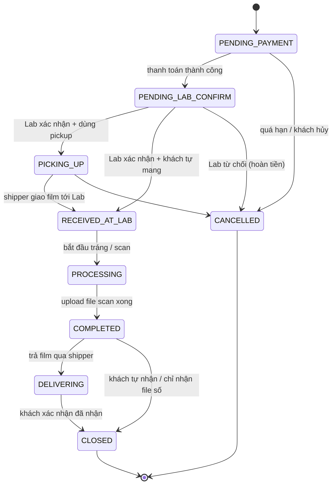

Mỗi lần chuyển trạng thái **bắt buộc** ghi một dòng vào `Order_Status_History` (thực hiện trong cùng transaction với `UPDATE Orders`).

### 9.2. Trạng thái tin Marketplace (`Equipment_Listing.status`)

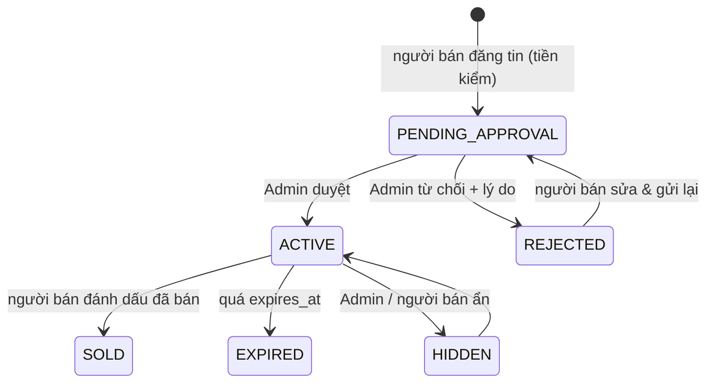

### 9.3. Trạng thái khiếu nại (`Dispute_Complaint.status`)

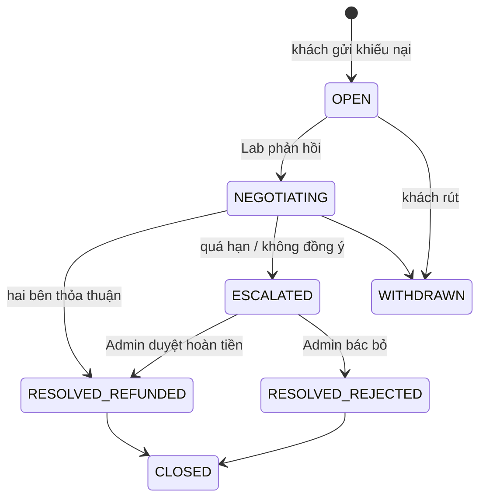

### 9.4. Các quy tắc nghiệp vụ cần kiểm tra ở tầng Backend / Trigger

Các ràng buộc dưới đây **không biểu diễn được bằng `CHECK` đơn bảng**, cần xử lý bằng trigger hoặc service layer:

| # | Quy tắc | Gợi ý hiện thực |
|---|---------|-----------------|
| R1 | Mọi `Order_Item.package_id` của một đơn phải thuộc cùng `Orders.lab_id` | Trigger `AFTER INSERT/UPDATE` trên `Order_Item` |
| R2 | Chỉ Lab có `approval_status = 'APPROVED'` mới nhận được đơn / hiển thị | Kiểm tra ở API + view `vw_ActiveLabs` |
| R3 | Chỉ khách hàng đã đơn `CLOSED` mới được tạo `Review` loại `LAB`; chỉ người mua có `Marketplace_Transaction` `COMPLETED` mới được review `SELLER` | Service layer + trigger |
| R4 | Chỉ user có vai trò `ADMIN` được điền `reviewed_by` / `moderated_by` / `assigned_admin_id` | Trigger kiểm `User_Roles` |
| R5 | Chỉ user có vai trò `LAB_OWNER` mới là `Lab_Profile.owner_id`; `EXPERT` mới là `Event.host_id` | Trigger hoặc kiểm ở API |
| R6 | `Refund.amount` cộng dồn ≤ `Payment.amount` | Trigger trên `Refund` |
| R7 | Số `Event_Registration` có `status IN ('REGISTERED','ATTENDED')` ≤ `Event.capacity` | Transaction + `UPDLOCK` khi đăng ký |
| R8 | Khiếu nại chỉ mở được khi đơn đã `COMPLETED`/`DELIVERING`/`CLOSED` và trong thời hạn quy định | Service layer |
| R9 | Cập nhật `Lab_Profile.avg_rating`/`review_count` khi `Review` thay đổi | Trigger trên `Review` |
| R10 | Mật khẩu chỉ lưu `password_hash`; file scan gốc chỉ lưu `storage_key`, nội dung nằm trên Cloud Storage | Quy ước thiết kế |
| R11 | `Review.status = 'VISIBLE'` mới được tính vào điểm trung bình | Truy vấn / trigger R9 |

---

## 10. Đối chiếu yêu cầu Week 1 ↔ Bảng CSDL

| Yêu cầu trong README Week 1 | Bảng CSDL đáp ứng |
|------------------------------|-------------------|
| 5 vai trò + RBAC với JWT | `Roles`, `User_Roles`, `Users` |
| Quản lý hồ sơ Lab, **Admin duyệt Film Lab** | `Lab_Profile` (`approval_status`, `reviewed_by`) |
| Tìm & so sánh Lab theo vị trí, định dạng film, giá, thời gian, đánh giá | `Lab_Profile`, `Lab_Film_Format`, `Service_Package`, `Review` + index tìm kiếm |
| Lab cấu hình gói dịch vụ & giá | `Service_Package` |
| Đặt dịch vụ tráng / scan / in, yêu cầu pickup & giao nhận | `Orders`, `Order_Item`, `Shipment`, `User_Address` |
| Thanh toán online (VNPay / MoMo) | `Payment` |
| Theo dõi tiến độ real-time, từng công đoạn (nhận, tráng, rửa, sấy, scan, QC) | `Order_Process_Step`, `Order_Status_History`, `Notification`, `Device_Token` |
| Lab upload file scan lên Cloud Storage | `Scan_File` (`storage_key`) |
| **Digital Film Archive** + metadata (loại film, máy ảnh, ống kính, ngày chụp, cách xử lý, thông số scan) | `Digital_Film_Archive`, `Archive_Photo`, `Photo_Metadata`, `Film_Stock`, `Process_Type`, `Tag`, `Photo_Tag` |
| Đối tác vận chuyển (Ahamove / Lalamove) cập nhật trạng thái | `Delivery_Partner_Profile`, `Shipment` (`provider`, `external_order_id`) |
| **Marketplace**: đăng bán/trao đổi, tìm kiếm, **liên hệ SĐT/Zalo**, theo dõi giao dịch, đánh giá người bán | `Equipment_Category`, `Equipment_Listing` (`contact_phone`, `contact_zalo`), `Listing_Image`, `Listing_Favorite`, `Marketplace_Transaction`, `Review` |
| **Tiền kiểm** tin Marketplace (Pending → Active/Rejected) | `Equipment_Listing.status`, `reviewed_by`, `reject_reason` |
| Chuyên gia đăng bài, review; **hậu kiểm** bài viết | `Expert_Profile`, `Post_Article` (`moderated_by`), `Post_Comment`, `Post_Category`, `Post_Tag` |
| Workshop & Photowalk | `Event`, `Event_Registration` |
| **Khiếu nại**: thương lượng → Admin phân xử → hoàn tiền | `Dispute_Complaint`, `Dispute_Message`, `Dispute_Evidence`, `Refund` |
| Admin: khóa tài khoản, cấu hình phí giao dịch, giám sát thanh toán | `Users.status/locked_*`, `System_Config`, `Payment`, `Audit_Log` |
| Báo cáo doanh thu / hiệu quả vận hành Lab | Truy vấn tổng hợp từ `Orders`, `Order_Item`, `Payment` (có thể tạo view `vw_LabRevenue`) |
| Sao lưu & phục hồi, nhất quán dữ liệu multi-tenant | `lab_id` có mặt ở `Service_Package`, `Orders` → cô lập dữ liệu theo Lab; ràng buộc FK/CHECK/UNIQUE đảm bảo nhất quán |

---

*Nhóm 8 · Term Project · Week 2 – Nhóm 1: Thiết kế Cơ sở dữ liệu*
