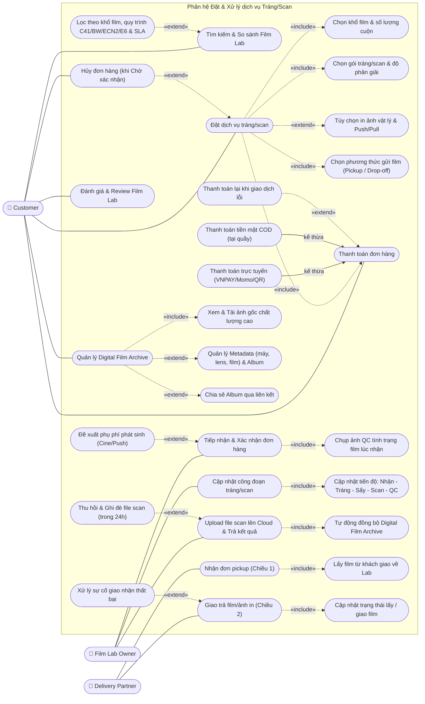
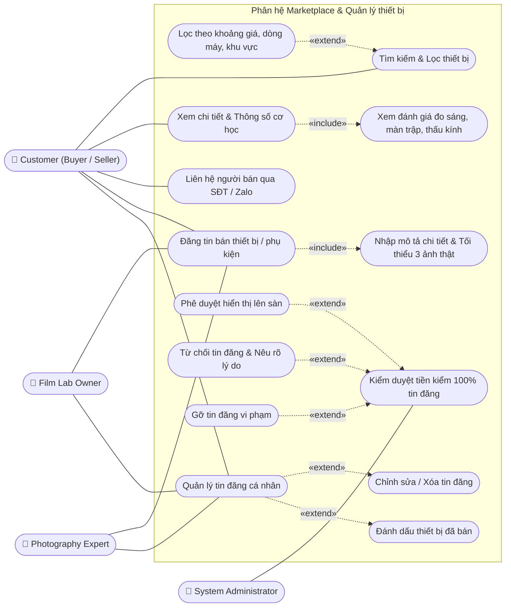
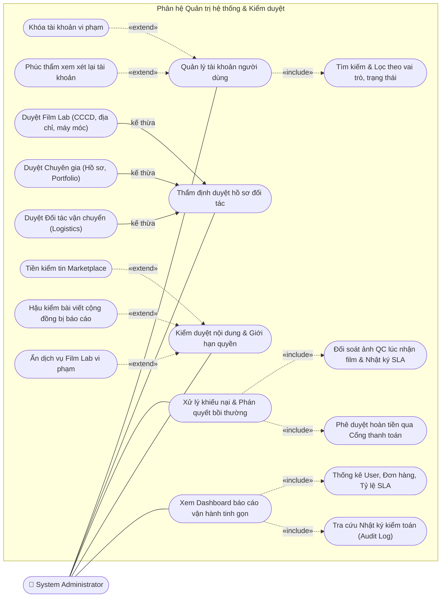
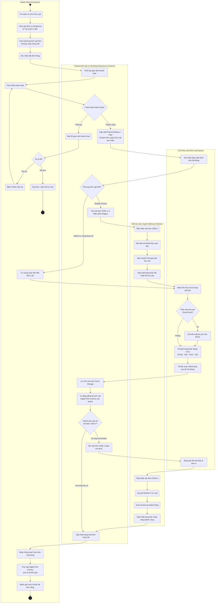
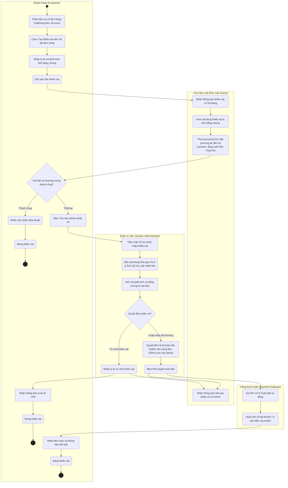

# Week 2 – Sơ đồ chức năng & Nghiệp vụ (Phân tích hệ thống)
> Dự án: Nền tảng kết nối cộng đồng nhiếp ảnh phim & dịch vụ Film Lab (MiniLab) — Nhóm 8

---

## 1. Use Case tổng quát (Overall Use Case Diagram)

Sơ đồ thể hiện toàn bộ ranh giới hệ thống với **5 Actor chính** theo đúng quy định phân quyền hệ thống (RBAC):
* **Customer:** Khách hàng / Nhiếp ảnh gia cá nhân.
* **Film Lab Owner:** Chủ tiệm Film Lab.
* **Photography Expert:** Chuyên gia nhiếp ảnh được cấp huy hiệu chứng nhận.
* **Delivery Partner:** Đối tác vận chuyển (Ahamove, Lalamove hoặc shipper nội bộ).
* **System Administrator:** Quản trị viên vận hành hệ thống.

```mermaid
flowchart LR

    CUS(["👤 Customer"])
    EXP(["👤 Photography Expert"])
    LAB(["👤 Film Lab Owner"])
    DEL(["👤 Delivery Partner"])
    ADM(["👤 System Administrator"])

    subgraph SYS["Hệ thống Quản lý Cộng đồng & Dịch vụ Film Lab"]
        direction LR
        %% Chức năng dùng chung
        AUTH(["Đăng ký / Đăng nhập / Quản lý tài khoản"])
        
        %% Customer
        C1(["Tìm kiếm & So sánh Lab"])
        C2(["Đặt dịch vụ tráng/scan & In ảnh"])
        C3(["Thanh toán đơn hàng & Hủy đơn"])
        C4(["Quản lý Digital Film Archive"])
        C5(["Review & Đánh giá Film Lab"])
        C6(["Gửi khiếu nại & Thương lượng"])
        C7(["Mua bán thiết bị Marketplace"])
        C8(["Tham gia thảo luận cộng đồng & Workshop"])

        %% Film Lab Owner
        L1(["Cấu hình hồ sơ tiệm & bảng giá dịch vụ"])
        L2(["Tiếp nhận đơn & Chụp ảnh QC"])
        L3(["Cập nhật công đoạn tráng/scan"])
        L4(["Upload file scan lên Cloud Archive"])
        L5(["Xem báo cáo vận hành & SLA"])
        L6(["Thương lượng bồi thường khiếu nại"])
        L7(["Đăng bán sản phẩm B2C (Film/Hóa chất)"])

        %% Photography Expert
        E1(["Đăng bài chia sẻ kỹ thuật chuyên môn"])
        E2(["Tổ chức Workshop & Photowalk"])
        E3(["Đăng bán thiết bị kiểm định"])

        %% Delivery Partner
        D1(["Nhận đơn pickup (Chiều 1)"])
        D2(["Giao trả film/ảnh in (Chiều 2)"])
        D3(["Cập nhật trạng thái giao vận"])

        %% System Administrator
        A1(["Thẩm định duyệt đối tác (Lab/Expert/Shipper)"])
        A2(["Tiền kiểm 100% tin Marketplace"])
        A3(["Hậu kiểm bài viết cộng đồng"])
        A4(["Phán quyết khiếu nại & Duyệt hoàn tiền"])
        A5(["Quản trị tài khoản & Khóa vi phạm"])
        A6(["Xem Dashboard vận hành & Audit Log"])
    end

    CUS --- AUTH & C1 & C2 & C3 & C4 & C5 & C6 & C7 & C8
    LAB --- AUTH & L1 & L2 & L3 & L4 & L5 & L6 & L7
    EXP --- AUTH & E1 & E2 & E3
    DEL --- AUTH & D1 & D2 & D3
    ADM --- AUTH & A1 & A2 & A3 & A4 & A5 & A6
```

---

## 2. Use Case phân rã – Đặt & xử lý dịch vụ tráng/scan

Chi tiết hóa quy trình dịch vụ cốt lõi: từ tìm kiếm tiệm, cấu hình đơn hàng (gói tráng, scan hi-res, in ảnh, chọn hình thức giao nhận), quy trình xác nhận kèm ảnh QC của Lab, xử lý phụ phí phát sinh, hủy đơn hợp lệ, lưu trữ Digital Film Archive cho đến đánh giá Lab.

---

## 3. Use Case phân rã – Marketplace & Quản lý thiết bị

Đặc tả chi tiết sàn trao đổi thiết bị máy ảnh phim (C2C và B2C), cơ chế tiền kiểm 100% của Admin, kiểm tra thông số cơ học và liên hệ trực tiếp người bán.

> **Phân hệ bổ trợ: Chuyên gia & Hoạt động Cộng đồng (Community & Expert)**  
> Để đảm bảo tính phân tách hệ thống sạch sẽ, các nghiệp vụ thảo luận và sự kiện của Chuyên gia được chuẩn hóa như sau:
> * **Photography Expert / Customer:** Đăng bài chia sẻ kỹ thuật kèm ảnh phim («include» thông số chụp), Tương tác (Like, Follow tác giả), Báo cáo vi phạm nội dung.
> * **Tổ chức sự kiện:** Expert khởi tạo Workshop & Photowalk («include» quản lý danh sách đăng ký); Customer tham gia đăng ký và thảo luận.
> * **Admin:** Hậu kiểm bài viết bị người dùng báo cáo (Ẩn / Gỡ bài) và Thẩm định cấp huy hiệu Chuyên gia (Verified Badge).

---

## 4. Use Case phân rã – Quản trị hệ thống & Kiểm duyệt

Đặc tả các quyền hạn và trách nhiệm của Quản trị viên (System Administrator): quản lý tài khoản (RBAC), thẩm định 3 nhóm đối tác, xử lý tranh chấp khiếu nại, giới hạn quyền can thiệp và bảng điều khiển Dashboard báo cáo vận hành kèm Audit Log.

---

## 5. Activity Diagram – Quy trình đơn hàng tráng/scan

Sơ đồ phân làn (Swimlane Diagram - 4 làn) chuẩn hóa theo đúng yêu cầu đề bài:
1. **Khách hàng (Customer)**
2. **Cổng thanh toán & Hệ thống (Payment & System Platform)**
3. **Đối tác vận chuyển (Delivery Partner)**
4. **Chủ Film Lab (Film Lab Owner)**

Sơ đồ xử lý đầy đủ các nhánh nghiệp vụ thực tế:
* Thanh toán thất bại $\rightarrow$ Cho phép khách bấm **"Thanh toán lại"** hoặc tự hủy sau 24h.
* Giao nhận film 2 chiều: Chiều 1 lấy film (Shipper Pickup hoặc Khách tự mang Drop-off); Chiều 2 giao trả vật lý (âm bản / ảnh in) nếu khách đăng ký.
* Xử lý phụ phí phát sinh (Cine ECN-2, film outdate Push sáng).
* Tự động lưu Cloud Storage và đồng bộ ảnh vào Digital Film Archive.

---

## 6. Activity Diagram – Quy trình khiếu nại & hoàn tiền

Quy trình chuẩn hóa 3 bước giải quyết tranh chấp:
1. **Bước 1 (Khách gửi khiếu nại):** Khách hàng phát hiện sự cố (film hỏng, trầy xước, scan mờ), tạo khiếu nại kèm hình ảnh bằng chứng.
2. **Bước 2 (Hai bên tự thương lượng):** Hệ thống thông báo cho Film Lab để chủ động trao đổi giải pháp đền bù (voucher, tặng cuộn film mới, chụp đền). Nếu khách đồng thuận $\rightarrow$ Đóng khiếu nại.
3. **Bước 3 (Admin can thiệp & Hoàn tiền tự động):** Nếu thương lượng bất thành, Admin vào cuộc đối soát ảnh QC lúc nhận film và nhật ký SLA. Admin ra phán quyết tỷ lệ hoàn tiền $\rightarrow$ Kích hoạt Cổng thanh toán hoàn tiền tự động về tài khoản/ví của khách hàng $\rightarrow$ Cập nhật thông báo cho cả Khách hàng và Film Lab.

