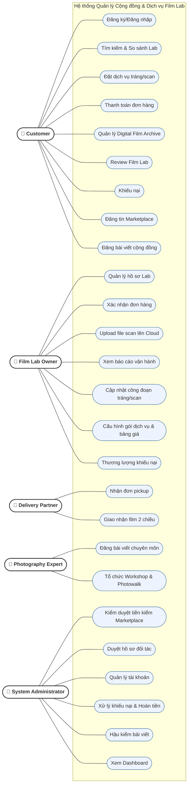
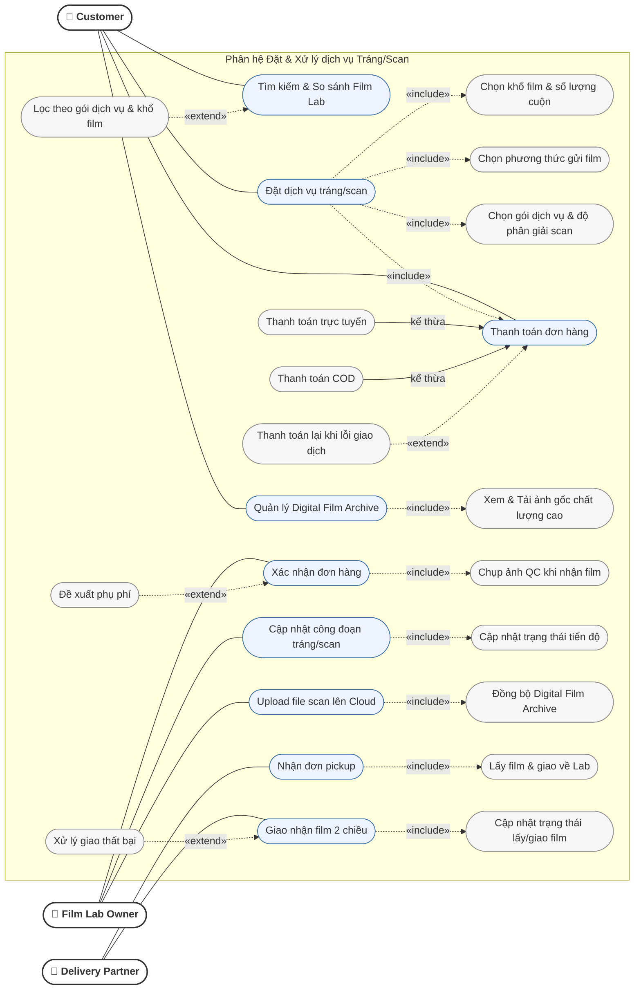
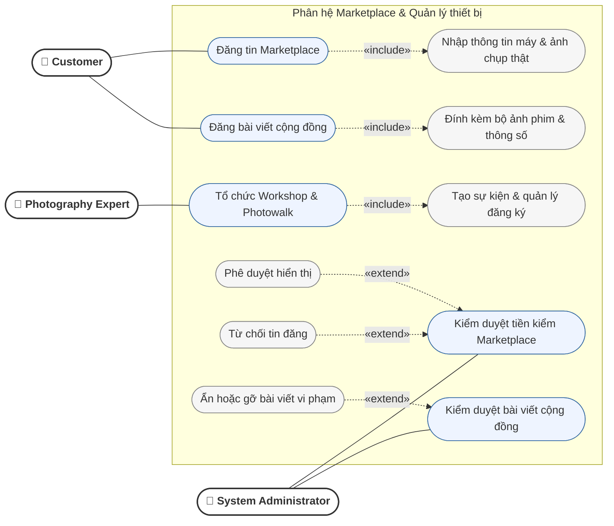
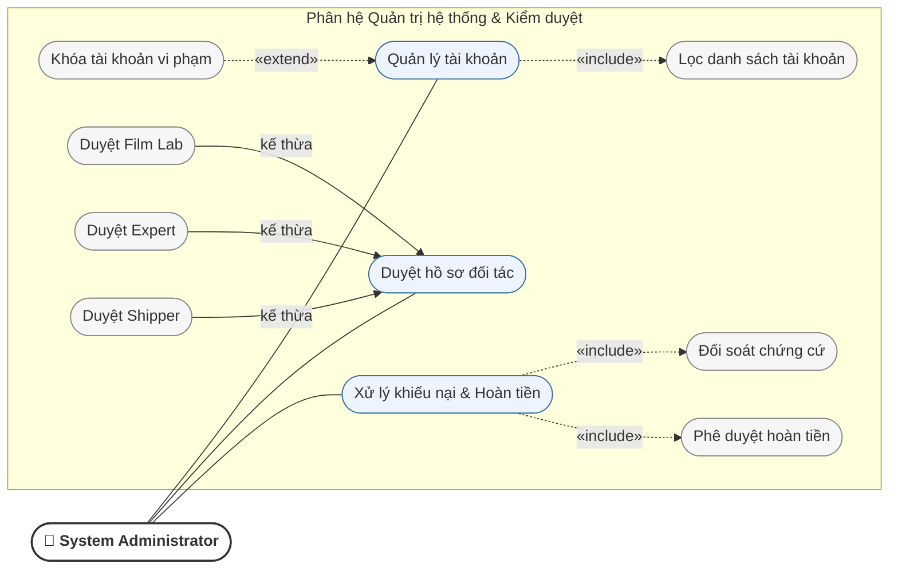

# Week 2 – Sơ đồ chức năng & nghiệp vụ

---

## 1. Use Case tổng quát

---

## 2. Use Case phân rã – Đặt & xử lý dịch vụ tráng/scan

---

## 3. Use Case phân rã – Marketplace & Quản lý thiết bị

---

## 4. Use Case phân rã – Quản trị hệ thống & Kiểm duyệt

---

## 5. Activity Diagram – Quy trình đơn hàng tráng/scan

```mermaid
flowchart TB
    classDef cus fill:#dbeafe,stroke:#1d4ed8,color:#111
    classDef pay fill:#fef3c7,stroke:#b45309,color:#111
    classDef del fill:#dcfce7,stroke:#15803d,color:#111
    classDef lab fill:#fce7f3,stroke:#be185d,color:#111
    classDef dec fill:#fff,stroke:#111,color:#111
    classDef term fill:#222,stroke:#222,color:#fff

    subgraph LEG["Chú thích (làn = màu)"]
        direction LR
        K1("Customer"):::cus
        K2("Payment Gateway"):::pay
        K3("Delivery Partner"):::del
        K4("Film Lab Owner"):::lab
    end

    S((" ")):::term
    C1("Tìm kiếm & chọn Film Lab"):::cus
    C2("Chọn gói dịch vụ<br/>(Khổ film, quy trình, độ phân giải)"):::cus
    C3("Chọn phương thức gửi film"):::cus
    C4("Xác nhận đặt đơn hàng"):::cus
    P1("Khởi tạo giao dịch thanh toán"):::pay
    C5("Thực hiện thanh toán trực tuyến / COD"):::cus
    P2{"Thanh toán thành công?"}:::dec
    P3("Trả về báo lỗi giao dịch"):::pay
    P4("Cập nhật trạng thái đơn<br/>(thanh toán thất bại)"):::pay
    E2(((" "))):::term
    P5("Cập nhật PaymentStatus"):::pay
    P6("Tạo vận đơn và gửi thông báo pickup"):::pay
    D1("Tiếp nhận vận đơn"):::del
    D2("Đến địa chỉ Khách hàng để lấy cuộn film"):::del
    D3("Vận chuyển cuộn film đến Film Lab"):::del
    D4("Cập nhật trạng thái<br/>Đã giao film cho Lab"):::del
    L1("Tiếp nhận film &<br/>Chụp ảnh QC tình trạng cuộn film"):::lab
    L2("Xác nhận đơn trên hệ thống"):::lab
    L3("Tiến hành tráng & scan film"):::lab
    L4("Tải file scan lên hệ thống"):::lab
    P7("Lưu file scan lên Cloud Storage"):::pay
    P8("Đồng bộ ảnh vào Digital Film Archive<br/>của Khách hàng"):::pay
    P9("Cập nhật trạng thái đơn"):::pay
    C6("Nhận thông báo Push trên ứng dụng"):::cus
    C7("Truy cập Digital Film Archive<br/>xem & tải ảnh gốc"):::cus
    C8("Đánh giá Lab & Xác nhận hoàn tất"):::cus
    E1(((" "))):::term

    LEG ~~~ S
    S --> C1 --> C2 --> C3 --> C4 --> P1 --> C5 --> P2
    P2 -->|Thất bại| P3 --> P4 --> E2
    P2 -->|Thành công| P5 --> P6 --> D1 --> D2 --> D3 --> D4
    D4 --> L1 --> L2 --> L3 --> L4 --> P7 --> P8 --> P9
    P9 --> C6 --> C7 --> C8 --> E1
```

---

## 6. Activity Diagram – Quy trình khiếu nại & hoàn tiền

```mermaid
flowchart TB
    classDef cus fill:#dbeafe,stroke:#1d4ed8,color:#111
    classDef lab fill:#fce7f3,stroke:#be185d,color:#111
    classDef adm fill:#ede9fe,stroke:#6d28d9,color:#111
    classDef pay fill:#fef3c7,stroke:#b45309,color:#111
    classDef dec fill:#fff,stroke:#111,color:#111
    classDef term fill:#222,stroke:#222,color:#fff

    subgraph LEG["Chú thích (làn = màu)"]
        direction LR
        K1("Customer"):::cus
        K2("Film Lab Owner"):::lab
        K3("System Administrator"):::adm
        K4("Payment Gateway"):::pay
    end

    S((" ")):::term
    C1("Phát hiện sự cố đơn hàng"):::cus
    C2("Chọn Tạo khiếu nại<br/>trên chi tiết đơn hàng"):::cus
    C3("Nhập lý do và đính kèm ảnh bằng chứng"):::cus
    C4("Gửi yêu cầu khiếu nại"):::cus
    L1("Nhận thông báo khiếu nại từ hệ thống"):::lab
    L2("Xem nội dung khiếu nại và hình ảnh bằng chứng"):::lab
    L3("Thương lượng trực tiếp<br/>phương án đền bù với khách"):::lab
    C5{"Hai bên tự thương lượng<br/>thành công?"}:::dec
    C6("Nhấn Xác nhận thỏa thuận"):::cus
    C7("Đóng khiếu nại"):::cus
    E1(((" "))):::term
    C8("Nhấn Yêu cầu Admin phân xử"):::cus
    A1("Tiếp nhận hồ sơ tranh chấp khiếu nại"):::adm
    A2("Đối soát nhật ký đơn hàng<br/>và ảnh QC lúc Lab nhận film"):::adm
    A3("Xem xét bằng chứng từ hai bên"):::adm
    A4{"Quyết định phân xử?"}:::dec
    A5("Nhập lý do từ chối"):::adm
    C9("Nhận thông báo lý do từ chối"):::cus
    C10("Đóng khiếu nại"):::cus
    E2(((" "))):::term
    A6("Quyết định tỷ lệ hoàn tiền"):::adm
    A7("Bấm Phê duyệt hoàn tiền"):::adm
    P1("Gọi API xử lý hoàn tiền tự động"):::pay
    P2("Hoàn tiền về tài khoản ban đầu của khách"):::pay
    C11("Nhận tiền hoàn và thông báo kết quả"):::cus
    C12("Đóng khiếu nại"):::cus
    E3(((" "))):::term

    LEG ~~~ S
    S --> C1 --> C2 --> C3 --> C4 --> L1 --> L2 --> L3 --> C5
    C5 -->|Thành công| C6 --> C7 --> E1
    C5 -->|Thất bại| C8 --> A1 --> A2 --> A3 --> A4
    A4 -->|Từ chối khiếu nại| A5 --> C9 --> C10 --> E2
    A4 -->|Chấp nhận| A6 --> A7 --> P1 --> P2 --> C11 --> C12 --> E3
```

