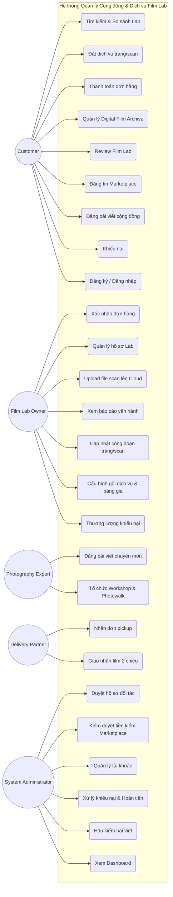
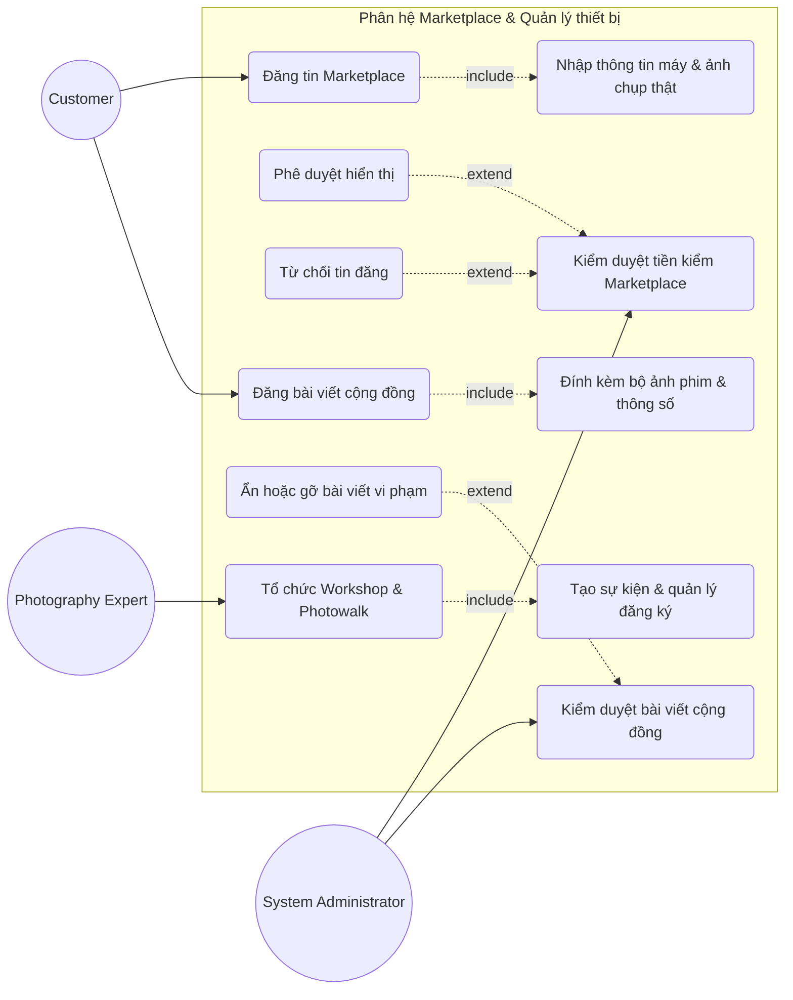
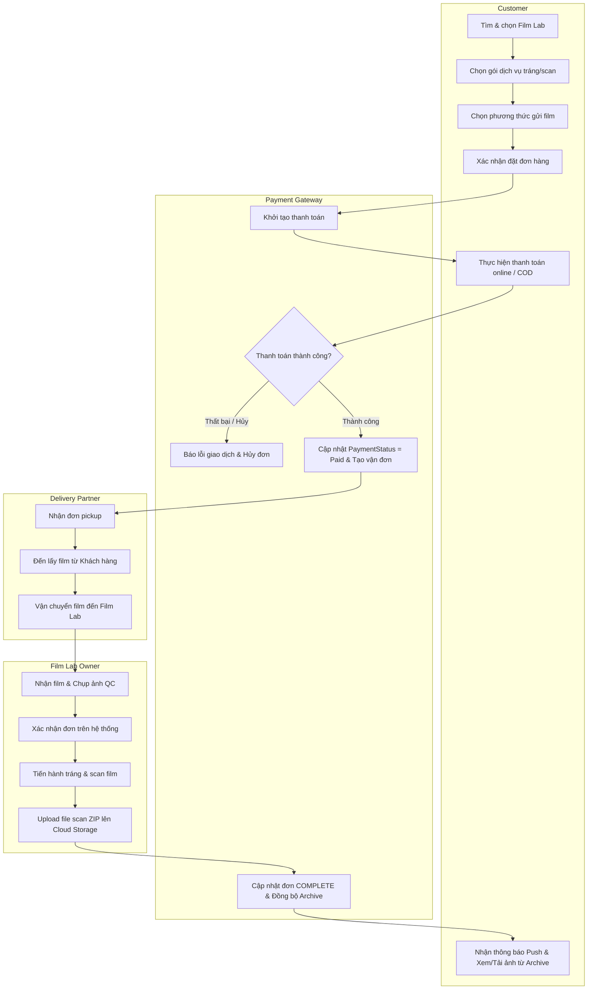
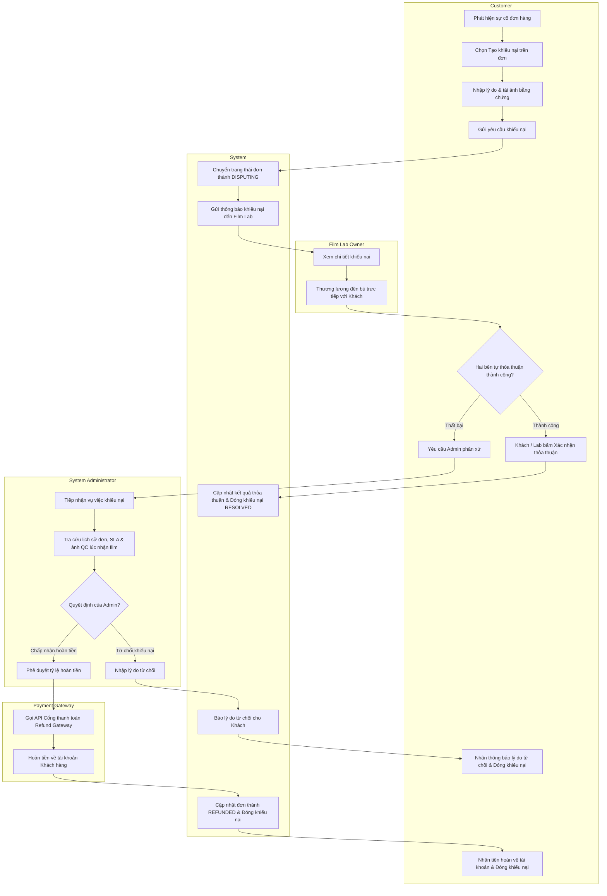

# SƠ ĐỒ CHỨC NĂNG VÀ NGHIỆP VỤ (WEEK 2)

---

## 1. Sơ đồ Use Case Tổng quát (Overall Use Case Diagram)



---

## 2. Các Sơ đồ Use Case Phân rã (Detailed Use Case Diagrams)

### 2.1. Phân hệ Đặt & Xử lý dịch vụ tráng/scan

```mermaid
graph LR
    Customer((Customer))
    Lab((Film Lab Owner))
    Shipper((Delivery Partner))

    subgraph Subsystem1 ["Phân hệ Đặt & Xử lý dịch vụ Tráng/Scan"]
        UC_Search(Tìm kiếm & So sánh Film Lab)
        UC_Filter(Lọc theo gói dịch vụ & khổ film)
        UC_Order(Đặt dịch vụ tráng/scan)
        UC_Opt1(Chọn khổ film & số lượng cuộn)
        UC_Opt2(Chọn phương thức gửi film)
        UC_Opt3(Chọn gói dịch vụ & độ phân giải scan)
        UC_Pay(Thanh toán đơn hàng)
        UC_PayOnline(Thanh toán trực tuyến)
        UC_PayCOD(Thanh toán COD)
        UC_PayRetry(Thanh toán lại khi lỗi giao dịch)
        UC_Archive(Quản lý Digital Film Archive)
        UC_Download(Xem & Tải ảnh gốc chất lượng cao)

        UC_Confirm(Xác nhận đơn hàng)
        UC_QC(Chụp ảnh QC khi nhận film)
        UC_Fee(Đề xuất phụ phí)
        UC_UpdateProcess(Cập nhật công đoạn tráng/scan)
        UC_UpdateStatus(Cập nhật trạng thái tiến độ)
        UC_Upload(Upload file scan lên Cloud)
        UC_Sync(Đồng bộ Digital Film Archive)

        UC_Pickup(Nhận đơn pickup)
        UC_BringLab(Lấy film & giao về Lab)
        UC_Delivery(Giao nhận film 2 chiều)
        UC_ShipStatus(Cập nhật trạng thái lấy/giao film)
        UC_ShipFail(Xử lý giao thất bại)
    end

    Customer --> UC_Search
    UC_Search -.->|extend| UC_Filter
    Customer --> UC_Order
    UC_Order -.->|include| UC_Opt1
    UC_Order -.->|include| UC_Opt2
    UC_Order -.->|include| UC_Opt3
    UC_Order -.->|include| UC_Pay
    UC_PayOnline --|> UC_Pay
    UC_PayCOD --|> UC_Pay
    UC_PayRetry -.->|extend| UC_Pay
    Customer --> UC_Archive
    UC_Archive -.->|include| UC_Download

    Lab --> UC_Confirm
    UC_Confirm -.->|include| UC_QC
    UC_Fee -.->|extend| UC_Confirm
    Lab --> UC_UpdateProcess
    UC_UpdateProcess -.->|include| UC_UpdateStatus
    Lab --> UC_Upload
    UC_Upload -.->|include| UC_Sync

    Shipper --> UC_Pickup
    UC_Pickup -.->|include| UC_BringLab
    Shipper --> UC_Delivery
    UC_Delivery -.->|include| UC_ShipStatus
    UC_ShipFail -.->|extend| UC_Delivery
```

### 2.2. Phân hệ Marketplace & Quản lý thiết bị



### 2.3. Phân hệ Quản trị hệ thống & Kiểm duyệt

```mermaid
graph LR
    Admin((System Administrator))

    subgraph Subsystem3 ["Phân hệ Quản trị hệ thống & Kiểm duyệt"]
        UC_UserMgmt(Quản lý tài khoản)
        UC_FilterUser(Lọc danh sách tài khoản)
        UC_LockUser(Khóa tài khoản vi phạm)

        UC_ApprovePartner(Duyệt hồ sơ đối tác)
        UC_ApproveLab(Duyệt Film Lab)
        UC_ApproveExpert(Duyệt Expert)
        UC_ApproveShipper(Duyệt Shipper)

        UC_Dispute(Xử lý khiếu nại & Hoàn tiền)
        UC_Proof(Đối soát chứng cứ)
        UC_Refund(Phê duyệt hoàn tiền)
    end

    Admin --> UC_UserMgmt
    UC_UserMgmt -.->|include| UC_FilterUser
    UC_LockUser -.->|extend| UC_UserMgmt

    Admin --> UC_ApprovePartner
    UC_ApproveLab --|> UC_ApprovePartner
    UC_ApproveExpert --|> UC_ApprovePartner
    UC_ApproveShipper --|> UC_ApprovePartner

    Admin --> UC_Dispute
    UC_Dispute -.->|include| UC_Proof
    UC_Dispute -.->|include| UC_Refund
```

---

## 3. Sơ đồ Hoạt động (Activity Diagrams)

### 3.1. Quy trình đơn hàng tráng/scan (Swimlane Diagram - 4 làn)



### 3.2. Quy trình khiếu nại & hoàn tiền


