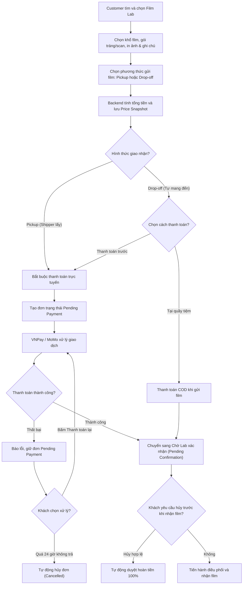
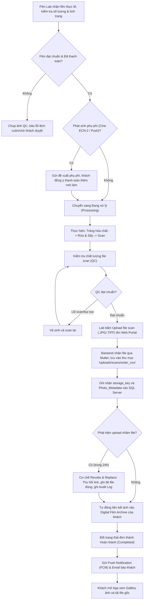
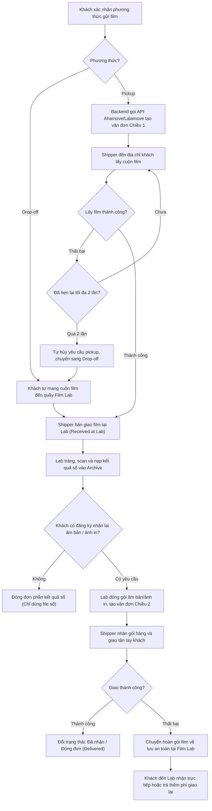
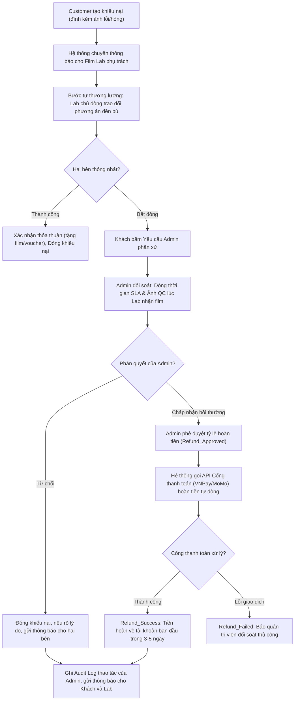

# WEEK 2 – SƠ ĐỒ KIẾN TRÚC & TRIỂN KHAI

> **Dự án:** MiniLab – Nền tảng kết nối cộng đồng nhiếp ảnh phim và các Film Lab  
> **Nhóm thực hiện:** Nhóm 8  
> **Phiên bản:** 2.0 (Đồng bộ hóa nghiệp vụ Week 1 & giải pháp lưu trữ Archive thực tế)

---

## 1. Mục tiêu và phạm vi

Tài liệu này đặc tả thiết kế kiến trúc hệ thống (System Architecture) và sơ đồ triển khai thực tế (Deployment Diagram) của nền tảng MiniLab. Hệ thống giải quyết trọn vẹn các yêu cầu nghiệp vụ Week 1, đồng thời làm rõ phương thức lưu trữ kho ảnh số **Digital Film Archive** một cách khả thi, tối ưu cho đồ án môn học.

| Tầng kiến trúc | Thành phần theo hướng dẫn Week 2 | Định hướng triển khai thực tế của đồ án |
| --- | --- | --- |
| **Client Layer** | Flutter Mobile App (Khách hàng) & Flutter Web (Film Lab, Admin) | Flutter Mobile (iOS/Android); Flutter Web (Lab Portal, Admin Dashboard) |
| **API / Backend Layer** | Node.js (Express), JWT, RBAC | Node.js + Express REST API, xác thực JWT, phân quyền RBAC 5 vai trò |
| **Data & Storage Layer** | SQL Server và Lưu trữ ảnh scan gốc (Storage) | **Database:** SQL Server (dữ liệu quan hệ, metadata ảnh);<br/>**File Storage:** Lưu trữ file scan gốc (.JPG, .TIFF) trên máy chủ (Local File System qua Multer & Express Static), lưu đường dẫn tương đối (`storage_key`) trong SQL Server |
| **External Services** | VNPay/MoMo; Ahamove/Lalamove | VNPay/MoMo (Thanh toán & Hoàn tiền); Ahamove/Lalamove (Logistics); Firebase Cloud Messaging (FCM) & SMTP Email (Thông báo) |

---

## 2. Sơ đồ kiến trúc hệ thống (System Architecture)

### 2.1 Sơ đồ kiến trúc phân tầng (4-Tier Architecture)

```mermaid
flowchart TB
    subgraph CLIENT["1. Client Layer (Giao diện người dùng)"]
        direction LR
        MOB["📱 Flutter Mobile App<br/>(Khách hàng, Shipper, Chuyên gia)"]
        WEB["💻 Flutter Web Portal<br/>(Chủ Film Lab, Quản trị viên Admin)"]
    end

    subgraph GATEWAY["Cổng bảo vệ & Điều hướng (Web Server)"]
        NGX["🛡️ Nginx Reverse Proxy / HTTPS Gateway<br/>(SSL Termination, Rate Limiting, Static Routing)"]
    end

    subgraph BACKEND["2. API / Backend Layer (Node.js + Express)"]
        direction TB
        AUTH_M["Module Xác thực & RBAC (JWT)"]
        ORDER_M["Module Đơn hàng & Snapshot Giá"]
        LAB_M["Module Quản lý Lab & Quy trình Tráng/Scan"]
        ARCH_M["Module Quản lý Digital Film Archive & Metadata"]
        SHIP_M["Module Tích hợp Giao vận 2 chiều"]
        DISP_M["Module Khiếu nại, Hoàn tiền & Audit Log"]
        MKT_M["Module Sàn Marketplace (Tiền kiểm 100%)"]
    end

    subgraph DATA_STORAGE["3. Data & Storage Layer (Dữ liệu & Lưu trữ tệp số)"]
        direction LR
        subgraph DB_BOX["Database Server (Quan hệ)"]
            SQL[("🗄️ SQL Server Database<br/>- Users, Lab_Profile, Orders<br/>- Digital_Film_Archive, Photo_Metadata<br/>- Refund_Transactions, Audit_Log")]
        end
        subgraph FILE_BOX["File Storage (Tệp số)"]
            FS[("📁 Local File Storage (Server Directory)<br/>- /uploads/scans/order_xxx/ (File scan gốc)<br/>- /uploads/thumbnails/ (Ảnh nén xem trước)<br/>- /uploads/marketplace/ (Ảnh thiết bị)")]
        end
    end

    subgraph EXT["4. External Services Layer (Dịch vụ tích hợp bên ngoài)"]
        direction LR
        PAY["💳 Cổng thanh toán<br/>(VNPay / MoMo)"]
        SHIP["🚚 Đơn vị vận chuyển<br/>(Ahamove / Lalamove)"]
        NOTIF["🔔 Push Notification<br/>(Firebase Cloud Messaging - FCM)"]
        MAIL["📧 Transactional Email<br/>(SMTP / Nodemailer)"]
    end

    CLIENT -->|HTTPS:443 REST API| NGX
    NGX -->|Proxy Pass HTTP:3000| BACKEND
    BACKEND -->|TDS Protocol / TCP:1433| SQL
    BACKEND -->|File I/O (Multer / File System)| FS
    BACKEND -->|HTTPS REST API / Webhooks| EXT
    NGX -.->|Serve ảnh Archive có kiểm tra token| FS
```

### 2.2 Chi tiết các tầng thành phần

#### (1) Client Layer
* **Flutter Mobile App:** Ứng dụng di động dành cho Khách hàng (Customer) để tìm kiếm Lab, đặt dịch vụ tráng/scan, thanh toán, theo dõi tiến độ đơn thời gian thực, quản lý kho ảnh số (Digital Film Archive), đăng tin mua bán máy ảnh và tương tác bài viết cộng đồng. Đồng thời hỗ trợ giao diện gọn nhẹ cho Đối tác vận chuyển (Delivery Partner) nhận đơn lấy film khi đi đường.
* **Flutter Web Portal:** Giao diện web dành cho Chủ Film Lab (Film Lab Owner) cấu hình bảng giá, quản lý đơn hàng, cập nhật công đoạn (Nhận - Tráng - Scan - QC), upload file scan hàng loạt; và dành cho Quản trị viên (System Administrator) duyệt hồ sơ đối tác, tiền kiểm tin bán máy, xem Dashboard vận hành và phân xử khiếu nại.

#### (2) API / Backend Layer
* Nền tảng xây dựng bằng **Node.js + Express** theo mô hình RESTful API.
* **Xác thực & Phân quyền:** Sử dụng JSON Web Token (JWT) kết hợp ma trận phân quyền RBAC chặt chẽ cho 5 vai trò.
* **Xử lý tệp tin (File Handling):** Tích hợp thư viện `multer` để tiếp nhận các tệp ảnh scan (.JPG, .TIFF), ảnh QC tình trạng film và ảnh kiểm tra máy Marketplace.

#### (3) Data & Storage Layer – Bản chất của Digital Film Archive
> [!IMPORTANT]
> **Giải pháp lưu trữ Archive của hệ thống MiniLab:**
> Kho lưu trữ số Digital Film Archive **KHÔNG** lưu dữ liệu nhị phân (BLOB) vào SQL Server (tránh phình to DB) và **KHÔNG** dùng link Google Drive (để đảm bảo tính tự động hóa và bảo mật riêng tư).  
> Thay vào đó, hệ thống áp dụng mô hình chuẩn: **"Metadata lưu trong SQL Server – Tệp ảnh lưu trong File Storage của Server"**:
* **SQL Server Database:** Quản lý cấu trúc dữ liệu quan hệ gồm 44 bảng. Riêng phân hệ Archive gồm các bảng: `Digital_Film_Archive` (đại diện cuộn film), `Scan_File` (file scan vật lý), `Archive_Photo` (từng bức ảnh) và `Photo_Metadata` (khẩu độ, tốc độ, ISO, loại film, máy ảnh, ống kính). Cột **`storage_key`** trong database chỉ lưu đường dẫn tương đối (VD: `/uploads/scans/order_101/roll_01_001.jpg`).
* **Local File Storage:** Thư mục tệp tin được tổ chức khoa học ngay trên máy chủ backend (`public/uploads/scans/{order_id}/`). Khi cần nâng cấp lên Cloud Storage (AWS S3 hay Google Cloud) trong tương lai, hệ thống chỉ cần thay đổi cấu hình adapter lưu trữ mà không phải sửa đổi cấu trúc CSDL hay logic nghiệp vụ.
* **Bảo vệ quyền riêng tư:** Thư mục ảnh Archive mặc định ở chế độ riêng tư (Private). API tải/xem ảnh bắt buộc kiểm tra JWT để đảm bảo chỉ chính chủ đơn hàng mới có thể truy cập ảnh, Quản trị viên chỉ được mở xem khi có tranh chấp khiếu nại chính thức.

#### (4) External Services Layer
* **VNPay / MoMo:** Cung cấp cổng thanh toán trực tuyến (QR code, ví điện tử, thẻ ATM/Visa), nhận callback/IPN cập nhật trạng thái đơn và gọi API hoàn tiền tự động khi có phán quyết tranh chấp.
* **Ahamove / Lalamove:** Tích hợp API tạo vận đơn, ước tính phí giao nhận, điều phối shipper lấy film (Chiều 1) và giao trả âm bản/ảnh in (Chiều 2).
* **Firebase Cloud Messaging (FCM):** Dịch vụ gửi Push Notification thời gian thực về ứng dụng di động của khách khi đơn hàng chuyển trạng thái hoặc khi có kết quả scan.
* **SMTP / Nodemailer:** Dịch vụ gửi email tự động (mã OTP đặt lại mật khẩu trong 15 phút, email thông báo đính chính khi có thu hồi file scan nhầm).

---

## 3. Sơ đồ triển khai hạ tầng thực tế (Physical Deployment Diagram)

Sơ đồ mô tả cách các thành phần phần mềm được phân bổ trên các máy chủ và thiết bị phần cứng thực tế, phân định rõ vùng mạng công cộng (DMZ) và vùng mạng nội bộ (Private Network):

```mermaid
flowchart TB
    classDef client fill:#e1f5fe,stroke:#0288d1,color:#01579b
    classDef dmz fill:#fff3e0,stroke:#f57c00,color:#e65100
    classDef internal fill:#e8f8f5,stroke:#26a69a,color:#004d40
    classDef external fill:#f3e5f5,stroke:#8e24aa,color:#4a148c

    subgraph CLIENT_ZONE["1. Thiết bị người dùng (Client Devices)"]
        C1["📱 Smartphone (Android / iOS)<br/>Flutter Mobile App"]:::client
        C2["💻 Desktop / Laptop (Web Browser)<br/>Flutter Web Application"]:::client
    end

    subgraph DMZ_ZONE["2. Vùng mạng công cộng (Public Subnet / DMZ)"]
        WEB_SRV["🌐 Web Server & Reverse Proxy Node<br/>Nginx (Linux Ubuntu Server)<br/>- Cổng tiếp nhận: 443 (HTTPS), 80 (HTTP)<br/>- Chức năng: SSL Termination, Reverse Proxy, Static Caching"]:::dmz
    end

    subgraph INTERNAL_ZONE["3. Vùng mạng nội bộ (Private Subnet / Server App)"]
        subgraph APP_NODE["Application Server Node (Host Server)"]
            APP_SRV["⚙️ Backend Runtime<br/>Node.js + Express REST API<br/>- Quản lý: PM2 / Docker Container<br/>- Cổng nội bộ: 3000 (HTTP)"]:::internal
            
            LOCAL_STORAGE[("📁 Thư mục lưu trữ tệp (File Storage)<br/>/var/www/minilab/uploads/<br/>- scans/ (Ảnh tráng gốc)<br/>- avatars/ & marketplace/")]:::internal
        end

        subgraph DB_NODE["Database Server Node"]
            DB_SRV[("🗄️ SQL Server Database Node<br/>Microsoft SQL Server 2019/2022<br/>- Cổng nội bộ: 1433 (TCP)<br/>- Ràng buộc 3NF, Bảng Audit Log & Metadata")]:::internal
        end
    end

    subgraph EXT_ZONE["4. Dịch vụ đối tác bên thứ ba (External Services)"]
        VNPAY["💳 VNPay / MoMo API<br/>(Thanh toán & Hoàn tiền)"]:::external
        AHAMOVE["🚚 Ahamove / Lalamove API<br/>(Điều phối giao vận 2 chiều)"]:::external
        FCM["🔔 Firebase Cloud Messaging (FCM)<br/>(Push Notification thời gian thực)"]:::external
        EMAIL_SVC["📧 SMTP Email Server<br/>(Gửi OTP & Thông báo tài khoản)"]:::external
    end

    C1 & C2 -->|HTTPS : 443| WEB_SRV
    WEB_SRV -->|Proxy Pass HTTP : 3000| APP_SRV
    APP_SRV -->|File I/O (Lưu/Đọc ảnh)| LOCAL_STORAGE
    APP_SRV -->|TDS / TCP : 1433| DB_SRV
    APP_SRV -->|HTTPS REST API / Webhooks : 443| EXT_ZONE
```

### Bảng phân công thành phần triển khai

| Node / Thành phần | Môi trường / Công nghệ | Vai trò & Cổng kết nối (Port) |
| --- | --- | --- |
| **Client Devices** | iOS / Android / Web Browsers | Chạy Flutter App/Web; giao tiếp qua giao thức bảo mật `HTTPS (Port 443)`. |
| **Web Server Node** | Nginx trên Linux Server | Đứng ở vùng DMZ; xử lý chứng chỉ SSL, chặn tấn công cơ bản, chuyển tiếp request API về cổng `3000` của Node.js. |
| **Backend App Server** | Node.js (v18+) + Express | Chạy API xử lý nghiệp vụ, quản lý phiên JWT, tiếp nhận upload file qua `multer`, ghi file vào ổ cứng máy chủ. |
| **File Storage** | Phân vùng ổ cứng máy chủ (`/uploads/`) | Chứa các file ảnh scan gốc do Lab upload; quản lý quyền truy cập qua middleware bảo mật của Backend. |
| **Database Server** | Microsoft SQL Server (2019/2022) | Đặt trong vùng mạng nội bộ (Private Subnet), chỉ lắng nghe cổng `1433 (TCP)` từ App Server, không mở ra Internet. |
| **External Partners** | API bên thứ ba qua Internet | Nhận lệnh thanh toán, vận chuyển; gửi webhook callback IPN về Backend qua HTTPS. |

---

## 4. Luồng nghiệp vụ chi tiết đối chiếu với kiến trúc

### 4.1 Đặt dịch vụ và thanh toán trực tuyến



---

### 4.2 Lab xử lý, upload scan và đồng bộ Archive (Mô hình Local Storage)



---

### 4.3 Điều phối vận chuyển film hai chiều



---

### 4.4 Khiếu nại và hoàn tiền (3 bước chuẩn hóa)



---

## 5. Chính sách bảo mật và Quyền hạn dữ liệu (RBAC)

1. **Xác thực JWT & RBAC 5 vai trò:** Mọi request (trừ API công khai như tìm kiếm Lab, xem bảng giá) đều phải đính kèm Header `Authorization: Bearer <token>`.
2. **Bảo mật thư mục Digital Film Archive:**
   * Không bật tính năng Directory Browsing trên thư mục `/uploads/scans/`.
   * Các tệp ảnh được quản lý qua endpoint bảo vệ (ví dụ: `GET /api/archive/photos/:id/view`). Backend kiểm tra `owner_id` của bức ảnh trong SQL Server trùng khớp với `user_id` trong JWT token của người gửi yêu cầu.
   * Admin tuyệt đối không có quyền mở ảnh riêng tư của khách, trừ khi đơn hàng phát sinh khiếu nại chính thức và hệ thống ghi lại nhật ký xem ảnh vào **Audit Log**.
3. **Bảo toàn dữ liệu giá (Price Snapshotting):** Giá dịch vụ và phụ phí được ghi cứng vào `Order_Items` tại thời điểm tạo đơn. Lab cập nhật giá mới chỉ áp dụng cho các đơn hàng tương lai.
4. **Tiền kiểm Marketplace 100%:** Tin đăng bán thiết bị mới tạo có trạng thái `Pending_Approval`. Sau khi Admin kiểm duyệt nội dung và tối thiểu 3 ảnh chụp thật thì tin mới được kích hoạt sang `Active`.

---

## 6. Kết luận

Kiến trúc 4 tầng của MiniLab kết hợp giải pháp **Local File Storage trên Server lưu `storage_key` trong SQL Server** mang lại 3 ưu thế vượt trội:
1. **Tính khả thi 100% cho đồ án:** Không phụ thuộc dịch vụ Cloud trả phí, dễ dàng triển khai demo và chấm bài trên máy tính cá nhân hoặc máy chủ cục bộ.
2. **Khắc phục triệt để nhược điểm của Google Drive:** Đảm bảo trải nghiệm Gallery View mượt mà trên ứng dụng Flutter, gắn đầy đủ thông số Metadata kỹ thuật và bảo vệ nghiêm ngặt quyền riêng tư của kho ảnh.
3. **Khả năng mở rộng (Scalability):** Thiết kế sẵn sàng nâng cấp lên Cloud Storage (S3, Firebase, Supabase) trong tương lai chỉ bằng việc cấu hình lại driver lưu trữ tệp, giữ nguyên vẹn 100% logic cơ sở dữ liệu quan hệ.
