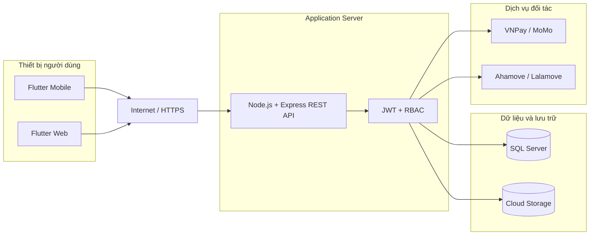
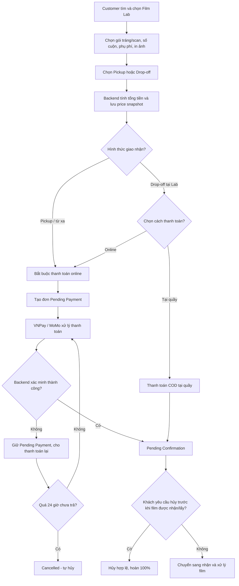
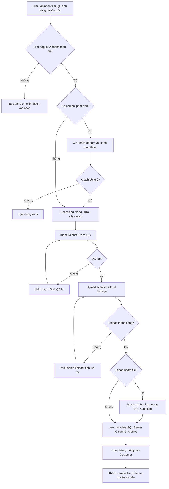
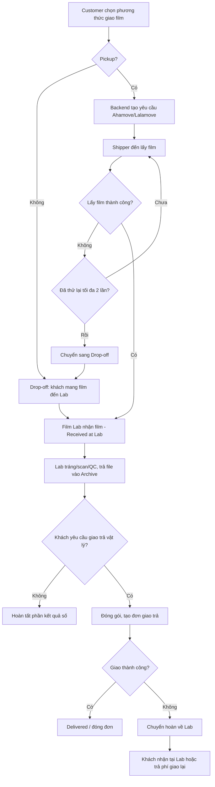
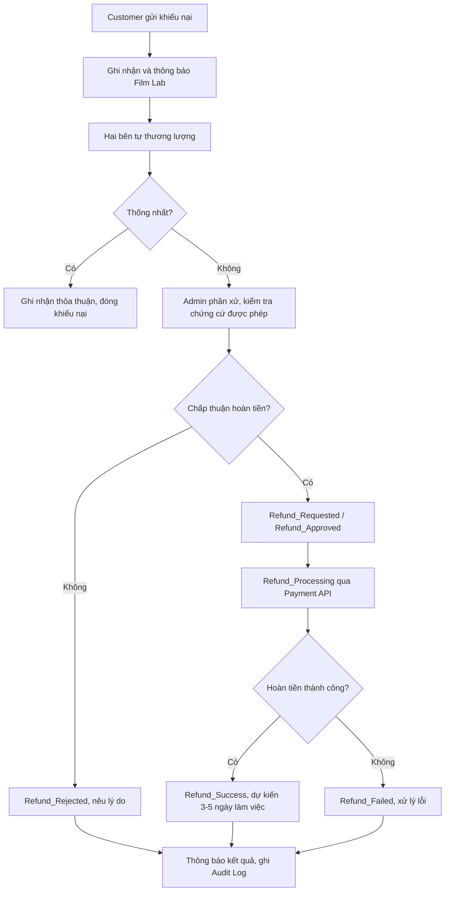

# WEEK 2 – SƠ ĐỒ KIẾN TRÚC & TRIỂN KHAI

> **Dự án:** MiniLab – Nền tảng kết nối cộng đồng nhiếp ảnh phim và các Film Lab  
> **Ghi chú:** Các phương án hạ tầng là đề xuất, chưa xác nhận triển khai.

## 1. Mục tiêu và phạm vi

Thiết kế kiến trúc logic và phương án triển khai của MiniLab, giải thích rõ các tầng, luồng dữ liệu, tích hợp bên ngoài và cách đáp ứng nghiệp vụ Week 1. Các máy chủ và cấu hình hạ tầng trong sơ đồ triển khai là đề xuất, chưa được tài liệu nguồn xác nhận.

| Tầng | Thành phần theo hướng dẫn Week 2 |
| --- | --- |
| Client | Flutter Mobile App (khách hàng); Flutter Web (Film Lab, Admin) |
| API / Backend | Node.js (Express), JWT, RBAC |
| Data & Storage | SQL Server, Cloud Storage (ảnh scan gốc) |
| External Services | VNPay/MoMo; Ahamove/Lalamove |

## 2. Sơ đồ kiến trúc hệ thống

*Hình 1. Kiến trúc phân tầng MiniLab (sơ đồ logic).*

### 2.1 Client Layer

Flutter Mobile hỗ trợ khách hàng tìm Lab, đặt dịch vụ, thanh toán, theo dõi đơn, quản lý Archive và tương tác cộng đồng. Flutter Web hỗ trợ Film Lab quản lý gói dịch vụ, tiến độ xử lý, tải scan; Admin kiểm duyệt và giải quyết tranh chấp. Photography Expert và Delivery Partner là các vai trò nghiệp vụ trong RBAC; giao diện cụ thể cho từng vai trò cần nhóm xác nhận.

### 2.2 API / Backend Layer

Node.js + Express cung cấp REST API. JWT xác thực người dùng, RBAC phân quyền truy cập. Các module logic đề xuất: Account/Auth; Lab & Service; Order & Pricing; Payment/Refund; Delivery; Archive; Community/Workshop; Marketplace; Administration/Audit. Module logic không nhất thiết là máy chủ riêng.

### 2.3 Data & Storage Layer

SQL Server quản lý dữ liệu quan hệ (User, Lab, Service, Order, Refund_Transactions, Photo_Metadata, Marketplace, Audit Log). Cloud Storage chứa file scan gốc; database lưu tham chiếu và metadata. File Archive mặc định riêng tư, cần kiểm tra chủ sở hữu ở backend.

### 2.4 External Services

VNPay/MoMo: khởi tạo giao dịch, nhận và xác minh kết quả, thực hiện yêu cầu hoàn tiền theo quy trình. Ahamove/Lalamove: điều phối lấy/giao film, lưu mã vận đơn và trạng thái. Các giao diện API chi tiết phụ thuộc tài liệu nhà cung cấp.

## 3. Sơ đồ triển khai (Deployment Diagram)

*Hình 2. Phương án triển khai đề xuất – thiết bị, server, dữ liệu và đối tác.*

| Thành phần | Vị trí | Chức năng |
| --- | --- | --- |
| Flutter Mobile | Thiết bị người dùng | Ứng dụng khách hàng |
| Flutter Web | Trình duyệt | Cổng Film Lab/Admin |
| Node.js + Express | Application Server | API, xác thực, xử lý nghiệp vụ |
| SQL Server | Database Server | Dữ liệu nghiệp vụ |
| Cloud Storage | Dịch vụ lưu trữ | Scan gốc, tệp số |
| Payment / Delivery | Hệ thống đối tác | Thanh toán, vận chuyển |

Luồng truy cập: Client → HTTPS → Express API → SQL Server / Cloud Storage / API đối tác. Không để ứng dụng truy cập trực tiếp SQL Server hoặc khóa bí mật đối tác. Tên nhà cung cấp hosting, cấu hình CPU/RAM và CI/CD chưa được xác định trong tài liệu.

## 4. Luồng nghiệp vụ chi tiết

Các sơ đồ Mermaid bên dưới được GitHub vẽ trực tiếp từ mã, không cần tải ảnh lên.

Các sơ đồ dưới đây diễn giải nghiệp vụ từ đặc tả Week 1 để làm rõ cách các tầng kiến trúc Week 2 phối hợp. **Đây là sơ đồ minh họa bổ trợ cho Nhóm 4, không thay thế sơ đồ Sequence/Activity do nhóm khác phụ trách.**

### 4.1 Đặt dịch vụ và thanh toán

*Hình 3. Luồng đặt đơn và thanh toán trực tuyến, bao gồm nhánh thất bại.*

Giá đơn = giá gói cơ bản × số cuộn + phụ phí scan/Push × số cuộn + giá in × số ảnh + phí giao nhận. Backend lưu giá tại thời điểm đặt (price snapshot). Khi thanh toán thất bại, đơn giữ Pending Payment để thanh toán lại; quá 24 giờ không thanh toán thì tự hủy. Chỉ được khách tự hủy và hoàn 100% khi Pending Confirmation, trước lúc nhận film.

### 4.2 Lab xử lý, upload scan và trả kết quả

*Hình 4. Luồng xử lý film → kiểm tra QC → Archive → thông báo.*

Upload thực hiện sau QC. Hỗ trợ tải tiếp nếu mất mạng. Khi upload nhầm, thu hồi và thay thế trong vòng 24 giờ, ghi Audit Log và thông báo đính chính. Archive chỉ chủ sở hữu xem, trừ quy trình tranh chấp được cho phép.

### 4.3 Điều phối vận chuyển

*Hình 5. Luồng lấy film và giao trả vật lý khi khách yêu cầu.*

Lấy film thất bại được thử lại tối đa 2 lần; sau đó chuyển phương án khách tự mang đến Lab. Giao trả thất bại thì hoàn về Lab; khách nhận tại Lab hoặc trả thêm phí giao lại. File scan số vẫn là kết quả chính của dịch vụ.

### 4.4 Khiếu nại và hoàn tiền

*Hình 6. Khách khiếu nại → tự thương lượng với Lab → Admin phân xử khi cần → hoàn tiền qua cổng thanh toán.*

- Khi hai bên chưa thống nhất, Admin chỉ xem ảnh làm chứng cứ khi có tranh chấp chính thức và hai bên đồng thuận.
- Khách hủy hợp lệ tại `Pending Confirmation` được hệ thống tự động duyệt hoàn tiền; tranh chấp hoặc film trắng cần Admin phê duyệt theo quy định Week 1.
- Lịch sử `Refund_Transactions`: `Refund_Requested` → `Refund_Approved` / `Refund_Rejected` → `Refund_Processing` → `Refund_Success` / `Refund_Failed`.
- Hoàn về tài khoản/ví ban đầu trong khoảng **3–5 ngày làm việc** sau khi được phê duyệt.

### 4.5 Những điểm đối chiếu cần giữ thống nhất

| Luồng | Điều kiện và ngoại lệ từ Week 1 |
| --- | --- |
| Đặt dịch vụ | Giá chốt theo thời điểm đặt; Pickup/đơn từ xa phải thanh toán online; COD chỉ tại quầy |
| Thanh toán | Thất bại giữ `Pending Payment`; cho thanh toán lại; tự hủy sau 24 giờ |
| Hủy đơn | Khách chỉ tự hủy khi `Pending Confirmation`, trước khi shipper lấy hoặc Lab nhận film |
| Xử lý film | Ghi tình trạng nhận film; phụ phí phát sinh phải được khách đồng ý trước khi xử lý |
| Scan & Archive | QC đạt mới upload; hỗ trợ resumable upload; thu hồi file nhầm trong 24 giờ |
| Vận chuyển | Pickup tối đa 2 lần thử lại; thất bại chuyển Drop-off; giao trả vật lý là tùy chọn |
| Khiếu nại | Ưu tiên thương lượng; Admin phân xử nếu bất đồng; bảo vệ quyền riêng tư ảnh |

## 5. Bảo mật, quyền hạn và kiểm soát

| Hạng mục | Thiết kế / yêu cầu |
| --- | --- |
| JWT & RBAC | 5 vai trò: Customer, Film Lab Owner, Photography Expert, Delivery Partner, System Administrator |
| Riêng tư Archive | Chủ tài khoản xem ảnh; Admin chỉ xem chứng cứ ảnh khi có tranh chấp và được đồng thuận |
| Quản lý giá | Lab tự quản giá; Admin chỉ ẩn dịch vụ vi phạm, không tự sửa giá |
| Marketplace | Tin đăng phải được duyệt trước khi hiển thị (tiền kiểm 100%) |
| Cộng đồng | Bài viết được hậu kiểm; Admin ẩn/gỡ, không tự ý sửa nội dung |
| Audit Log | Lưu ai thao tác, lúc nào, thao tác gì, đối tượng và lý do |
| Bảo vệ API (đề xuất) | HTTPS, hash mật khẩu, xác minh callback, kiểm tra đầu vào và quyền truy cập |

## 6. Đối chiếu yêu cầu Week 1 với kiến trúc

| Yêu cầu nghiệp vụ | Thành phần đảm nhiệm |
| --- | --- |
| Đăng ký/đăng nhập | Flutter → Auth API → SQL Server |
| Tìm Lab, so sánh, đặt đơn | Flutter → Lab/Order API → SQL Server |
| Thanh toán, hoàn tiền | Payment API → VNPay/MoMo → SQL Server |
| Nhận film, xử lý, upload | Film Lab Web → Order/Archive API → Cloud Storage |
| Digital Film Archive | Flutter → Archive API → Cloud Storage + SQL Server |
| Giao nhận hai chiều | Delivery API → Ahamove/Lalamove → SQL Server |
| Marketplace / Community | Flutter → Content/Marketplace API → SQL Server |
| Kiểm duyệt và tranh chấp | Admin Web → Administration API → SQL Server / Audit Log |

## 7. Kết luận và các điểm cần xác nhận

Kiến trúc MiniLab gồm bốn tầng: Client, API/Backend, Data & Storage, External Services. Sơ đồ đáp ứng các nhóm nghiệp vụ đã xác định trong Week 1 và cho phép phát triển theo module, quản lý dữ liệu tập trung, bảo vệ Archive riêng tư và tích hợp thanh toán/vận chuyển.

Nhóm cần xác nhận: môi trường hosting cụ thể; nhà cung cấp Cloud Storage; cách triển khai push notification/email; giao diện cho Expert và Delivery Partner; cơ chế tích hợp và webhook thực tế của các đối tác. Các nội dung này không được khẳng định là đã triển khai.
