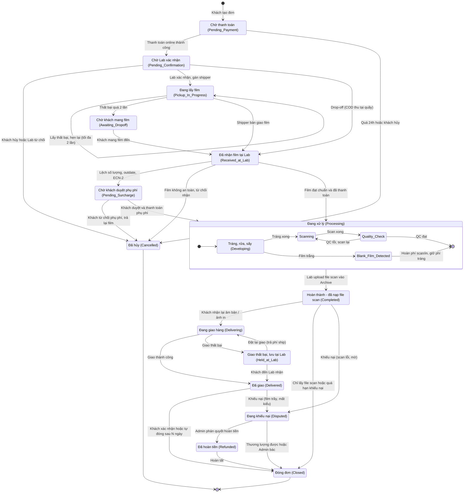
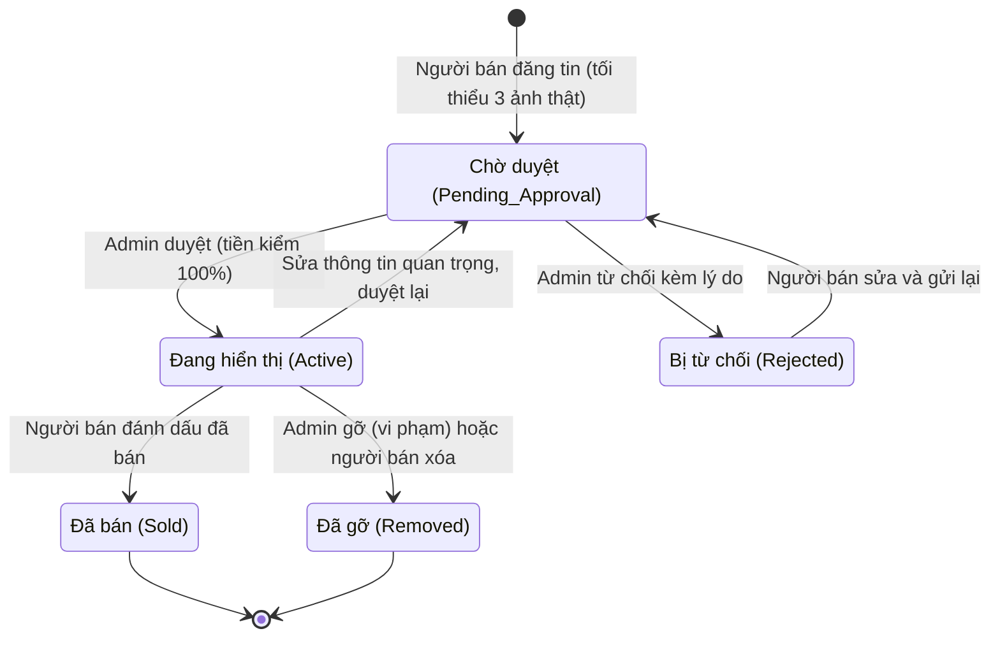
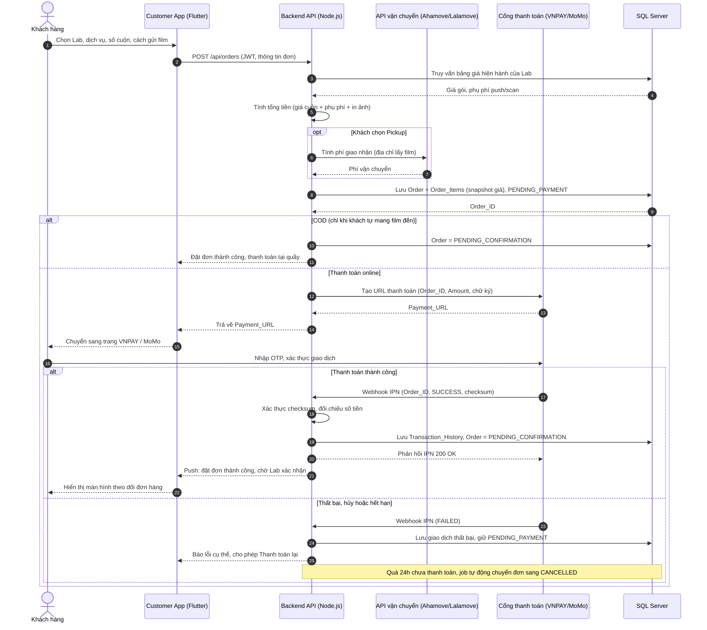
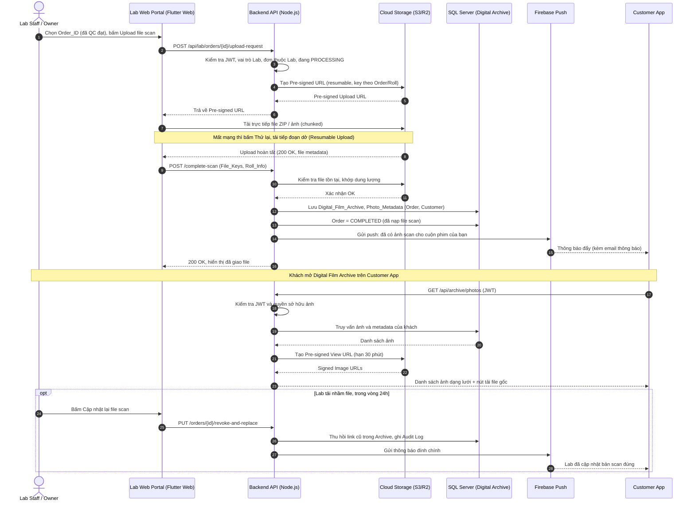
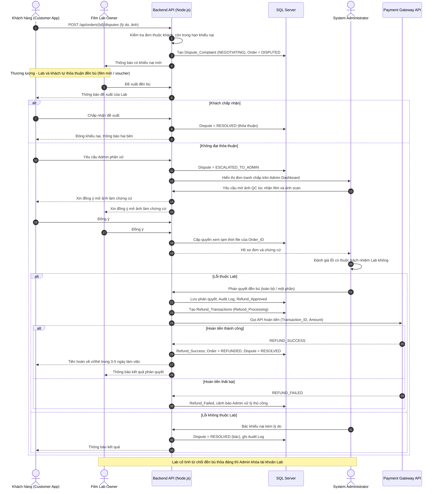

# Week 2 - Sơ đồ trạng thái và tương tác động (Issue #14)

## 1. State Machine - Order

## 2. State Machine - Tin đăng Marketplace (tùy chọn)

## 3. Sequence 1 - Đặt dịch vụ và thanh toán trực tuyến

## 4. Sequence 2 - Lab hoàn thành scan và trả kết quả vào Archive

## 5. Sequence 3 - Xử lý khiếu nại và hoàn tiền

