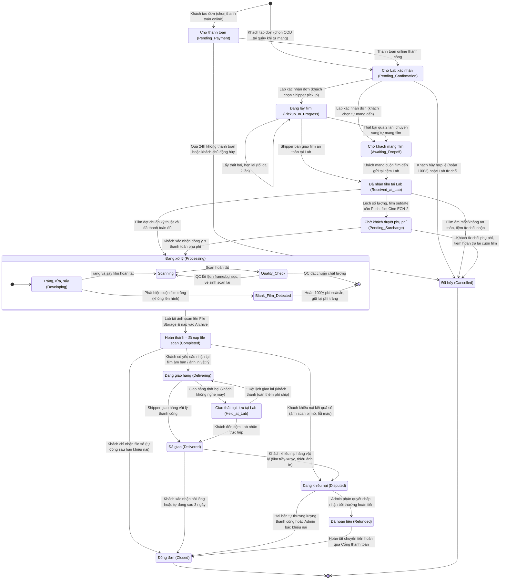
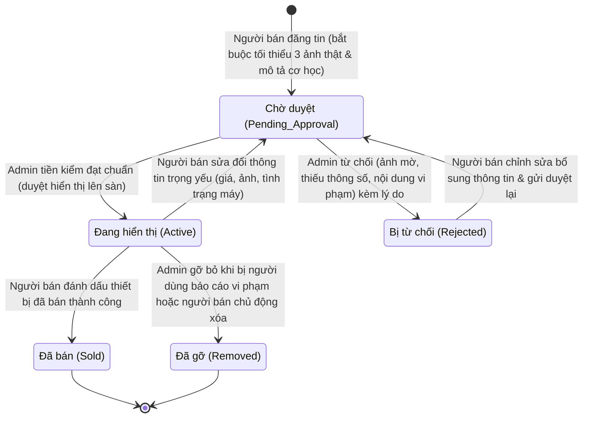
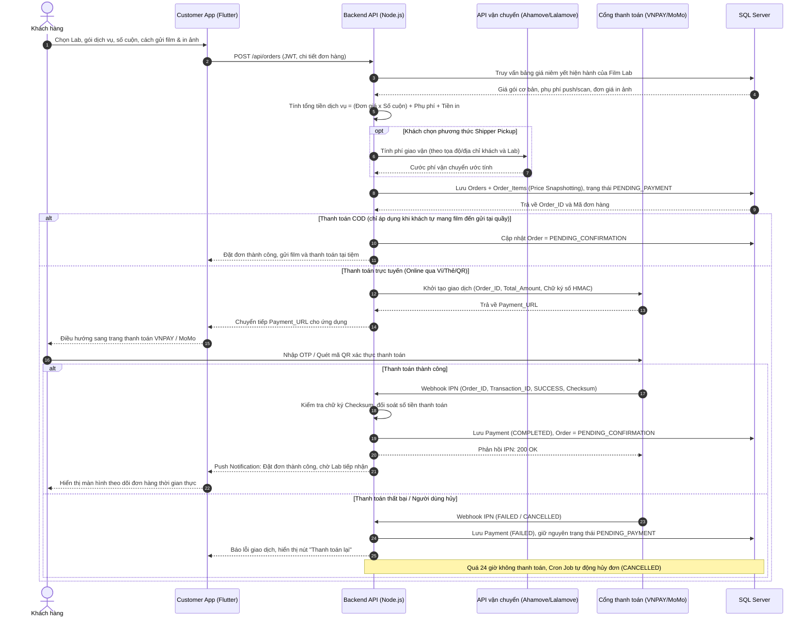
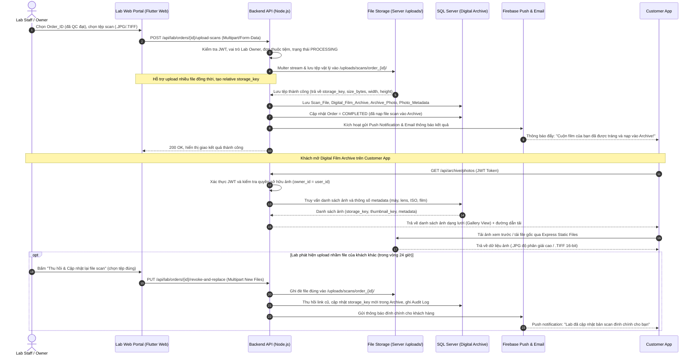
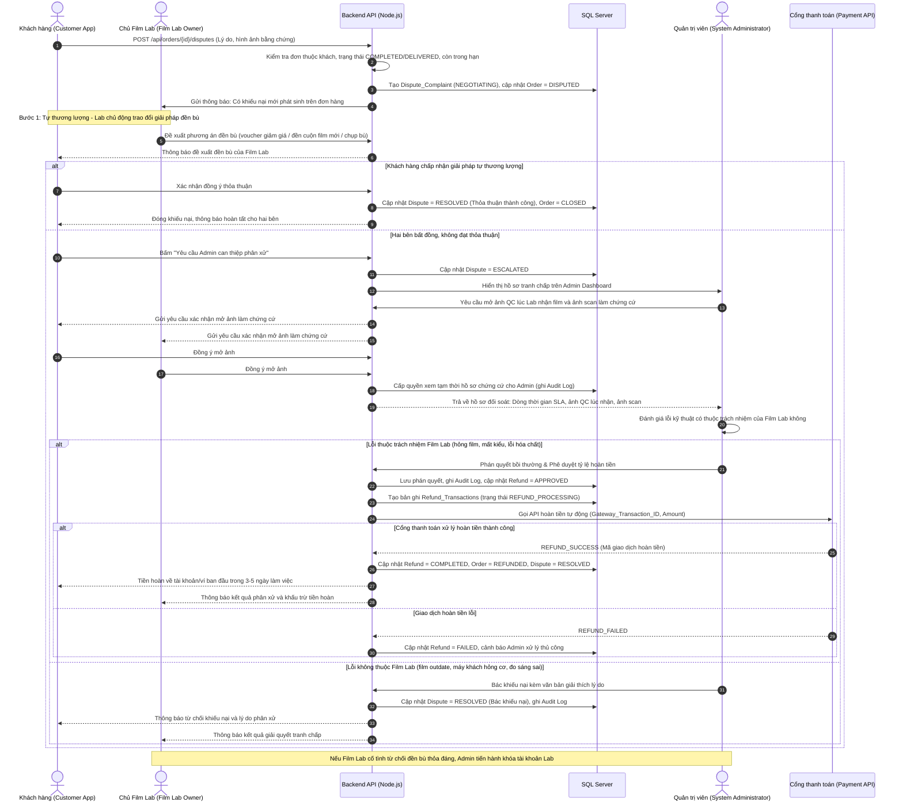

# WEEK 2 – SƠ ĐỒ TRẠNG THÁI VÀ TƯƠNG TÁC ĐỘNG

> **Dự án:** MiniLab – Nền tảng kết nối cộng đồng nhiếp ảnh phim và các Film Lab  
> **Nhóm thực hiện:** Nhóm 8 (Nhóm 3: Sơ đồ trạng thái & Tương tác động)  
> **Phiên bản:** 2.0 (Đồng bộ hóa 100% với Nghiệp vụ Week 1, Kiến trúc triển khai & Thiết kế CSDL)

---

## 1. Mục tiêu và phạm vi

Tài liệu này đặc tả các khía cạnh hành vi động (Dynamic Behavioral Modeling) của hệ thống MiniLab, bao gồm:
1. **Sơ đồ máy trạng thái (State Machine Diagram):**
   * Vòng tuần hoàn chuyển giao trạng thái của **Đơn hàng tráng/scan (Order Lifecycle)**.
   * Vòng tuần hoàn kiểm duyệt của **Tin đăng thiết bị Marketplace**.
2. **Sơ đồ tuần tự (Sequence Diagram) – 3 kịch bản tương tác quan trọng nhất:**
   * **Kịch bản 1:** Đặt dịch vụ & Thanh toán trực tuyến (tích hợp snapshot giá và xử lý Webhook IPN).
   * **Kịch bản 2:** Lab hoàn thành scan và trả kết quả vào Digital Film Archive (mô hình File Storage trên máy chủ, lưu `storage_key`, phục vụ qua Express Static Files).
   * **Kịch bản 3:** Xử lý khiếu nại & Hoàn tiền tự động (quy trình 3 bước: Tự thương lượng $\rightarrow$ Admin phân xử $\rightarrow$ Hoàn tiền tự động qua Cổng thanh toán).

---

## 2. Máy trạng thái đơn hàng (State Machine – Order)

Sơ đồ mô tả toàn diện chu kỳ sống của một đơn hàng dịch vụ tráng/scan film, từ khi khách khởi tạo đến khi đóng đơn hoặc hủy đơn. Sơ đồ xử lý đầy đủ các nhánh nghiệp vụ thực tế: Pickup thất bại tối đa 2 lần, đề xuất phụ phí phát sinh (Cine ECN-2, Push sáng), trạng thái phức hợp công đoạn tráng/scan, giao nhận 2 chiều và giải quyết tranh chấp.

---

## 3. Máy trạng thái tin đăng Marketplace (State Machine – Marketplace Listing)

Sơ đồ thể hiện quy trình **tiền kiểm 100%** đối với tin đăng bán máy ảnh, ống kính và phụ kiện nhiếp ảnh phim nhằm ngăn chặn tình trạng lừa đảo hoặc thông tin sai lệch:

---

## 4. Sequence 1 – Đặt dịch vụ và thanh toán trực tuyến

Kịch bản mô tả sự phối hợp giữa Khách hàng, Ứng dụng Flutter, Backend Node.js, Đối tác giao vận (Ahamove/Lalamove), Cổng thanh toán (VNPAY/MoMo) và Cơ sở dữ liệu SQL Server. Kịch bản làm rõ cơ chế **Price Snapshotting** và xử lý **Webhook IPN** đa nhánh:

---

## 5. Sequence 2 – Lab hoàn thành scan và trả kết quả vào Archive (Mô hình File Storage)

Kịch bản mô tả quy trình sau khi hoàn thành tráng và kiểm tra chất lượng (QC). Film Lab tải tệp ảnh scan gốc (.JPG chất lượng cao, .TIFF 16-bit) lên hệ thống lưu trữ tệp (**File Storage trên Server** qua Multer). Hệ thống tự động ghi nhận đường dẫn `storage_key` vào SQL Server, nạp ảnh vào Digital Film Archive của khách hàng và hỗ trợ cơ chế **Thu hồi & Ghi đè (Revoke & Replace)** trong 24 giờ nếu tải nhầm file:

---

## 6. Sequence 3 – Xử lý khiếu nại và hoàn tiền tự động

Kịch bản mô tả quy trình 3 bước giải quyết tranh chấp theo đúng quy định phân quyền hệ thống (RBAC):
1. **Bước 1:** Khách hàng gửi khiếu nại kèm hình ảnh bằng chứng lỗi.
2. **Bước 2 (Tự thương lượng):** Khách hàng và Film Lab trực tiếp trao đổi phương án đền bù (voucher, tặng cuộn film mới, chụp bù). Nếu khách đồng ý $\rightarrow$ Đóng khiếu nại thỏa thuận.
3. **Bước 3 (Admin can thiệp phân xử):** Nếu hai bên bất đồng $\rightarrow$ Chuyển Admin phân xử $\rightarrow$ Admin xin quyền đồng thuận mở ảnh QC lúc nhận film và ảnh scan làm chứng cứ $\rightarrow$ Ra phán quyết bồi thường $\rightarrow$ Kích hoạt Cổng thanh toán (VNPay/MoMo) hoàn tiền tự động về tài khoản khách hàng trong 3–5 ngày làm việc $\rightarrow$ Ghi Audit Log toàn bộ thao tác:

---

## 7. Kết luận và Ma trận đồng bộ với CSDL & Kiến trúc

| Kịch bản / Trạng thái | Bảng CSDL SQL Server tương ứng | Thành phần hạ tầng thực thi |
| --- | --- | --- |
| **Pending_Payment $\rightarrow$ Pending_Confirmation** | `Orders.status`, `Payment` (lưu mã giao dịch và trạng thái) | Frontend App $\rightarrow$ Express API $\rightarrow$ VNPay/MoMo Webhook $\rightarrow$ SQL Server |
| **Pickup $\rightarrow$ Received_at_Lab** | `Shipment` (chiều 1), `Order_Process_Step` (step `RECEIVE` kèm `evidence_photo_url`) | Ahamove/Lalamove API $\rightarrow$ Shipper Mobile $\rightarrow$ Web Portal của Lab |
| **Processing (Tráng, Sấy, Scan, QC)** | `Order_Process_Step` (lưu tiến độ chi tiết và thời gian hoàn thành từng bước) | Lab Web Portal $\rightarrow$ Express API $\rightarrow$ SQL Server |
| **Upload scan $\rightarrow$ Archive** | `Scan_File`, `Digital_Film_Archive`, `Archive_Photo` (`storage_key`), `Photo_Metadata` | Lab Web Portal $\rightarrow$ Multer $\rightarrow$ Thư mục `/uploads/scans/` trên Server $\rightarrow$ SQL Server $\rightarrow$ FCM Push |
| **Giao trả vật lý (Delivering $\rightarrow$ Delivered)** | `Shipment` (chiều 2), `Orders.return_method` | Express API $\rightarrow$ Ahamove/Lalamove $\rightarrow$ Khách nhận hàng |
| **Tranh chấp & Hoàn tiền** | `Dispute_Complaint`, `Dispute_Message`, `Dispute_Evidence`, `Refund`, `Audit_Log` | Admin Web Portal $\rightarrow$ Express API $\rightarrow$ Payment Refund API $\rightarrow$ SQL Server |
